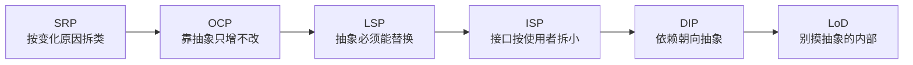

# 迪米特法则（LoD）：别和陌生人说话

> 一句话：**一个对象对其他对象要尽可能少地了解，只和「直接朋友」交流。**
> 也叫「最少知识原则」（Least Knowledge Principle）。

---

## 从 DIP 的「抽象」说起

上一篇我们用 DIP 让查询层只依赖 `QueryEngine` 抽象。但依赖了抽象，并不等于万事大吉——还有一种「隐蔽的耦合」：**高层虽然拿着抽象，却把手伸进了抽象背后的「内部零件」里。**

LoD 就是来管这种「伸手」的。

---

## 原则是什么

LoD（Law of Demeter）：

> Each unit should have only limited knowledge about other units: only units "closely" related to the current unit.
> —— 每个单元只应该对其他单元有有限的了解：只了解与自己「紧密相关」的单元。

它有个著名的口语版：**「别和陌生人说话。」** 具体到代码，一个方法内部，只应该调用：

1. 它自己的成员；
2. 它自己的参数；
3. 它自己创建的对象。

除此之外（比如「参数的成员」「返回值再取出的成员」）都是**陌生人**，不该被直接调用。

---

## 真实案例：计算层别去摸 `indexdb`

存储层内部有 `indexdb`（索引）这样的内部零件。计算层要做拓扑聚合、要写数据，它该关心的只是「把这条 Edge 存进去」，而不是「存储层内部是先用 indexdb 查 ID、再写 data 文件」的实现细节（`【实测】` 存储分层见 [指标冒险之旅](/observability/victoriametrics/metric-journey.md)）。

**反例**：穿越抽象，直接摸内部零件：

```go
// 计算层："我不管，我就是要直接摸你的 indexdb"
func (c *TopologyComputer) saveEdge(edge Edge) error {
    id := c.storage.indexdb.lookup(edge.Key) // 陌生人：storage 内部的 indexdb
    return c.storage.data.write(id, edge.Value) // 又摸到另一个内部零件 data
}
```

这段代码里，`TopologyComputer` 同时和 `storage.indexdb`、`storage.data` 两个「陌生人」打交道。一旦存储层内部把 `indexdb` 重构成别的结构，计算层全部跟着崩——**它了解得太多了。**

**正例**：只和「直接朋友」`storage` 说话：

```go
// 计算层只依赖 storage 这个"直接朋友"，一个方法搞定
func (c *TopologyComputer) saveEdge(edge Edge) error {
    return c.storage.Upsert(edge) // storage 内部自己决定怎么查 ID、怎么写 data
}
```

存储层内部怎么变，只要 `Upsert` 的契约不变，计算层无感。这就是「最少知识」。

<details>
<summary>💭 想一想：LoD 反对的是「链式调用」本身吗？</summary>

**答案**：不是。LoD 反对的是「**跨越多个陌生对象**」的依赖，不是语法上的 `a.b.c`。判断标准是：`a.b.c` 里的 `b` 和 `c` 是不是你的「直接朋友」。如果 `storage` 是你的朋友、`indexdb` 是 storage 的朋友但不是你的朋友，那 `storage.indexdb` 就违反了 LoD；但如果 `edge.Key` 里的 `Key` 本身就是 `edge` 的组成部分（值对象），`edge.Key` 完全没问题。**关键在「对象的关系」，不在「点的个数」。**

</details>

---

## 谁是「陌生人」

LoD 眼里的世界，只有两类对象：

| 类型 | 例子 | 能否直接调用 |
|------|------|-------------|
| **直接朋友** | 方法参数、自身成员、自己创建的对象 | ✅ 可以 |
| **陌生人** | 「参数/成员」再取出的内部对象、返回值里的深层对象 | ❌ 尽量避免 |

`c.storage.Upsert(edge)` 里，`c` 是自身、`storage` 是成员、`edge` 是参数——全是朋友，合规。而 `c.storage.indexdb.lookup()` 里的 `indexdb` 是「朋友的内部零件」，是陌生人。

---

## 红线：LoD 不是「禁止一切深层访问」

LoD 一旦教条化，会走向另一个极端——**中间人泛滥**：

1. **不要为每个内部对象都包一层转发方法**。如果 `storage` 被迫给 `indexdb` 写一堆 `Lookup()`、`Write()` 转发，那只是把耦合「藏」起来，没「消」掉。
2. **值对象/数据结构不适用 LoD**。`edge.Key`、`row.Labels` 这些是「数据」而非「行为对象」，直接访问字段是合理的，LoD 管的是「对象之间的行为依赖」。
3. **本质是「降低变化传播半径」**，而不是「堆中间层」。如果某个深层访问 10 年不变，硬包一层反而是负收益。

一句话：**LoD 是让你「少了解」，不是让你「多转发」。**

---

## 六原则因果链：一张图收尾

到这里，六大原则全部讲完。它们不是六条孤立的戒律，而是一条**因果链**：



- **SRP** 拆出「变化轴」→ 才有 **OCP** 要封闭的「变化点」；
- **OCP** 靠抽象 → 才需要 **LSP** 保证抽象可替换；
- **LSP** 的根子是接口太胖 → 引出 **ISP** 拆接口；
- **ISP** 拆完接口 → 引出 **DIP** 决定依赖方向；
- **DIP** 依赖了抽象 → 还需要 **LoD** 防止「穿越抽象摸内部」。

**六条原则，其实是在合力回答一件事：怎么让变化的代价，只发生在它该发生的那一小块地方。**

---

## 小结

- LoD = 只和「直接朋友」交流，别摸朋友内部的零件；
- 计算层只调 `storage.Upsert`、不摸 `storage.indexdb`，是 LoD 的典型落地；
- 六大原则是一条因果链，不是六条孤立戒律。

到这里，「道」的部分讲完了。但原则是抽象的——**「高内聚低耦合」「可扩展」「健壮」「可测试」这些工程目标，怎么把原则翻译成可度量、可落地的标准？** 这是下一部分的内容。

👉 下一篇（工程实践）：[高内聚与低耦合](/design-principles/02-engineering/01-cohesion-coupling.md)（待补充）

---

<details>
<summary>📌 本文事实来源</summary>

- 存储层内部 indexdb/data 分层：`【实测】` [指标冒险之旅](/observability/victoriametrics/metric-journey.md)
- LoD 的「直接朋友/陌生人」定义：`【业界通用】` 经典 OOD 原则（Law of Demeter 原始论文）
- 本节 Go 代码为示意性简化 `【推断】`

</details>
