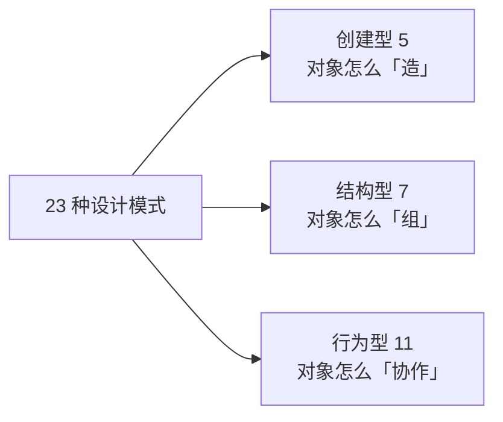

# 设计模式总纲：从「原则」到「招式」

> 一句话：**设计原则是「心法」，设计模式是「招式」——模式，是原则在具体场景下反复验证过的成熟解法。**
> 心法告诉你「为什么」，招式告诉你「怎么做」。

---

## 先泼一盆冷水：模式不是银弹

在学 23 种模式之前，必须先立三个清醒认知，否则你会掉进「套模式」的坑：

1. **模式是「描述」，不是「处方」**。它描述的是「某类问题反复出现时的通用解法」，不是「看到 X 就用 Y」的强制公式。
2. **模式的价值在「意图」，不在「结构」**。两个长得像的模式（如策略 vs 状态），差别在「它要解决的变化是什么」。
3. **用得不对，模式就是「反模式」**。没有需求硬套单例、工厂，是过度设计，不是优雅。

一句话：**先有「变化的问题」，才有「对应的模式」——永远让问题牵着模式走，别让模式牵着问题走。**

---

## 三分类地图

23 种模式按「解决什么问题」分三类（`【业界通用】` GoF 经典分类）：

| 分类 | 回答的问题 | 数量 |
|------|-----------|------|
| **创建型** | 对象**怎么创建**，让创建和使用解耦 | 5 |
| **结构型** | 类/对象**怎么组合**成更大的结构 | 7 |
| **行为型** | 对象**怎么协作**、职责怎么分配 | 11 |

---

## 每个模式背后，都站着一个原则

这是本系列最重要的一个观点：**模式不是凭空发明的，它是「原则」在具体场景下的落地。** 反过来看这张映射表，你就能理解每个模式「为什么长这样」：

| 原则 | 它催生了哪些模式 | 一句话 |
|------|-----------------|--------|
| **OCP**（对扩展开放） | 策略、模板方法、装饰器、桥接 | 把变化封装成「可插拔的部件」 |
| **SRP**（单一职责） | 组合、门面 | 把多职责拆成单一职责的组合 |
| **LSP**（可替换） | 工厂、抽象工厂、策略 | 保证「造出来的东西能互换」 |
| **ISP**（接口隔离） | 适配器、门面、代理 | 给不同使用方提供恰到好处的接口 |
| **DIP**（依赖倒置） | 工厂方法、抽象工厂、依赖注入 | 让创建/调用依赖抽象 |
| **LoD**（最少知识） | 门面、中介者 | 让模块只和「直接朋友」说话 |

> 读每一个模式时，先问一句：**「它在为哪个原则打工？」** 想通这个问题，23 个模式就不再是 23 个孤立的招式，而是一张有内在逻辑的网。

---

## 23 模式总览（附 APM 落点）

下表是后续每篇的索引。每个模式的 APM 落点，都锚定本博客的真实工程或 OTel/VM 公开设计：

| 模式 | 分类 | 一句话 | APM 落点 |
|------|------|--------|---------|
| 工厂方法 | 创建型 | 把 `new` 隐藏到工厂 | 协议 parser 工厂 |
| 抽象工厂 | 创建型 | 成套创建一族对象 | 按协议族创建解析器 |
| 建造者 | 创建型 | 分步构建复杂对象 | 复杂查询条件构建 |
| 原型 | 创建型 | 克隆一个模板 | 配置/Span 模板克隆 |
| 单例 | 创建型 | 全局唯一实例 | 指标注册表、连接池 |
| 适配器 | 结构型 | 转换接口让它能用 | **14 种协议归一化** |
| 桥接 | 结构型 | 分离抽象与实现 | 存储/查询两维度解耦 |
| 组合 | 结构型 | 树形整体-部分 | 规则树、标签表达式 AST |
| 装饰器 | 结构型 | 无侵入地增强 | exporter 重试/限流包装 |
| 门面 | 结构型 | 统一简化入口 | 查询层统一 API |
| 享元 | 结构型 | 共享不可变对象 | 标签字符串共享 |
| 代理 | 结构型 | 访问控制/懒加载 | 存储读写分离代理 |
| 责任链 | 行为型 | 沿链逐个处理 | receiver→processor→exporter |
| 命令 | 行为型 | 把动作封装成对象 | 控制平面 Task API |
| 解释器 | 行为型 | 解析并执行语言 | PromQL/规则 DSL |
| 迭代器 | 行为型 | 统一遍历方式 | 时间序列遍历 |
| 中介者 | 行为型 | 集中协调多个对象 | ControlPlaneManager |
| 备忘录 | 行为型 | 快照与回滚 | 配置快照回滚 |
| 观察者 | 行为型 | 事件通知解耦 | Arthas StateEventBus |
| 状态 | 行为型 | 状态机封装 | Arthas 生命周期状态机 |
| 策略 | 行为型 | 算法可替换 | 采样策略（head/tail） |
| 模板方法 | 行为型 | 固定流程骨架 | Exporter 发送流程 |
| 访问者 | 行为型 | 分离操作与结构 | 对不同信号类型操作 |

💭 想一想：为什么「策略」和「状态」长得几乎一样，却是两个模式？

**答案**：区别在「**意图**」——策略模式是**让算法可以互换**（调用方主动选择用哪个采样策略），状态模式是**让对象随内部状态改变行为**（探针自己根据 STOPPED/RUNNING 切换行为）。结构上都是「接口 + 多实现」，但一个的切换由**外部**驱动，一个由**内部状态**驱动。**这印证了开头那句：模式的价值在意图，不在结构。**

---

## 怎么选模式：三步法

面对一个具体问题，不要上来就翻 23 个模式的名字，按这三步走：

1. **识别变化轴**：这段代码里，什么是「会变的」？（协议种类？算法？状态？组合结构？）
2. **匹配原则**：这个变化，该用哪条原则应对？（变化→OCP，职责→SRP，依赖→DIP…）
3. **落到模式**：这条原则在这个场景下，成熟的「招式」是哪个？

例：接入层「协议种类会变」→ 变化 → OCP → 用什么模式？→ **适配器**（把不同协议适配成统一 `rawRow`）+ **工厂方法**（按协议创建 parser）。

**模式是第 3 步的「标准答案」，前两步才是真正要动脑的地方。**

---

## 本部分阅读顺序

后续模式篇会**按 APM 相关性排序**，而非按字母表——先讲你在真实工程里最常用的：

1. 行为型：策略、观察者、状态、模板方法、责任链、命令、中介者…
2. 结构型：适配器、装饰器、门面、组合、代理、桥接、享元…
3. 创建型：工厂方法、抽象工厂、建造者、单例、原型…

每篇统一结构：`一句话 → 结构示意 → APM 案例演进 → Go 代码 → 对应原则 → 何时别用`。

👉 下一篇（模式首篇）：[策略模式](/design-principles/03-patterns/behavioral/strategy.md)（待补充）

---

📌 本文事实来源

- 三分类与 23 模式定义：`【业界通用】` GoF《设计模式》经典分类
- 各模式的 APM 落点：`【实测】` 本博客 observability 系列（协议归一化/控制平面/Arthas 生命周期/采样）
- 「原则→模式」映射表：`【推断】` 本系列基于原则与模式意图的整理，供理解参考

