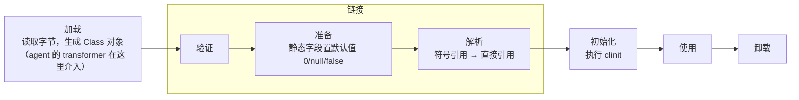
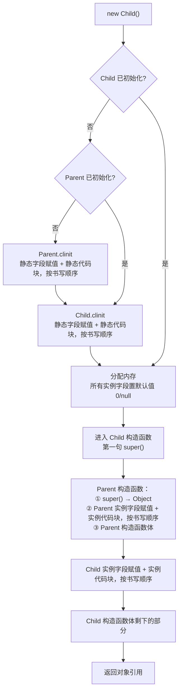

# Java 类加载、初始化与执行顺序：一次实验讲清 static、代码块和构造函数

> 静态字段、静态代码块、实例字段、实例代码块、构造函数，再加上继承，执行顺序到底是什么？`new` 一个对象时 JVM 依次做了哪些事？哪些操作会触发类初始化、哪些不会？
> 本文用一个 Parent/Child 的实验（JDK 21）把规则一次性跑出来，再结合规范说明原因。

---

## 结论先行

1. **类初始化（`<clinit>`）在第一次“主动使用”时执行，并且只执行一次**。先初始化父类，再初始化子类。
2. **同一个类里，静态字段赋值和静态代码块按代码书写顺序执行**，不是“先字段后代码块”。实例字段和实例代码块也一样。
3. **`new` 的顺序**：父类的（实例字段/实例代码块 → 构造函数体）全部完成后，才轮到子类的（实例字段/实例代码块 → 构造函数体）。
4. **不会触发初始化的常见情况**：读取编译期常量、创建数组、通过子类引用父类的静态字段（只初始化父类）、`Class.forName(name, false, loader)`。

---

## 一、实验

### 1.1 代码

```java
package demo;

class L {
  static int v(String s) { System.err.println(s); return 1; }
  static void p(String s) { System.err.println(s); }
}

class Parent {
  static final int CONST = 100;                       // 编译期常量
  static int ps = L.v("  [1] Parent 静态字段 ps");
  static { L.p("  [2] Parent 静态代码块"); }
  int pf = L.v("  [a] Parent 实例字段 pf");
  { L.p("  [b] Parent 实例代码块"); }
  Parent() { L.p("  [c] Parent 构造函数体"); hook(); }
  void hook() { L.p("  Parent.hook()"); }
}

class Child extends Parent {
  static { L.p("  [3] Child 静态代码块（写在静态字段前面）"); }
  static int cs = L.v("  [4] Child 静态字段 cs");
  { L.p("  [d] Child 实例代码块（写在实例字段前面）"); }
  int cf = L.v("  [e] Child 实例字段 cf");
  String name = "child";
  Child() { super(); L.p("  [f] Child 构造函数体"); }
  @Override void hook() { L.p("  [!] 父构造器调用了子类重写的 hook()，此时 name = " + name); }
}

class Lazy { static { L.p("  Lazy.<clinit>"); } }

public class InitOrder {
  public static void main(String[] a) throws Exception {
    L.p("① 读 Parent.CONST（编译期常量）= " + Parent.CONST);
    L.p("② new Child[2]（创建数组）"); Child[] arr = new Child[2];
    L.p("③ 通过 Child 读父类静态字段 Child.ps = " + Child.ps);
    L.p("④ 第一次 new Child()"); new Child();
    L.p("⑤ 第二次 new Child()"); new Child();
    L.p("⑥ Class.forName(\"demo.Lazy\", false, cl)");
    Class.forName("demo.Lazy", false, InitOrder.class.getClassLoader());
    L.p("⑦ Class.forName(\"demo.Lazy\")"); Class.forName("demo.Lazy");
  }
}
```

注意两处刻意的写法：`Child` 的静态代码块写在静态字段**前面**，实例代码块写在实例字段**前面**，用来验证“按书写顺序”而不是“按类型”。

### 1.2 输出（JDK 21）

```text
① 读 Parent.CONST（编译期常量）= 100
② new Child[2]（创建数组）
  [1] Parent 静态字段 ps
  [2] Parent 静态代码块
③ 通过 Child 读父类静态字段 Child.ps = 1
④ 第一次 new Child()
  [3] Child 静态代码块（写在静态字段前面）
  [4] Child 静态字段 cs
  [a] Parent 实例字段 pf
  [b] Parent 实例代码块
  [c] Parent 构造函数体
  [!] 父构造器调用了子类重写的 hook()，此时 name = null
  [d] Child 实例代码块（写在实例字段前面）
  [e] Child 实例字段 cf
  [f] Child 构造函数体
⑤ 第二次 new Child()
  [a] Parent 实例字段 pf
  [b] Parent 实例代码块
  [c] Parent 构造函数体
  [!] 父构造器调用了子类重写的 hook()，此时 name = null
  [d] Child 实例代码块（写在实例字段前面）
  [e] Child 实例字段 cf
  [f] Child 构造函数体
⑥ Class.forName("demo.Lazy", false, cl)
⑦ Class.forName("demo.Lazy")
  Lazy.<clinit>
```

[1][2] 出现在第 ③ 行的**前面**，不是因为第 ② 步触发了初始化：第 ③ 行要先拼接字符串，计算 `Child.ps` 时触发了 `Parent` 初始化，拼接完成后才打印这一行。

### 1.3 逐条解读

| 编号 | 观察 | 规则 |
|------|------|------|
| ① | 读 `Parent.CONST` 没有触发任何初始化 | 编译期常量（`static final` 的基本类型或 String，且用常量表达式赋值）在编译时直接内联到使用处，运行时根本不访问 `Parent` |
| ② | `new Child[2]` 没有触发初始化 | 创建数组只会创建数组类型本身，不初始化元素类型 |
| ③ | 只输出了 Parent 的 [1][2]，没有 Child 的 [3][4] | 通过子类引用父类声明的静态字段，只初始化**声明这个字段的类** |
| ④ 静态部分 | [3] 在 [4] 前面 | 静态字段赋值和静态代码块**按书写顺序**合并成 `<clinit>` |
| ④ 实例部分 | [a][b][c] 全部在 [d][e][f] 之前 | 子类构造函数第一句是 `super()`，父类完整构造完才轮到子类 |
| ④ [!] | `name = null` | 父构造函数里调用了子类重写的方法，此时子类的实例字段还没赋值 |
| ④ [d][e] | 在 [c] 之后、[f] 之前 | 实例字段赋值和实例代码块被编译器插到构造函数里 `super()` 之后、原构造函数体之前 |
| ⑤ | 没有 [1]~[4] | 类初始化只做一次，之后每次 `new` 只走实例部分 |
| ⑥⑦ | 第二个参数为 `false` 时只加载，不初始化；单参数版本会初始化 | `Class.forName(String)` 等价于 `forName(name, true, 调用者的类加载器)` |

---

## 二、类的生命周期



| 阶段 | 做什么 | 要点 |
|------|--------|------|
| 加载 | 类加载器读取 `.class` 字节，定义出 `Class` 对象 | Java Agent 的 `ClassFileTransformer` 在这一步改写字节码，所以增强发生在初始化之前。详见 [Java Agent 加载顺序与增强时机](/observability/implementation/otel-javaagent-loading-order.md) |
| 验证 | 检查字节码格式和安全性 | — |
| 准备 | 为静态字段分配内存并置**默认值** | `static int x = 5;` 在这一步 `x` 是 `0`，到初始化阶段才变成 `5` |
| 解析 | 把符号引用换成直接引用 | 规范允许延迟到第一次使用时才解析 |
| 初始化 | 执行 `<clinit>`：静态字段赋值和静态代码块 | 只执行一次；JVM 用初始化锁保证多线程下只有一个线程执行 |

---

## 三、什么时候触发类初始化

**会触发**（规范称为“主动使用”）：

- `new` 创建实例；
- 读写**非常量**的静态字段、调用静态方法；
- 反射，例如 `Class.forName(name)`（单参数版本）；
- 初始化子类时，先初始化父类；
- 作为主类启动（含 `main` 方法的类）。

**不会触发**：

| 操作 | 实验编号 |
|------|---------|
| 读取编译期常量 | ① |
| 创建该类型的数组 | ② |
| 通过子类引用父类的静态字段（子类不初始化） | ③ |
| `Class.forName(name, false, loader)`、`ClassLoader.loadClass(name)` | ⑥ |

---

## 四、`new` 一个对象的完整顺序



一句话记忆：**先静态后实例，先父类后子类；同一类内按书写顺序；静态只做一次。**

<details>
<summary>💭 想一想：为什么实例字段赋值在父构造函数之后？</summary>

**答案**：编译器会把实例字段的赋值语句和实例代码块，按书写顺序插到**每个**构造函数里 `super(...)` 调用的后面（构造函数里如果是 `this(...)` 调用其他构造函数，则不插，避免重复执行）。`super(...)` 必须是构造函数的第一句，所以父类一定先构造完，子类的字段才开始赋值。这也解释了实验中的 `name = null`：父构造函数执行 `hook()` 时，子类那句 `name = "child"` 还没运行。

</details>

---

## 五、常见陷阱

### 5.1 父构造函数调用可被重写的方法

实验中的 `[!]` 就是这个坑。子类重写的方法会在子类字段赋值之前被调用，读到的是默认值。**构造函数里只调用 `private`、`static` 或 `final` 方法**，可以避免这个问题。

### 5.2 静态字段只赋值一次，取决于初始化那一刻的环境

```java
public class MetricsReporter {
  static final Meter METER = GlobalOpenTelemetry.getMeter("demo");
}
```

`METER` 在 `MetricsReporter` 第一次被主动使用时赋值，之后不会再变。如果那一刻 `GlobalOpenTelemetry` 还是 noop，`METER` 就永远是 noop。这是 OTel 自定义指标最常见的“没有数据也不报错”的原因，完整分析见 [Spring Boot 中使用 Meter.batchCallback](/observability/implementation/otel-meter-batchcallback-springboot.md)。

### 5.3 静态初始化抛异常

`<clinit>` 抛出异常时，第一次访问得到 `ExceptionInInitializerError`；这个类会被标记为初始化失败，之后再访问得到的是 `NoClassDefFoundError`。排查 `NoClassDefFoundError` 时，要去找第一次的 `ExceptionInInitializerError`，那里才有真正的原因。

### 5.4 静态字段书写顺序影响结果

```java
class A {
  static int x = y();          // 此时 count 还没赋值
  static int count = 10;
  static int y() { return count; }   // 返回 0
}
```

`<clinit>` 按书写顺序执行，`x` 赋值时 `count` 还是准备阶段的默认值 `0`。

---

## 六、面试问答

<details>
<summary>Q1：说一下父子类的初始化顺序。</summary>

父类静态（字段赋值和代码块按书写顺序）→ 子类静态 → 父类实例字段和实例代码块 → 父类构造函数体 → 子类实例字段和实例代码块 → 子类构造函数体。静态部分只在类第一次主动使用时执行一次。

</details>

<details>
<summary>Q2：静态代码块和静态字段谁先执行？</summary>

没有固定先后，**按书写顺序**。编译器把它们按出现顺序合并进 `<clinit>`。实验中 `Child` 的静态代码块写在静态字段前面，就先执行。

</details>

<details>
<summary>Q3：哪些情况不会触发类初始化？</summary>

读取编译期常量；创建数组；通过子类引用父类的静态字段（只初始化父类）；`Class.forName(name, false, loader)` 或 `ClassLoader.loadClass`。

</details>

<details>
<summary>Q4：类初始化是线程安全的吗？</summary>

是。JVM 对每个类有初始化锁，多个线程同时触发初始化时，只有一个线程执行 `<clinit>`，其他线程等待。这也是“静态内部类实现单例”能保证线程安全的原因。代价是：如果 `<clinit>` 里有耗时或阻塞操作，所有等待的线程都会被卡住；两个类的 `<clinit>` 互相依赖、且由不同线程同时触发，可能死锁。

</details>

<details>
<summary>Q5：Java Agent 的字节码增强和类初始化谁先谁后？</summary>

增强先。`ClassFileTransformer` 在类加载、定义 `Class` 对象时被调用，初始化在这之后。所以 `<clinit>` 执行的已经是增强后的代码。对于已经初始化过的类，agent 只能通过 retransform 改方法体，不会重新执行 `<clinit>`。

</details>

---

## 七、边界说明

- 实验只覆盖了类（class），没有覆盖接口初始化的规则（例如接口有默认方法时，实现类初始化是否会触发接口初始化）。
- 第五节 5.3、5.4 和 Q4 的线程安全、死锁结论来自 JLS/JVMS，**本文实验没有覆盖**。

---

<details>
<summary>📌 本文事实来源</summary>

- 第一节输出与解读：`【实测】` JDK 21 实验
- 生命周期阶段、主动使用、初始化锁：`【业界通用】` Java 虚拟机规范（JVMS）第 5 章、Java 语言规范（JLS）12.4
- 实例初始化插入构造函数：`【业界通用】` JLS 12.5
- `Class.forName` 单参数版本会初始化：`【业界通用】` JDK `java.lang.Class` Javadoc，并由实验 ⑥⑦ 验证

</details>
