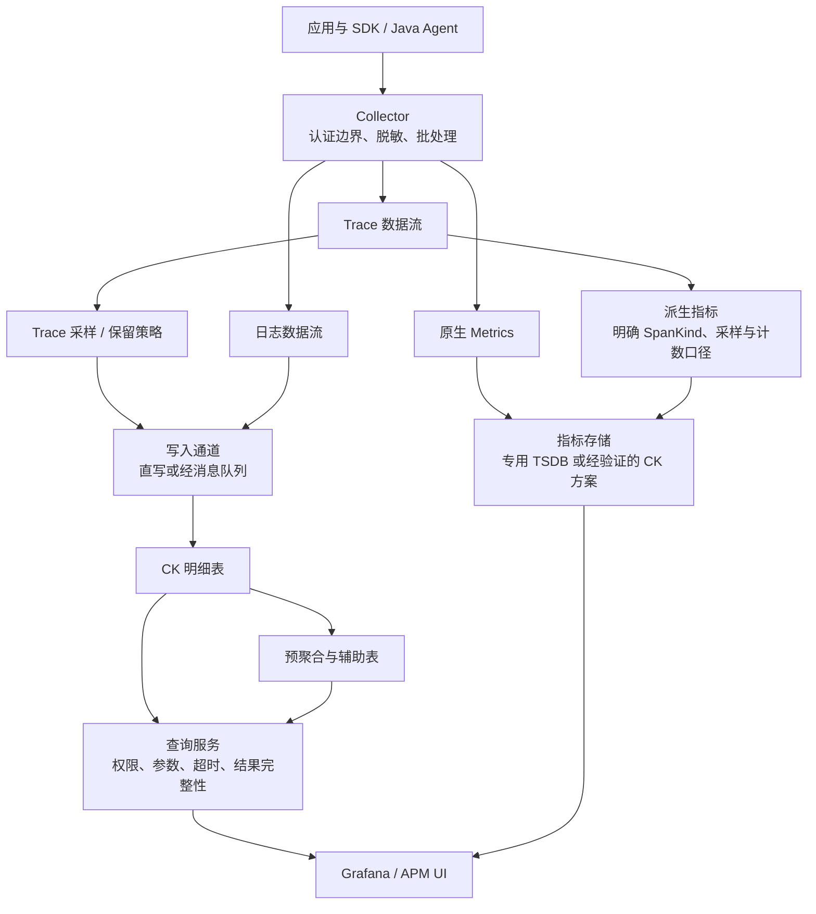

# 01 · CK 在可观测平台里，应该负责什么

> 故事从一个排障请求开始：“昨晚支付接口变慢了，找出最慢的那批请求，再看看它们的日志。”
> 这个问题同时要求筛选、聚合、关联与明细回查。选数据库之前，先把这几种工作分清。

**证据边界**：本文为官方资料整理与架构设计建议，不是生产压测报告。调研日期 2026-11-27；版本与实验状态见[系列导读](/observability/clickhouse/README.md)。

## 一、不是所有“监控数据”都在问同一个问题

| 信号 | 常见问题 | 数据与查询特点 | 建模时先问 |
|------|----------|----------------|------------|
| Logs | 哪些请求报错？关键字在哪里？ | 大量事件、长文本、结构化属性混合 | 以属性过滤为主，还是复杂全文检索为主？ |
| Traces | 某个 TraceId 发生了什么？哪个服务慢？ | Span 明细、层级关系、标识检索与统计并存 | TraceId 回查和服务趋势谁更频繁？ |
| Metrics | 请求量趋势、错误率、延迟分布如何？ | 时间序列、聚合、时间语义、序列基数 | 数据是 delta 还是 cumulative？计数是否经过采样？ |

ClickHouse 的列式存储、排序、压缩和 SQL 聚合使它值得进入日志/Trace 分析的选型清单。但“能存储指标”不等于“具有完整 Prometheus 语义”，也不意味着一条 SQL 可以替代采集、服务发现、规则计算与展示系统。[S1]

OTel ClickHouse Exporter 在本系列锁定的 README 提交中，Trace、Logs 为 beta，Metrics 为 alpha。这是**该组件文档的稳定性声明**，不是对 ClickHouse 整个产品能力的评分，也不代表所有 Collector 版本。[S2]

## 二、数据平台不是一条直线

下面是教学候选架构，不是作者生产系统的拓扑。指标侧保留选型出口，不预设所有数据都进 CK。

这张图有两个容易看漏的地方：

1. **Span 派生指标与 Trace 保留策略分开讨论。** 若先只保留错误和慢请求，再把剩余 Span 当作总体，得到的错误率和延迟分布可能有选择偏差。“放在采样前”也不自动等于全量，入口之前可能已有 SDK 头部采样。
2. **查询服务不是一层可有可无的转发。** 它必须处理租户权限、最大时间范围、结果数量、查询取消和分片不完整。客户端能传 `tenant_id` 不代表它有权查询这个租户。

## 三、先确定访问模式，再比较产品

以下是选型的提问清单，不是无条件的产品优劣排名。

| 候选角色 | 值得优先验证的能力 | 不应默认拥有的能力 |
|------------|-------------------|--------------------|
| CK 日志/Trace 分析 | 时间范围内多维筛选、列裁剪、聚合、明细回查、长期保留成本 | 任意搜索都快、任意更新都便宜、所有 PromQL 可直接运行 |
| 专用指标 TSDB | 序列查询、PromQL 生态、counter reset 与时序函数语义 | 任意日志正文检索、任意宽表 SQL 分析 |
| 搜索引擎 | 分词、相关性、全文检索及搜索交互 | 与 CK 相同的聚合/压缩成本曲线 |
| 对象存储归档 | 低频历史保存、备份介质 | 无计算层即可交互式检索 |

如果目标是“按服务和时间找错误日志”，结构化过滤可能占主导；如果目标是“多语言分词、相关性排序、模糊检索”，应该单独验证搜索能力。CK 的文本索引与 JSON 等功能持续演进，必须按目标版本评估，不能拿旧结论封死新能力，也不能拿新文档指导旧集群。

## 四、两条写入路径：少一个组件，还是多一层缓冲

### 方案 A：Collector 直接写 CK

优点是链路短、组件少。代价是需要认真配置 Collector 队列、持久化、重试和背压；服务端不可用多久，队列就可能积压多久。内存队列不能承诺重启后数据还在。[S2]

### 方案 B：Collector → 消息队列 → Writer → CK

适合需要独立重放、较长缓冲或写入端独立扩缩容的场景。代价转移到消息保留、消费位点、Writer 并发、批次标识和重复处理。增加 Kafka **不自动获得 exactly-once**。

| 维度 | 直接写入 | 消息队列解耦 |
|------|----------|--------------|
| 故障缓冲位置 | Collector 队列等 | 队列 + Writer，本身也要持久化与容量治理 |
| 恢复方式 | 排队重试，受持久化与保留条件限制 | 从位点重放，必须处理已入库但未提交位点的批次 |
| 运维成本 | 较少组件，但压力更直接传导 | 多一套系统与链路监控 |
| 共同验收 | 丢失、重复、背压、可见延迟、恢复后数据校验 | 同左 |

没有实际停机容忍时间、数据量和团队运维条件，不能替用户宣布哪条路径“生产最优”。可靠写入的确认边界见[第 04 篇](/observability/clickhouse/04-ingestion-and-delivery.md)。

## 五、把“性能好”翻译成可验收合同

建议先列四组指标，再测存储：

- **新鲜度**：数据从事件发生或 Collector 接收到查询可见分别多久？这两个时钟不能混用。
- **查询**：指定数据分布、时间范围和并发下，延迟分布、读取字节、超时率是多少？
- **可靠性**：哪些故障不丢？允许哪些重复？多久恢复？如何证明恢复完整？
- **成本**：主数据、副本、索引、聚合、备份、临时合并空间分别占多少？

延迟采样还引入“等待 Trace 决策”的时间；不要把这段等待都算成数据库写入慢。已有[延迟采样方案](/observability/design/otel-tail-based-sampling.md)可以作为需求背景，但其中容量举例不能当作本系列的 CK 实测数据。

## 六、三个业务故事贯穿后续文章

1. **找一条链路**：某租户给出 TraceId，服务名未知，部分 Span 迟到。涉及辅助索引、跨分片路由和查询范围。
2. **看服务趋势**：服务一分钟内请求量、错误率、P99。涉及 SpanKind、采样、重复、聚合状态和时间桶。
3. **定位写入变慢**：输入流量没变，part 数和合并压力却上升。涉及批量、分区、重试及后台工作。

这三类问题分别检验“查得出”“算得对”和“跑得稳”。只做其中一项的演示，不能代表完成了可观测存储建设。

想一想：如果历史 Trace 都能查到，为什么服务 QPS 仍可能不可信？

Trace 可查证明的是保留数据可访问。QPS 的分母、时间窗口、统计对象、采样覆盖和重复处理可能仍然错误。例如同时统计 Client 和 Server Span，或只统计尾部采样留下的慢请求，都不等于完整业务请求量。

## 七、面试表达：先给边界，再给证据

**问：为什么可观测系统会选 CK？**

答：对于大量追加事件的结构化分析，可以利用列式读取、排序裁剪和聚合；但我会用实际查询集验证，不预设它替代 TSDB 或搜索引擎。首先明确数据量、新鲜度、可靠性与成本合同。

**问：为什么不把所有信号统一到一个库？**

答：统一存储与统一语义不是一回事。Metrics 的累计/增量、重置、直方图和查询语言兼容性需要额外适配。减少组件可能降低运维成本，也可能把成本转移到业务实现，必须比较总成本。

## 来源与适用边界

- [S1 · ClickHouse for observability](https://clickhouse.com/docs/use-cases/observability/introduction)：产品角色与生态组合；滚动官方文档，不引用其营销数字作为性能保证。
- [S2 · OTel ClickHouse Exporter README，固定提交](https://github.com/open-telemetry/opentelemetry-collector-contrib/blob/083eddd8df2eb2c48a9cf43995470b25df4bf8b8/exporter/clickhouseexporter/README.md)：组件状态、队列与 schema 管理建议；不是生产部署版本。
- [OTel Metrics Data Model](https://opentelemetry.io/docs/specs/otel/metrics/data-model/)：指标语义需独立于存储选型考虑。

本文没有 CK SQL 或压测执行结果；两套架构及验收合同为设计建议。

---

[返回导读](/observability/clickhouse/README.md) · 下一篇：[一条 Span 的落盘之旅](/observability/clickhouse/02-mergetree-internals.md)
