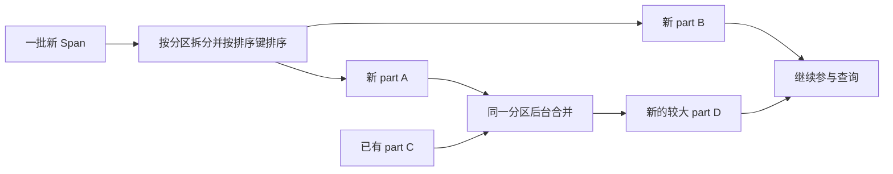
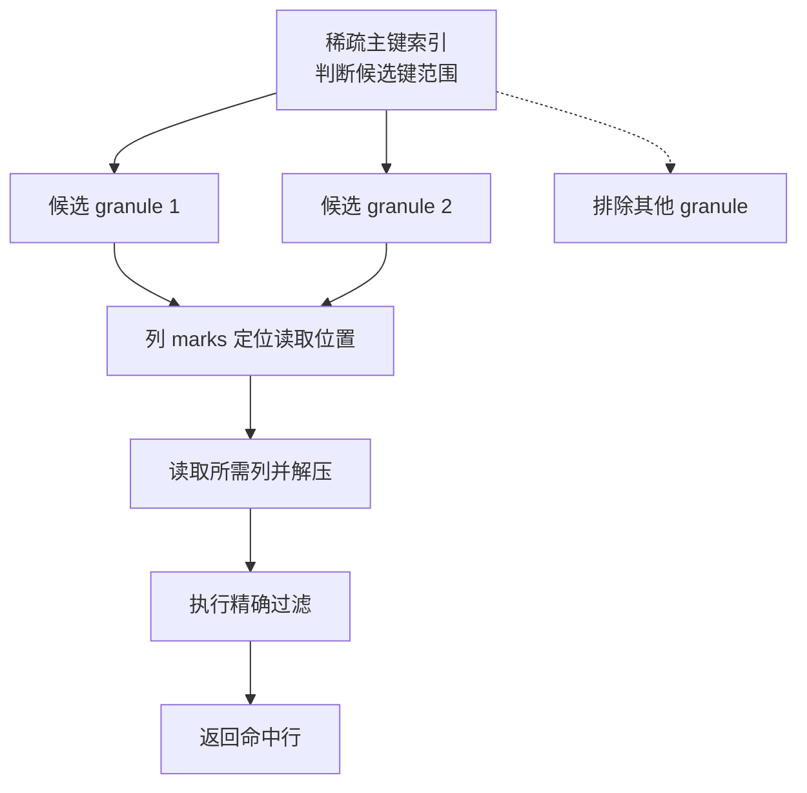

# 02 · MergeTree：为什么少读数据，比更快地读更重要

> “只查一个服务最近十分钟，为什么还读了这么多数据？”
> 答案通常不在 SQL 的长度里，而在数据落盘时相邻的究竟是什么。

**证据边界**：本文依据官方机制文档解释教学模型，不是生产实测。调研日期为 2026-11-27；全部 SQL 均未在 ClickHouse 执行，没有延迟、吞吐或压缩率承诺。唯一主表定义见[第 03 篇](/observability/clickhouse/03-schema-and-access-patterns.md)，不要另建同名表。

## 一、先拆开“列式数据库很快”这句话

查询 `count()`、延迟分布时，可能只需要时间、服务、耗时几个字段，并不需要每条 Span 的完整属性。
列式组织让查询能够围绕需要的列工作；同一列的类型和分布相近，也为编码和压缩创造条件。
但如果时间范围很宽、过滤无法排除数据，列式仍然可能读取大量数据。[S1][S2]

| 层次 | 解决什么问题 | 不等于什么 |
|------|-------------|------------|
| 列式存储 | 不必为了少数列读取整条宽记录的所有字段 | 不保证只读最终命中的行 |
| 向量化执行 | 对列片段批量计算，减少逐值调用开销 | 不保证所有算子都使用 SIMD |
| 编码与压缩 | 利用值的规律，减少表示和存储成本 | 不保证 CPU 消耗也同时下降 |
| 排序与稀疏索引 | 尽早排除不可能命中的范围 | 不是逐行 B-tree 定位 |

官方架构文档以列数组和内存 `Block` 描述批量计算。[S1]
**执行批次、存储 granule、压缩块是不同抽象**，不要把它们都想成“8192 行一块”。

## 二、从一批 Span 到磁盘上的 part

MergeTree 插入数据时会创建新的数据部件（part）；part 内按排序键组织数据，并生成相应索引。
一个插入请求可能涉及多个分区，也会受内部拆分影响，不能假设“一次请求永远等于一个 part”。[S2]



图中只有属于同一分区的 A、C 可以参与这次合并；B 不因图形相邻就能跨分区合并。

### 2.1 不可变，是生命周期约束，不是不能更新

官方 `Table parts` 将数据部件描述为 immutable。[S3]
常规写入不是在旧部件中寻找空位；后台合并生成新部件，旧部件被标记为不活跃，随后按生命周期规则清理。
更新、删除等能力不能简单类比事务数据库的原地更新，它们有各自的实现与版本边界。

这一设计把写入与整理分开，但整理不是免费的：

- 写入不断产生小 part，后台需要投入 CPU、读写 I/O 和临时磁盘空间进行合并。
- 查询可能同时面对多个活跃 part，需要分别做索引判断和读取。
- 当前查询仍使用的旧部件，不能因为新部件生成就立即删除。
- 合并速度追不上新增速度时，“查询变慢”可能首先是写入组织的问题。

普通 MergeTree 合并负责重新组织数据，**不自动去重，也不自动把相同键的行聚合成一行**。[S2]
不同 MergeTree 家族引擎可以有额外语义，不能从普通 MergeTree 推导替换或求和行为。

### 2.2 分区是合并和生命周期边界

本系列候选方案按 `toDate(timestamp)` 分区，主要为了时间范围裁剪与保留策略管理。
它是教学选择，不是所有可观测平台都应该按天分区的结论。

不同分区的 part 不会在后台合并；同一分区也不保证最终只剩一个 part。[S2]
因此，把高基数的租户或 TraceId 直接做分区键，可能制造大量无法互相合并的小集合。

| 设计问题 | 优先检查的结构 |
|----------|----------------|
| 哪些日期根本不必读取？ | 分区表达式与时间谓词 |
| 某服务的数据是否靠在一起？ | 排序键 |
| 按排序范围能排除多少候选数据？ | 主键稀疏索引 |
| 过期数据何时物理清除？ | TTL、后台合并与资源条件 |

## 三、granule 和 mark：索引提供路标，不提供门牌号

在 MergeTree 文档的模型里，granule 是选择数据时最小的不可分数据集合。
稀疏主键索引记录 granule 起始行对应的键值；各列的 marks 则帮助定位列数据文件中的读取位置。[S2]



这张图刻意保留“精确过滤”：索引缩小候选集后，候选集合内仍然可能有大量不匹配行。
相邻 granule 也可能涉及相同压缩块，不能按“命中两行”推导“只做两行的物理 I/O”。

### 3.1 为什么“每个粒度固定 8192 行”不准确

`index_granularity` 的默认值是 8192，官方描述的 granule 行数范围为 `1` 到该配置值。
结合 `index_granularity_bytes` 的自适应字节约束后，宽行会使实际粒度更小。[S2]
若一行自身已经超过字节阈值，单行粒度允许超过该字节阈值。

所以，8192 应理解为**默认配置下的行数上限**，不是每个部件永远相同的切块尺寸。
修改粒度会改变索引规模、定位精细度和读取开销；不能只看到“越细越精准”，却忽略更多标记的成本。

### 3.2 主键为什么不保证唯一

`ORDER BY` 决定 part 内排序；没有显式指定 `PRIMARY KEY` 时，排序键也作为主键。
两者可以不同，但主键表达式必须是排序键表达式的前缀。[S2]

本系列候选排序为：

```text
(tenant_id, service_name, toStartOfHour(timestamp), trace_id, timestamp, span_id)
```

它先服务于租户、服务和时间桶检索，而不是把 TraceId 当成唯一行地址。
同一个 `trace_id`、`span_id` 被重试写入两次，普通 MergeTree 可以保留两行；排序键不会拒绝重复数据。
去重策略必须回到写入协议、事件身份与引擎语义讨论，不能用“已经有主键”作为答案。

## 四、排序、编码和压缩是一组联动选择

排序影响相邻值的相似程度；编码可以利用相邻值的差值或重复规律；通用压缩再压缩编码结果。
官方可观测 Schema 示例对时间列使用 `Delta` 与 `ZSTD`，但这只是候选组合，不是本系列已经测出的最佳配置。[S4]

| 数据特点 | 可以评估的方向 | 必须观察的反面成本 |
|----------|----------------|--------------------|
| 相邻时间变化较平滑 | 差分编码后压缩 | 实际排序可能打断时间连续性 |
| 服务名重复较多 | `LowCardinality(String)` | 字典维护与真实基数变化 |
| 宽属性字段 | 压缩、脱敏、选择性保留 | 解压 CPU、属性提取与读取宽度 |
| 标识符高基数 | 先测通用压缩和实际表示 | 不凭“都是字符串”套用低基数类型 |

这里的“可以评估”很重要：压缩率更好不自动等于查询更快。
验证应固定数据、排序和查询，分别比较存储量、写入 CPU、查询读取量和端到端耗时。
只替换 codec，同时又改变批量大小和排序键，就很难解释收益来自哪里。

## 五、用两类查询观察，而不是凭概念下结论

以下只读示例复用 `obs_lab.spans`。业务查询的 `tenant` 必须由服务端鉴权上下文绑定，时间范围也要受服务端上限约束。

```sql
SELECT count() AS span_count, sum(duration_ns) AS total_duration_ns
FROM obs_lab.spans
WHERE tenant_id = {tenant:String}
  AND service_name = {service:String}
  AND timestamp >= {from:DateTime64(9, 'UTC')}
  AND timestamp < {to:DateTime64(9, 'UTC')}
  AND toStartOfHour(timestamp) >= toStartOfHour({from:DateTime64(9, 'UTC')})
  AND toStartOfHour(timestamp) <= toStartOfHour({to:DateTime64(9, 'UTC')});
```

`sum(duration_ns)` 这里只用于展示窄列读取，不是请求端到端耗时：并发、嵌套 Span 的时长不能直接相加解释为用户等待时间。

运维侧可以观察活跃部件；这是隔离实验库的管理查询，没有业务租户列，应只向授权运维开放。

```sql
SELECT partition, name, rows, marks, bytes_on_disk
FROM system.parts
WHERE database = 'obs_lab' AND table = 'spans' AND active
ORDER BY bytes_on_disk DESC
LIMIT 20;
```

`rows / marks` 只能帮助观察部件的平均粒度，不能证明每个 granule 大小相同；这里也没有展示任何实际查询结果。[S5]

建议验证顺序：

1. 固定同一份脱敏数据，对比不同写入批次组织后的 part 数和大小分布。
2. 等待并观察后台合并，记录期间的磁盘余量、CPU 和查询尾延迟。
3. 对同一业务查询检查候选分区、granule 和实际读取字节，方法见第 07 篇。
4. 单独替换排序或 codec，比较结果正确性与资源消耗，而不是只截取最快一次。

## 六、TTL 不是一个精准的删除闹钟

第 03 篇的教学表尚未配置 TTL；以下解释机制，不表示实验数据已启用自动清理。
TTL 过期清理在后台合并过程中执行，不保证到期时刻立刻物理删除。
官方明确指出，两次合并之间的查询可能读到已过期数据。[S2]

如果 API 只允许查询最近一段时间，应在服务端校验查询窗口，不要把访问规则寄托在 TTL 上。
如果涉及严格删除期限，还需要单独定义删除流程、验证方法和备份副本处理，不应仅写一条 TTL 就宣布满足要求。

另外，清理 TTL 与移动 TTL 不是完全相同的动作；部分移动行为受插入时设置影响，不能把所有 TTL 都概括为同一种执行路径。

## 七、面试追问：把四个概念说清楚

### Q1：有分区键和主键，为什么还会扫描很多行？

分区先排除大范围，稀疏主键再排除排序范围；都不是逐行唯一定位。
如果时间窗很宽、条件不能有效约束排序前缀，或者目标值分散在大量粒度中，剩余数据仍可能很多。
判断依据应是执行计划与真实读取量，不是“建了几个键”。

### Q2：把 `index_granularity` 调小就能解决慢查询吗？

不能。它可能让范围定位更细，却增加标记和索引开销；压缩块、数据分布和查询列宽仍然影响读取成本。
应先确认问题确实来自粗粒度候选范围，而不是大量小 part、全量排序或低选择性的查询条件。

### Q3：为什么重试写入后，合并没有消掉重复 Span？

因为普通 MergeTree 不提供唯一约束或按键去重语义。
先定义重复事件的身份、允许的更新和重试边界，再讨论写入幂等或其他引擎；不要用强制合并掩盖模型问题。

## 来源与适用范围

- [S1] [Architecture Overview](https://clickhouse.com/docs/development/architecture)：列式接口、列片段与向量化计算。
- [S2] [MergeTree](https://clickhouse.com/docs/engines/table-engines/mergetree-family/mergetree)：部件、排序、主键、粒度、分区和 TTL。
- [S3] [Table parts](https://clickhouse.com/docs/parts)：不可变部件与后台合并生命周期。
- [S4] [Designing a schema for observability](https://clickhouse.com/docs/use-cases/observability/schema-design)：排序与编码选择。
- [S5] [system.parts](https://clickhouse.com/docs/operations/system-tables/parts)：部件统计字段。

上述为滚动官方文档；SQL 仅做静态语义审校，目标版本、真实粒度与 codec 收益仍需隔离环境验证。

**上一篇**：[01 · CK 的角色与架构](/observability/clickhouse/01-role-and-architecture.md) · **下一篇**：[03 · Schema 与访问模式](/observability/clickhouse/03-schema-and-access-patterns.md)
