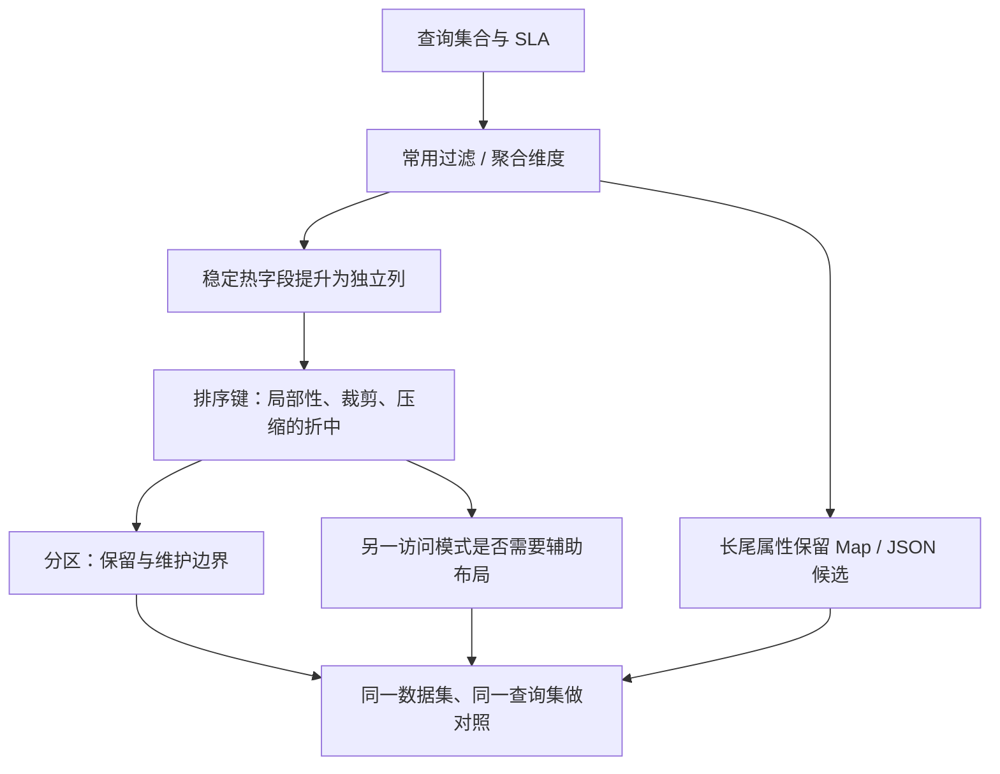

# 03 · 先写查询，再设计表

> “先把所有属性扔进 Map，慢了再加索引。”这像把快递堆满仓库后才决定货架编号：能存，不等于能高效找出。
> 本篇从查询合同推导教学表，后续 SQL 都使用这里的字段，避免每篇换一套口径。

**示例状态**：以下 DDL 是隔离实验设计，尚未在 ClickHouse 执行。它不是 OTel Exporter 的默认表，不可把 Collector 的默认 INSERT 直接接到这张表上。正式使用前固定 CK、Collector、客户端版本并验证列名、类型与枚举映射。

## 一、先列出四种查询合同

| 查询 | 必须已知的条件 | 返回内容 | 主要冲突 |
|------|----------------|----------|----------|
| 服务慢请求列表 | 租户、服务、时间范围 | Top N Span | 需要服务/时间裁剪，也要按耗时排序 |
| 整条 Trace | 租户、TraceId、可约束的搜索范围 | 跨服务 Span | 用户不一定知道服务名 |
| 服务趋势 | 租户、服务、时间范围、SpanKind | 数量、错误、延迟分布 | 明细扫描与预聚合成本取舍 |
| 属性排查 | 租户、时间、少量属性 | 明细样本 | 属性变化快，但不值得为所有键建列/索引 |

“按租户过滤”是查询合同的一部分，不代表 SQL 自带权限。租户应从鉴权上下文派生，并结合数据库账号、行策略或隔离表等防线；不允许客户端自行指定任意租户。



## 二、统一教学模型：先把时间、单位和身份写清楚

| 字段 | 本系列约定 | 原因与限制 |
|------|------------|------------|
| `tenant_id` | 可信入口确认的租户 | 不从未经验证的 OTLP 属性直接采信 |
| `timestamp` | Span 开始时间，UTC，纳秒精度 | 用于时间范围与分桶；不等于接收时间 |
| `ingested_at` | CK 接收 INSERT 时计算的时间 | 演示延迟分析；不是 Collector 初次接收时间 |
| `trace_id` / `span_id` | 小写十六进制字符串 | 入口校验长度和格式；String 列本身不保证合法 |
| `duration_ns` | 非负纳秒数 | 上游若输出微秒必须显式转换，不能混用 |
| `span_kind` | Writer 规范化后的 `SERVER` / `CLIENT` 等 | 教学字符串，不是 OTLP 原始枚举值 |
| `status_code` | Writer 规范化后的 `UNSET` / `OK` / `ERROR` | `UNSET` 不自动代表业务成功 |
| `attributes` | `Map(String, String)` | 为教学统一类型，会丢失 OTLP AnyValue 原类型信息 |

生产模型若需要保留数值、布尔、数组和嵌套属性，必须设计无损映射或保留原始载荷。不要以“示例里都是 String”为理由静默转换所有生产属性。[S1]

## 三、最小 DDL：让后续章节可以使用同一张表

**只在授权的隔离实例执行，本文没有执行。** 使用新库 `obs_lab`，避免与线上表混淆；不提供删除库、强制合并等命令。示例暂不加 TTL，以免实验数据按事件时间提前过期；生产必须单独制定保留政策。

```sql
CREATE DATABASE IF NOT EXISTS obs_lab;

CREATE TABLE obs_lab.spans
(
    tenant_id String,
    service_name LowCardinality(String),
    timestamp DateTime64(9, 'UTC') CODEC(Delta(8), ZSTD(1)),
    trace_id String,
    span_id String,
    parent_span_id String,
    span_name String,
    span_kind LowCardinality(String),
    duration_ns UInt64,
    status_code LowCardinality(String),
    attributes Map(String, String),
    ingested_at DateTime64(3, 'UTC') DEFAULT now64(3)
)
ENGINE = MergeTree
PARTITION BY toDate(timestamp)
PRIMARY KEY (tenant_id, service_name, toStartOfHour(timestamp), trace_id)
ORDER BY (tenant_id, service_name, toStartOfHour(timestamp), trace_id, timestamp, span_id);
```

### 为什么这样排列？

- 租户和服务排前面，面向“某租户某服务”的常见查询。
- 小时桶让同一小时具有局部性，桶内再按 TraceId 排序。这是服务时间检索与 Trace 局部性之间的**候选折中**，不是普适最佳键。
- 完整时间和 SpanId 进一步排序；主键只取排序键前缀，控制稀疏索引宽度。[S2]
- 日分区只是演示。日/月/不分区要结合单分区大小、迟到数据、保留与维护操作选择，不能直接复制为生产标准。
- `Delta + ZSTD` 是时间列的一个可测候选。排序并不保证时间全局单调，压缩收益须实际测量，不把 codec 名称当优化结果。

**这个键不保证单 TraceId 回查高效。** 未指定服务时，排序前缀缺一段；多个服务的 Span 本来也不应被一个服务过滤条件排除。解决办法可能是辅助表、投影或另一张排序布局，而不是随意加长主键。[S1]

更一般地，时间表达式是否被优化器有效利用要看计划。对于这个教学键，可同时给出精确时间范围与覆盖它的小时范围；两者保持一致，最终仍由精确范围决定结果。

## 四、先确认一条有边界的明细查询

下面是 ClickHouse 类型化参数语法。参数需通过客户端/驱动绑定；`tenant` 来自服务端鉴权，不能简单接收请求体里的同名字段。

```sql
SELECT timestamp, trace_id, span_id, span_name, duration_ns
FROM obs_lab.spans
WHERE tenant_id = {tenant:String}
  AND service_name = {service:String}
  AND timestamp >= {from:DateTime64(9, 'UTC')}
  AND timestamp < {to:DateTime64(9, 'UTC')}
  AND toStartOfHour(timestamp) >= toStartOfHour({from:DateTime64(9, 'UTC')})
  AND toStartOfHour(timestamp) <= toStartOfHour({to:DateTime64(9, 'UTC')})
  AND span_kind = 'SERVER'
ORDER BY duration_ns DESC, timestamp DESC, trace_id, span_id
LIMIT 100;
```

这里 `LIMIT 100` 只限制返回数量，不保证最多扫描 100 行。按耗时排序与表的物理排序不同，仍可能需要读取候选范围并做 Top N。[S2]

API 层还应限制最大查询窗、超时、并发和结果体积；允许的列名/排序字段来自白名单，不能靠值参数绑定解决标识符注入。

## 五、三个键，三种责任

| 定义 | 本例 | 真正的责任 |
|------|------|------------|
| 分区键 | `toDate(timestamp)` | 数据管理和分区裁剪；不同分区不互相合并 |
| 排序键 | 完整 `ORDER BY` | part 内物理有序；影响压缩与跳过能力 |
| 主键 | 排序键前四项 | 稀疏主索引；不提供唯一约束 |

本例允许重复的 `(tenant_id, trace_id, span_id)`。若重试写入同一 Span，普通 MergeTree 合并不会自动去掉重复。

以后若换成 `ReplacingMergeTree`，重复的定义是**完整排序键**而不是“看起来唯一的几个业务字段”。把会变化的状态、时间或版本随意放进排序键，可能让同一实体永远不能按预期替换。版本选择与业务身份必须一起设计。[S3]

## 六、Map、JSON、独立列：按访问方式分工

| 方案 | 合理用途 | 要验证什么 |
|------|----------|------------|
| 独立列 | 常用筛选、分组、排序和稳定语义 | 写入映射、schema 演进、缺失值语义 |
| Map | 键集合动态、值类型可统一的长尾属性 | 单键访问成本、缺键和空值区别、重复键治理 |
| JSON 类型 | 需要嵌套和多类型表达的半结构化数据 | 目标版本、动态路径策略、驱动及 exporter 兼容性 |
| String 原始载荷 | 原文保留、低频解析与追溯 | 查询时解析成本、脱敏与存储费用 |

`attributes['http.route']` 缺失时不能直接当作已知的空路由。需要区分缺键，可用 `mapContains` 再决定处理方式。实际生产还应保证同一 Map 中键不重复。[S4]

热属性提取常见两条路径：

- **Writer 显式写列**：类型校验前移，schema 与采集映射共同发布。
- **MATERIALIZED 列**：插入时计算并存储；已有数据是否需显式物化、重写成本和缺值处理要单独验证。

`ALIAS` 列是在查询时计算的便利表达，不等于提前计算、保存了结果。[S1]

### LowCardinality 不是高基数的解药

字典编码适合重复值较多的列。把租户请求路径中的随机 ID、TraceId 或用户输入直接当作“低基数字符串”，可能得不偿失。官方给出的基数建议是经验参考，不是阈值内必快、阈值外必慢的定理。[S5]

`span_name` 若包含动态 URL，先规范化为路由模板，通常比事后给任意名称加索引更有价值。是否能改写名称，还需保留原始诊断信息与采集语义。

## 七、上线前的 schema 验收

1. **兼容性**：用真实 Writer 发一条脱敏样本，核对列映射、时区、duration 单位、Map 值类型。
2. **正确性**：空 ParentSpanId、缺键、超长属性、错误枚举、异常时钟、迟到数据是否有明确处理？
3. **查询性**：固定数据分布，用 TraceId、服务时间和长尾属性三组查询对照，不只测一条最快的。
4. **维护性**：分区数、part 数、压缩大小和写入耗时是多少？修改 schema 后旧批次还能重放吗？
5. **安全性**：SQL 参数化之外，有无跨租户查询测试、敏感属性丢弃策略、只读查询账号？

本系列只给出教学表，不替生产库选键。没有实测数据分布时，不能承诺它优于 exporter 默认 schema。

<details>
<summary>想一想：给 TraceId 建主键，就能替代服务时间索引吗？</summary>

不能。把 TraceId 放在最前面改善一种定位路径，也可能让服务时间范围扫描失去前缀局部性。一个布局的收益要用整个查询集合衡量；多布局则用额外写入与存储成本换取查询收益。

</details>

## 面试问答

**问：CK 主键与 MySQL 主键最大的区别是什么？**

本篇 MergeTree 主键是稀疏索引，不保证行唯一，也不是每行一条定位记录；同一个主键可以有多条记录。完整排序键还参与 part 内排序，不能把两者与分区键混为一谈。

**问：为什么不按租户和服务都分区？**

需要先估计分区数和写入扇出。每批数据若分散到许多分区，可能产生很多小 part，而不同分区不合并。权限隔离也不是靠分区名称实现。

## 来源与边界

- [S1 · 官方可观测 Schema 设计](https://clickhouse.com/docs/use-cases/observability/schema-design)：字段提升、排序取舍、TraceId 辅助时间范围。
- [S2 · MergeTree](https://clickhouse.com/docs/engines/table-engines/mergetree-family/mergetree)：主键前缀、排序、分区及稀疏索引。
- [S3 · ReplacingMergeTree](https://clickhouse.com/docs/engines/table-engines/mergetree-family/replacingmergetree)：按排序键替换与合并时机。
- [S4 · Map](https://clickhouse.com/docs/sql-reference/data-types/map)：Map 类型、缺键读取与键行为。
- [S5 · LowCardinality](https://clickhouse.com/docs/sql-reference/data-types/lowcardinality)：字典编码与基数建议。

本篇 SQL 为设计示例，未在 CK 执行。JSON、投影、属性索引具体能力需按目标版本核验。后续实验先记录 `SELECT version()`，再按[第 10 篇](/observability/clickhouse/10-labs-and-interview.md)验收。

---

上一篇：[MergeTree 原理](/observability/clickhouse/02-mergetree-internals.md) · 下一篇：[写入成功，数据就安全了吗](/observability/clickhouse/04-ingestion-and-delivery.md) · [导读](/observability/clickhouse/README.md)
