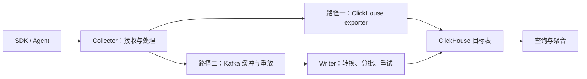
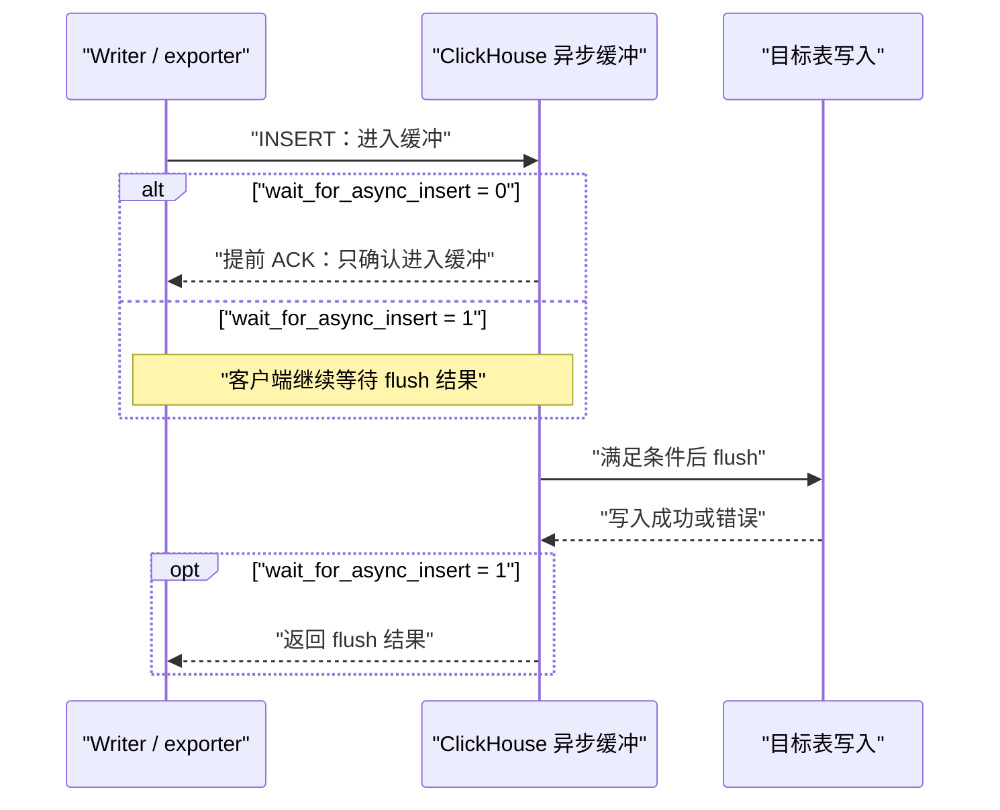

# 04 · 写入与交付：从 Collector 到可查询数据

> 面向可观测数据的写入设计。本文区分接收、排队、落表与复制，不把一次成功响应解释为端到端可靠性。
> 示例是设计推演；未执行 Collector 部署、数据库写入、故障注入或吞吐测试。

## 1. 业务困境：请求成功了，为什么仍然查不到？

假设一个追踪系统同时接收在线 Span 和断网后的历史补传。
应用看到 SDK 发送成功，Collector 看到请求成功，数据库也没有明显报错，却仍可能出现短暂不可见、重复记录或数据缺口。
这不是一个“重试次数不够”的问题，而是不同组件对“成功”的定义不同。

需要先把业务诉求拆成三个指标：

- **可见延迟**：从事件发生或接入到查询能看到数据的时间。
- **交付完整性**：接受的数据在约定故障范围内是否最终进入目标表。
- **重复容忍度**：重复 Span 是否影响检索、计数和聚合口径。

没有明确故障范围，“不丢不重”只是口号。
例如进程重启、节点永久丢失、磁盘损坏、整区故障，对系统的要求并不相同。

## 2. 两条路径：直写与 Kafka Writer

### 2.1 Collector 直写

适合希望减少组件、使用 exporter 既有映射、业务能接受其队列与重试边界的场景。
少一个消息系统，意味着少一组部署与运维责任；不意味着自动拥有更强交付语义。

必须确认以下责任是否有人承担：

| 责任 | 需要回答的问题 |
| --- | --- |
| 队列 | 内存还是持久队列？满了丢弃、拒绝还是阻塞？ |
| 重试 | 哪些错误重试？持续多长时间？耗尽后如何计数和告警？ |
| 恢复 | Collector 重启后，未完成请求是否恢复？ |
| Schema | exporter 的列名、类型和目标表是否一致？ |
| ACK | 返回成功发生在接收、入队，还是数据库完成写入之后？ |

持久队列降低进程重启丢失排队数据的风险，但其存储介质和故障域仍需设计。
不能因为 exporter 使用了持久队列，就宣称整条 SDK → 查询链路恰好一次。

### 2.2 Kafka + 自定义 Writer

这是一个可选的架构方案，而不是 ClickHouse exporter 的必经模式。
它适合需要独立吸收积压、回放历史数据、隔离写入升级或自行控制字段映射的团队。
代价是增加消息存储、消费进度、分区规划、转换兼容和回放治理。

本文建议的 Writer 合约是：

1. 消费一批消息，保留来源分区和位置信息。
2. 完成校验、字段规范化与稳定分批。
3. 等待目标写入满足约定的确认条件。
4. 再推进该批消息对应的消费进度。
5. 对不可重试记录隔离并告警，不无声跳过。

这仍是**至少一次**设计：如果数据库写入成功后、进度提交前 Writer 崩溃，恢复时会再次消费。
Kafka 的确认、副本和保留策略也要独立核对；“接了 Kafka”并不自动证明数据安全。

## 3. 机制：异步写入改变的是合批与应答时机

ClickHouse 的 `async_insert` 是服务端小请求合批机制，不是“客户端一定立即返回”。
官方异步写入文档区分两种确认模式：[异步写入机制](https://clickhouse.com/docs/optimize/asynchronous-inserts)。

| 设置组合 | 成功应答边界 | 不能由此推导的结论 |
| --- | --- | --- |
| `async_insert=1, wait_for_async_insert=0` | 请求进入服务端内存缓冲 | 已落表、故障后必定恢复、后续错误能返回本次调用 |
| `async_insert=1, wait_for_async_insert=1` | 异步 flush 成功完成、写入目标存储 | 已执行 `fsync`、全部副本完成、跨系统恰好一次 |

官方建议使用等待 flush 的方式，避免提前确认隐藏后续写入失败。
缓冲中的数据在 flush 前不可查询；等待时间还包括排队与实际执行，不只是一个 flush 定时器。

服务端按节点、INSERT 形状与设置组合维护缓冲，并非整个集群共享一个缓冲区。
大小、等待时间或累计 INSERT 请求数等条件可以触发 flush，具体设置和默认值依版本核实。
把同一流量拆给更多节点或不同写入形状，可能削弱合批效果。

如果目标是 `Distributed` 表，还要区分其后台发送队列与这里的异步缓冲。
两者处在不同层，不能用一个 `wait_for_async_insert` 推导远端分片和所有副本都已完成。
详见[第 08 篇](/observability/clickhouse/08-clusters-and-reliability.md)。

## 4. Exporter 选型：先锁定版本，再解释配置

本篇核对的是 [ClickHouse exporter README 固定提交](https://github.com/open-telemetry/opentelemetry-collector-contrib/blob/083eddd8df2eb2c48a9cf43995470b25df4bf8b8/exporter/clickhouseexporter/README.md)。
提交号是文档证据锚点，**不是 Collector 发布版本，也不是本文的兼容性测试结果**。

### 4.1 不同信号不是同一成熟度

该提交标注：Logs 为 **beta**，Traces 为 **beta**，Metrics 为 **alpha**。
因此不能把“ClickHouse exporter 支持指标”写成“指标能力与 Trace 同等成熟”。
生产评估应分别检查信号映射、升级兼容、失败恢复及查询口径。

### 4.2 参数责任表，而不是未经验证的 YAML

下表描述的是**固定 README 快照标注的职责**；默认值、配置路径和兼容性必须按实际 Collector 发行包复核，不能把文档快照当成所有版本的运行时保证。[S5]

| 参数或能力 | 该快照标注的责任与边界 |
| --- | --- |
| `create_schema` | 快照标注默认 `true`，并建议生产改为 `false`、自行管理 Schema |
| 目标表列名与类型 | 自管 Schema 仍须匹配 exporter 的 INSERT，不能任意改名 |
| `sending_queue.storage` | 快照标注默认 `none`，未配置持久扩展时队列为内存态且重启丢失 |
| `sending_queue.queue_size` | 快照标注容量单位受 `sizer` 影响，不能默认理解为 Span 条数 |
| `sending_queue.block_on_overflow` | 快照标注默认关闭；开启后从满队列丢弃改为阻塞背压 |
| `sending_queue.batch` | 快照推荐内部 batching，取代 pipeline 外部 `batch` processor；快照称默认关闭 |
| `retry_on_failure` | 快照标注默认启用且有界；有界重试不等于无限保留 |
| `timeout` | 快照标注单次发送时间预算，不是整条交付链路的保留时间 |
| `async_insert` | 快照标注顶层配置默认 `true`；连接参数和服务端仍可能覆盖最终行为 |
| `wait_for_async_insert` | 该 README 未说明，必须另外核对 ClickHouse 设置与实际连接行为 |

新旧配置不能混用：旧文章里的独立 `batch` processor 与这里推荐的内部 batching，来自不同版本语境。
该 README 未给出内部 batching 配置的最低 Collector 版本；部署前应核对实际发行包、配置解析及变更记录。
队列与批次的 `sizer` 还应显式确认，不能依赖跨版本默认值推算内存需求。

`create_schema=false` 的最小权限也不能只凭 README 拍板。该快照一处写“此模式只发送 INSERT”，另一处又写 exporter 启动时会执行 `DESC TABLE` 检查兼容性；两处描述存在张力。实际权限应结合目标版本实现与数据库审计结果确定。
凭据只从环境变量或受控秘密注入链路提供；不要在文章、YAML、命令历史和连接 URL 中写明文值。

### 4.3 教学表不是 exporter 默认表

本系列的 `obs_lab.spans` 是[第 03 篇](/observability/clickhouse/03-schema-and-access-patterns.md)定义的手工教学模型。
其 `timestamp`、`duration_ns`、`status_code` 等字段**不等于 exporter 默认列名与类型**。

- 若使用官方 exporter，应以对应版本的 SQL 模板和 INSERT 映射管理目标表。
- 若使用教学模型，需要独立 Writer 显式转换，不能直接把 exporter 指向该表。
- `SERVER`、`ERROR` 是教学 Writer 的规范化枚举，不是声称 OTLP 原始值就是这些字符串。

## 5. 超时、重试与重复：真正困难的是结果不确定

“超时”只说明客户端没有在预算内得到确定结果，不证明服务端没有写入。
网络响应丢失、进程切换以及写入成功后消费进度未提交，都可能导致重复投递。

| 现象 | 不应采取的推断 | 应保留的证据 |
| --- | --- | --- |
| 请求超时 | 数据一定没写，换批次随便重试 | 请求标识、批次内容、发送时间、查询记录 |
| 重试后计数变大 | 主键会自动消除重复 | 事件标识、块边界、去重配置与窗口 |
| 相同消息再次消费 | 一定是 Kafka 重复生产 | 写入确认与消费进度提交之间的时序 |
| 相同 Trace 重放 | 数据顺序一定不变 | Writer 并发、分批和排序行为 |

复制表的传统块去重要求关注相同内容、相同块边界和相同行顺序，并受去重记录窗口约束。
异步去重机制存在版本变化，不能直接把同步块去重规则或新版本默认行为套到所有环境。
存在物化视图时，还要单独验证目标聚合是否重复；不能只核对明细行数。

如果窗口已经过期，或者回放改变了分块方式，重复仍可能进入目标表。
业务主键、ReplacingMergeTree 与插入去重是不同机制；排序键不是唯一性约束。
选择业务去重时，还要定义：同一 `tenant_id + trace_id + span_id` 的重复与更新如何区分。

## 6. 吞吐不是只看每秒行数：还要看 part 产生速度

一个批次覆盖多个分区时，会形成面向不同分区的写入工作与 part。
因此“把批次调大”不一定解决小 part：历史补传可能把一个大批次分散到许多日期分区。

建议同时记录四个维度：

- 每批行数与序列化字节数，而非只看请求数。
- 每批触达的分区数，以及在线流量与回放流量的比例。
- 活跃 part 的数量和大小分布，以及 merge 能否消化增长。
- 队列最老记录的年龄、重试量、丢弃量与最终可见延迟。

先减少过细分区和无意义的写入形状差异，再评估批次、并发与服务端异步写入。
增加并发可能同时放大 part 生成、内存占用和重试风暴；本文不给出通用“最佳并发数”。

## 7. 隔离环境验证清单

以下是待执行实验，不是已经获得的测试结论。

| 实验 | 验证动作 | 通过标准如何定义 |
| --- | --- | --- |
| 正常链路 | 写入带唯一事件标识的有限数据集 | 接收、排队、落表与查询计数可对账 |
| 确认边界 | 分别验证两种 `wait_for_async_insert` 模式 | 能说明 ACK 发生在哪一层，不仅记录成功率 |
| 结果不确定 | 在隔离代理模拟响应丢失后重试 | 统计原始写入、重复与最终逻辑事件数 |
| 队列恢复 | 带积压重启测试 Collector 或 Writer | 实测恢复量，记录无法恢复的故障范围 |
| 历史回放 | 保持行数相近，改变覆盖日期数 | 对比 part 生成与可见延迟，不虚构倍数 |
| 聚合一致性 | 明细与依赖聚合同时接收重试 | 明确重复是否传播，符合业务口径 |

采证时固定 Collector 版本、服务端版本、表定义、有效设置和测试数据摘要。
不在生产上故意断网、杀进程或修改确认设置；故障注入必须有隔离和回滚边界。

## 8. 常见问答与边界

**问：`wait_for_async_insert=1` 就是持久化保证吗？**
答：它等待异步 flush 成功，不等于 `fsync`、全部副本确认或端到端恰好一次。

**问：用了 Kafka 就不会丢吗？**
答：不能这样推导。生产确认、保留、消费进度和数据库确认都需要各自的故障模型。

**问：为什么不直接给一份完整 YAML？**
答：本文没有验证具体 Collector 发行版和扩展组合，参数责任表比貌似可复制的跨版本配置更可靠。

## 9. 官方来源与继续阅读

- [S5 · OTel ClickHouse exporter：固定提交 README](https://github.com/open-telemetry/opentelemetry-collector-contrib/blob/083eddd8df2eb2c48a9cf43995470b25df4bf8b8/exporter/clickhouseexporter/README.md)：信号成熟度、Schema、队列及批次；仅代表该文档快照。
- [ClickHouse Asynchronous inserts](https://clickhouse.com/docs/optimize/asynchronous-inserts)：异步缓冲、确认与版本边界。
- [Replicated table engines](https://clickhouse.com/docs/engines/table-engines/mergetree-family/replication)：复制与块去重。
- [Distributed table engine](https://clickhouse.com/docs/engines/table-engines/special/distributed)：另一层写入队列与路由。

官方站点是滚动文档；实际部署版本优先于本文对网页现状的归纳。
上一篇：[03 · Schema 与访问模式](/observability/clickhouse/03-schema-and-access-patterns.md) · 下一篇：[05 · Trace 与日志查询](/observability/clickhouse/05-trace-and-log-queries.md)
