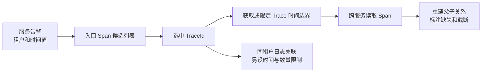
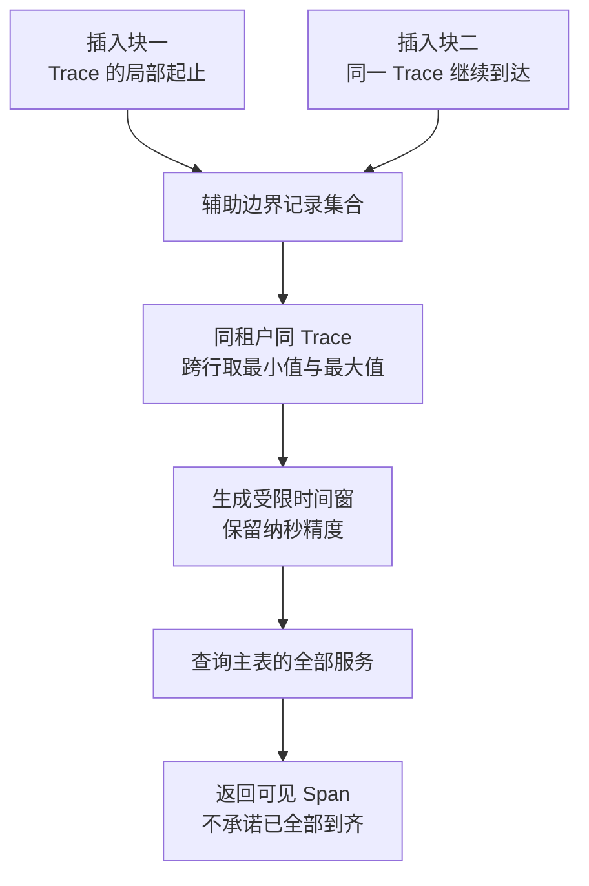

# 05 · 从慢请求到整条 Trace：查询不能在最关键的地方丢证据

> 告警说支付服务变慢，列表里也找到了一个 TraceId。
> 点开详情却只剩支付服务自己的几个 Span：数据库没有丢数据，是查询把其他服务过滤掉了。

**证据边界**：本文为查询与 API 设计说明，全部 SQL 未在 ClickHouse 执行，不声称已有可运行的查询服务或日志关联模块。调研日期为 2026-11-27。复用[第 03 篇](/observability/clickhouse/03-schema-and-access-patterns.md)的 `obs_lab.spans`，不是 OTel exporter 默认 Schema。

## 一、一次排障，其实有三种访问模式

| 阶段 | 用户问题 | 查询范围 | 常见误区 |
|------|----------|----------|----------|
| 找候选 | 哪些服务入口 Span 慢或报错？ | 租户、服务、时间、状态/耗时 | 把 Span 列表当成去重后的请求列表 |
| 看 Trace | 某 TraceId 的调用关系是什么？ | 租户、TraceId、相关时间窗 | 沿用列表的单服务过滤 |
| 找上下文 | 这条链路附近有什么日志？ | 租户、关联 ID、时间和权限 | 对日志与全部 Span 直接多对多 JOIN |

候选列表可以限制服务；**整条分布式 Trace 的回查不应继承单服务限制**。
不过租户边界必须继承：TraceId 是关联标识，不是授权凭证。



## 二、候选列表：先找线索，别提前宣布它是“请求数”

下面查询筛选 `SERVER` Span，展示耗时超过阈值的候选项。
`SERVER` 是本系列 Writer 规范化的字符串，不是直接照搬 OTLP 数值枚举。
一个 Trace 可能经过多个服务、包含多个入口 Span，因此结果是 **Span 列表**，并非自动去重的全局请求列表。

```sql
SELECT
    timestamp, trace_id, span_id, span_name,
    duration_ns / 1000000.0 AS duration_ms, status_code
FROM obs_lab.spans
WHERE tenant_id = {tenant:String}
  AND service_name = {service:String}
  AND timestamp >= {from:DateTime64(9, 'UTC')}
  AND timestamp < {to:DateTime64(9, 'UTC')}
  AND toStartOfHour(timestamp) >= toStartOfHour({from:DateTime64(9, 'UTC')})
  AND toStartOfHour(timestamp) <= toStartOfHour({to:DateTime64(9, 'UTC')})
  AND span_kind = 'SERVER'
  AND duration_ns >= {min_duration_ns:UInt64}
ORDER BY timestamp DESC, trace_id DESC, span_id DESC
LIMIT {page_size:UInt32};
```

服务端应限制 `page_size`、最大时间窗和超时；类型化参数防止把值拼接为 SQL，但不能替代鉴权。[S2]
`tenant` 必须由可信会话或令牌映射产生，不能直接信任客户端请求里的租户值。
覆盖小时的两个谓词辅助匹配教学排序表达式，精确时间谓词仍决定最终边界。

按耗时排序适合“最慢的若干条”，按时间排序适合持续翻页；这是两种不同接口语义。
若改成耗时排序，游标键也必须包含耗时及后续完整排序键，不能继续使用只有时间的游标。

## 三、稳定分页：排序相同，不代表分页天然稳定

对上述时间倒序列表，续页需要保持同一查询窗口和筛选条件，并在 `WHERE` 内增加：

```sql
AND (timestamp, trace_id, span_id) < (
    {cursor_time:DateTime64(9, 'UTC')},
    {cursor_trace:String},
    {cursor_span:String}
)
```

这是插入前一查询的条件片段，不是独立 SQL。元组按字典序比较，方向必须与完整 `ORDER BY` 一致。
服务端可以读取 `page_size + 1` 条判定是否存在后页，但只把正式返回页的最后一条作为游标。

| 边界 | 为什么重要 | 处理建议 |
|------|------------|----------|
| 同一纳秒有多条记录 | 单独使用 `timestamp` 不是全序 | 增加 `trace_id`、`span_id` |
| 客户端时间精度降低 | 纳秒转毫秒会改变边界 | 原样保留精确时间字符串，避免浮点转换 |
| 重复写入同一 Span | 三元组可能完全相同 | 明确去重或增加可靠事件身份策略 |
| 翻页期间仍有新数据 | 游标不是跨请求快照 | 冻结查询窗，并声明迟到可见性语义 |
| 游标被篡改或串租户使用 | 筛选条件和授权范围可能变化 | 签名游标，绑定租户、条件和过期时间 |

**本系列普通 MergeTree 允许重复三元组**，因此上述方案只有在该键唯一或上游已确定性去重的前提下，才提供稳定的行边界。
若重复行正好跨过页尾，严格 `<` 可能跳过尚未返回的同键行；换成 `<=` 又可能反复返回同键行。
这不是换一个比较符就能解决的问题，也不能靠给每页临时编号解决。

即使键唯一，迟到写入仍可能进入已经翻过的时间区间。
固定事件时间上界可以稳定搜索范围，却不是数据库快照；严格导出应另设计一致性策略，而非声称普通 keyset 分页不会漏数据。

## 四、Trace 详情：先收回服务过滤，再谈读取成本

已知可信时间窗口时，详情查询只按租户、TraceId 和时间范围检索。
返回 `service_name` 用于展示，但不以单个服务做过滤。

```sql
SELECT
    timestamp, service_name, trace_id, span_id, parent_span_id,
    span_name, span_kind, duration_ns, status_code
FROM obs_lab.spans
WHERE tenant_id = {tenant:String}
  AND trace_id = {trace:String}
  AND timestamp >= {trace_from:DateTime64(9, 'UTC')}
  AND timestamp < {trace_to:DateTime64(9, 'UTC')}
  AND toStartOfHour(timestamp) >= toStartOfHour({trace_from:DateTime64(9, 'UTC')})
  AND toStartOfHour(timestamp) <= toStartOfHour({trace_to:DateTime64(9, 'UTC')})
ORDER BY timestamp, trace_id, span_id
LIMIT {fetch_limit:UInt32};
```

`fetch_limit` 是由服务端硬上限推导的“展示上限加一”，不是客户端任意指定的扫描许可。
超出上限时，API 应明确返回“结果已截断”，不能把前若干行包装为完整 Trace。
即使返回不足上限，也只能说“当前窗口内当前可见的结果未达到上限”，不能据此证明采集完整。

教学排序键在租户之后是服务，不带服务条件时不能假设 TraceId 就能直接精确定位。
增加单服务条件虽然可能减少读取，却会改变结果语义；正确的优化方向是辅助访问路径、另一种布局或投影。[S1]

## 五、不知道 Trace 时间，不能把全历史扫描当默认兜底

可选策略是先查询 TraceId 的辅助时间边界，再查主表。
官方可观测 Schema 文档展示了这种路径；以下是带租户隔离的**设计约定**，本系列并未创建辅助表或物化视图。[S1]

辅助数据至少应表达：

| 概念字段 | 语义 |
|----------|------|
| `tenant_id`、`trace_id` | 关联键，查询必须同时约束 |
| `min_span_timestamp` | 某插入块内该 Trace 最早的 Span 开始时间 |
| `max_span_timestamp` | 某插入块内该 Trace 最晚的 Span 开始时间 |

同一 Trace 的 Span 可以跨多个插入块到达，因而辅助表可能有多行局部边界。
查询必须对满足租户和 TraceId 的所有相关行重新取 `min(min_span_timestamp)` 与 `max(max_span_timestamp)`。
不能取任意一行、只取最新一行，或指望普通 MergeTree 合并自动算出全局边界。



这里有五个容易忽略的条件：

1. **空结果先判断**：同时检查匹配行数，避免把空集合聚合的默认时间值误当真实起点。
2. **最大时间是开始时间**：`max_span_timestamp` 不是 `timestamp + duration_ns`，更不是全链路完成时间。
3. **右边界不可丢最后一条**：主表使用半开区间，需要生成严格大于最大开始时间的上界，保留精度并校验溢出；或单独改用明确的闭区间协议。
4. **辅助记录也会迟到**：先查到的边界仅覆盖当时已到达的数据，可按策略留余量、刷新和重试，不能以留余量证明完整。
5. **保留策略必须匹配**：辅助数据先过期可能找不到仍在主表的 Trace；辅助数据保留更久则可能只得到已过期主表数据的边界。

辅助表尚未建成、查询无结果或权限不足时，接口应返回明确状态。
需要搜索时，可以采用受限的最近时间窗或分段扩大窗口，并设置最大历史范围、预算和取消机制；不要静默退化为全历史扫描。

## 六、缺失的父节点，不一定是存储故障

构建调用树时，以当前租户和 Trace 内的 `span_id`、`parent_span_id` 关联，不依赖查询返回顺序猜父子关系。
跨主机时间偏差意味着时间顺序并不等于因果关系；嵌套或并发 Span 的时长也不能直接求和作为链路总耗时。[S3]

| 现象 | 可解释的原因 | 展示与排查策略 |
|------|--------------|----------------|
| 父 Span 不在结果中 | 采样、迟到、过滤、传输失败或过期 | 标记缺失父节点，保留子树 |
| 只看到部分服务 | 上下文传播中断或误带服务过滤 | 先检查查询条件，再检查传播链路 |
| 相同 SpanId 多次出现 | 写入重试或重复采集 | 保留诊断信息，按约定的身份策略处理 |
| 点击详情后数量增长 | Span 或辅助数据继续到达 | 显示查询时刻，允许受控刷新 |
| 数量恰好等于限制 | 可能存在截断 | 读取额外一条并展示截断标记 |

“返回了根节点”不等于完整，“没有根节点”也不等于所有子节点无效。
除非系统另有可靠完成协议，否则 Trace 查询服务应表达“当前可见视图”，而不是虚构一个完成状态。

## 七、日志关联：共享上下文，不是复制 Trace Schema

OTel 日志模型支持携带 TraceId、SpanId；这些字段可能缺失，不能要求所有日志都天然属于某个 Span。[S4]
一个候选日志 Schema 可以包括租户、事件时间、观测时间、TraceId、SpanId、服务、级别和正文。
这些只是概念字段，**本系列没有新增日志表、DDL 或日志查询实现**。

建议关联分两步：先确定有权限的 Trace，再以同租户、TraceId 和受限时间范围读取日志。
若用户要查看整个 Trace 的日志，也不能无提示地继承单服务过滤；若仅查看选中 Span，则明确这是局部视图。

不要把全部 Span 与全部日志仅按 TraceId 做普通 JOIN：一条 Trace 有多条 Span、多条日志时，会产生组合放大。
只需要筛选相关日志时，优先考虑去重后的关联键或半连接语义；需要逐 Span 挂载时，再校验 SpanId 与空值规则。
日志正文、属性和查询条件都可能含敏感信息，查询权限、脱敏、审计和保留策略必须独立设计。

## 八、怎样验证“能查询”没有变成“查错了”

准备固定的小型合成数据，先验证正确性，再测读取代价：

- 同一 Trace 跨三个服务，服务候选列表只看一个服务，详情仍能返回三个服务。
- 同一个纳秒放多个不同 Span，验证续页边界；再插入同键重复行，观察既定策略是否生效。
- 同一 Trace 分两批写入，第二批包含更早和更晚的开始时间，检查辅助边界是否跨行合并。
- 让父 Span 迟到、超出查询窗或未写入，检查 UI 是否明确标记缺失而非静默丢弃子 Span。
- 超过详情上限、空 Trace、非法游标、跨租户 TraceId 请求，都应得到有定义的结果或拒绝。

以上是待执行的验收用例，不是已通过的测试报告。

## 九、面试追问

### Q1：TraceId 是唯一的，为什么查询还要带租户和时间？

标识的唯一性假设不能提供授权；租户范围来自鉴权。时间范围则约束扫描预算与生命周期。
不知道时间时先找辅助边界或限制搜索窗，而不是无条件查全历史。

### Q2：为什么游标分页仍然会漏迟到数据？

游标保存的是排序位置，不是数据快照。迟到记录可能落在已翻过的区间；完全相同的排序键还会带来重复边界问题。
必须分别定义事件身份和读一致性，不能用“没有 OFFSET”来证明不漏不重。

### Q3：辅助表已经有最大时间，为什么还不能宣布 Trace 完整？

最大值只总结当前已到达的数据，而且通常是最大 Span 开始时间。后续批次仍可能扩大范围，采样和丢失也可能永远留下缺口。
完整性需要采集与完成协议的证据，不是一个聚合函数的副产品。

## 来源与适用范围

- [S1] [Designing a schema for observability](https://clickhouse.com/docs/use-cases/observability/schema-design)：TraceId 辅助时间路径及跨块边界聚合。
- [S2] [Defining and using query parameters](https://clickhouse.com/docs/sql-reference/syntax#defining-and-using-query-parameters)：类型化参数语法；鉴权与游标协议是本文的应用层设计建议。
- [S3] [OpenTelemetry Traces](https://opentelemetry.io/docs/concepts/signals/traces/)：Trace、Span 和父子关系。
- [S4] [OpenTelemetry Logs Data Model](https://opentelemetry.io/docs/specs/otel/logs/data-model/)：日志时间与可选 Trace 上下文字段。

SQL、游标实现、辅助表刷新与日志关联均未在本次实施中运行；不把官方示例或设计推导当成生产证据。

**上一篇**：[04 · 写入与交付语义](/observability/clickhouse/04-ingestion-and-delivery.md) · **下一篇**：[06 · 指标与物化视图](/observability/clickhouse/06-metrics-and-materialized-views.md)
