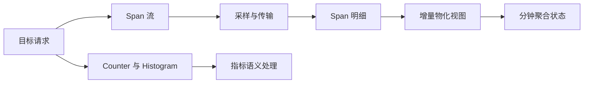

# 06 · 指标与物化视图：算得快之前，先算对

> 本篇问题：怎样把 Span 明细变成分钟级统计，同时避免把重复、采样和分位数误差包装成精确指标？
>
> **验证边界**：本篇只有官方语义核对，所有 SQL 均未执行。DDL 仅面向隔离的 `obs_lab`；先完成 [03 · Schema 设计](/observability/clickhouse/03-schema-and-access-patterns.md)。这里是教学模型，不是 OpenTelemetry exporter 默认表。

## 1. 先给仪表盘上的数字取对名字

一次用户操作可能经过网关、订单、库存三个服务，每个服务还产生内部 Span。
把所有 Span 相加，得到的是观测数量，不是“用户发了多少次请求”。

| 想回答的问题 | 可以采用的输入 | 必须成立的约束 |
| --- | --- | --- |
| 某服务收到多少次调用 | 约定的入口 `SERVER` Span | 每次目标调用恰有一个入口 Span，无丢失、无重复 |
| 全站用户请求量 | 边界明确的入口计数器 | 排除内部重试、健康检查等非目标事件 |
| 请求错误率 | 同一请求集合中的错误数与总数 | 错误定义一致，分子分母覆盖相同集合 |
| 延迟 P99 | 目标请求的延迟分布 | 单位、采样、窗口及聚合方法一致 |

`span_kind = 'SERVER'` 只是本系列的过滤约定，不是请求计数正确性的证明。
服务内部重试、重复埋点、缺失 Span，以及业务错误未标记为 `ERROR`，都会改变解释。
因此，下文把统计量命名为 **observed server spans**，先承认看到了什么，再讨论业务映射。

### 1.1 采样不是一个可随手除掉的系数

- 均匀概率采样也需要已知入样概率、正确计数单位与额外丢失假设，才能讨论估计。
- 按错误或慢请求优先保留的 Tail Sampling，会改变保留集合的错误比例与延迟分布。
- 此时用“保留数量 ÷ 一个平均采样率”反推 QPS，不足以恢复各类请求的真实权重。
- Tail Sampling 也无法恢复上游 Head Sampling 已经丢弃的请求。

若需要用于 SLO 的全量指标，优先使用独立于 Trace 保留决策的请求 Counter 与 Histogram。
也可以从采样前的 Span 流生成指标，但仍要验证入口映射、丢失、重试与重复。
“在采样前”解决的是一个问题，不是给整条链路颁发正确性证书。[1][2]

## 2. 原生 Metrics 与 Span 派生指标是两条不同的路



这幅图不是承诺 Counter 永远完整，而是提醒两种输入需要分别验收。
将 Histogram 写进 ClickHouse，也不能跳过 OTel 的时间语义。[1]

| 数据类型或语义 | 处理要点 | 常见误算 |
| --- | --- | --- |
| Delta Sum | 累加不重叠区间，识别重复点和缺口 | 相同区间重发一次就多算一次 |
| Cumulative Sum | 按同一流、起点与顺序计算增量，识别 reset | 对每次累计快照再求和 |
| Gauge | 按问题取最新值、时间聚合或其它明确规则 | 默认当 Counter 做差分 |
| Histogram | 合并兼容桶的计数、count、sum，并处理 temporality | 把累计直方图快照直接相加 |
| Summary 分位数 | 保留其原始语义与适用范围 | 跨实例平均 P99 |

同一累计流从 100 变为 120，在起点不变且语义连续时，可以解释为新增 20。
若进程重启且起点改变，下一点为 5，不能计算成新增 -115，也不能无条件沿用旧基线。
需要保存流身份、起始时间、结束时间、temporality、单调性及重置判断结果。
乱序、重叠区间和多个 Writer 共享流身份，都必须有明确处理规则。

Histogram 的成本通常随“属性组合数量 × 每条流的桶状态”增长。
把 `trace_id`、用户 ID 或完整 URL 放进指标维度，常会把指标系统变成昂贵的事件库。
删除维度时还应真正再聚合，不能只擦掉标签，让原本不同的流发生身份冲突。
显式桶边界必须兼容或能共同粗化；粗桶不能反推出已经丢失的细粒度分布。

## 3. 为什么保存 State，而不是保存一个 P99

假设第一分钟只有少量请求，第二分钟有大量请求。
两个分钟 P99 的平均值，既没有按完整分布排序，也没有保存各请求的权重。
即使按分钟请求数加权，**加权平均分位数仍不等于总体分位数**。

本篇保存 `quantilesTDigest` 的中间状态，再跨分钟合并。
它保留可合并的分布摘要，而不是保存一个不可继续正确聚合的终值。
TDigest 是近似算法：不能承诺固定误差，也不能声称任何分布下都等同精确分位数。
应在目标版本、数据分布和误差预算下，与明细上的精确统计抽样对照。[3][4]

### 3.1 状态列与函数必须成对出现

| 目标列类型 | 写入表达式 | 读取表达式 |
| --- | --- | --- |
| `AggregateFunction(count)` | `countState()` | `countMerge(span_count)` |
| `AggregateFunction(sum, UInt64)` | `sumState(toUInt64(status_code = 'ERROR'))` | `sumMerge(error_count)` |
| `AggregateFunction(quantilesTDigest(0.5, 0.95, 0.99), Float64)` | 同参数 `quantilesTDigestState` | 同参数 `quantilesTDigestMerge` |

本例选择错误标志求和，避免把 `countIfState` 的状态类型与普通 `count` 混写。
纳秒先除以 `1000000.0` 得到 `Float64` 毫秒，单位转换也属于类型契约。

## 4. 创建一个分钟聚合目标，而不是一组重复表

**以下会创建对象，只能在隔离实验库执行；尚未执行验证。**
前置条件：第 03 篇的 `obs_lab.spans` 已存在，对象名尚未使用。
若对象已存在，先检查 `SHOW CREATE TABLE`，不要用 `IF NOT EXISTS` 掩盖类型差异。

```sql
CREATE TABLE obs_lab.service_minute
(
    tenant_id String,
    service_name LowCardinality(String),
    minute DateTime('UTC'),
    span_count AggregateFunction(count),
    error_count AggregateFunction(sum, UInt64),
    latency_ms AggregateFunction(quantilesTDigest(0.5, 0.95, 0.99), Float64)
)
ENGINE = AggregatingMergeTree
PARTITION BY toDate(minute)
ORDER BY (tenant_id, service_name, minute)
TTL minute + INTERVAL 30 DAY DELETE;

CREATE MATERIALIZED VIEW obs_lab.spans_to_service_minute
TO obs_lab.service_minute
AS SELECT
    tenant_id,
    service_name,
    toDateTime(toStartOfMinute(timestamp), 'UTC') AS minute,
    countState() AS span_count,
    sumState(toUInt64(status_code = 'ERROR')) AS error_count,
    quantilesTDigestState(0.5, 0.95, 0.99)(duration_ns / 1000000.0) AS latency_ms
FROM obs_lab.spans
WHERE span_kind = 'SERVER'
GROUP BY tenant_id, service_name, minute;
```

`GROUP BY` 与目标排序键使用相同维度，避免不同业务分组在后台合并时混到一起。
显式转换 `minute` 为 `DateTime('UTC')`，不依赖时间函数扩展结果类型的设置。
30 天只是教学保留策略，不是容量测算结果；生产应按需求独立决定分区与 TTL。
创建此视图不会自动把之前已经存在的源表数据补入目标。

### 4.1 一次插入究竟触发了什么

增量物化视图对源表的**新插入 block** 执行查询，把结果写入目标表。[5]
同一分钟跨多个 block 插入，就可能暂时得到多行状态。
目标后台合并会继续合并状态，但业务查询不能等待它“碰巧已经合完”。

源表发生后台 merge、mutation、删除或 TTL 清理，不会自动重新计算已写出的聚合。
目标状态的合并，也不是把源表历史重新读一遍。
因此，这个方案适合追加流的预聚合，不是通用的双向同步数据库。

## 5. 跨分钟读取：Merge 才是聚合协议

以下是参数化查询模板。`tenant` 必须来自服务端可信鉴权上下文。
`from`、`to` 为 UTC 分钟边界，应用层检查 `from < to`，采用左闭右开区间。
客户端按其绑定机制传参；不要把用户输入拼接进 SQL。

```sql
SELECT
    tenant_id,
    service_name,
    countMerge(span_count) AS observed_server_spans,
    sumMerge(error_count) AS observed_error_spans,
    observed_error_spans / nullIf(observed_server_spans, 0) AS observed_error_ratio,
    quantilesTDigestMerge(0.5, 0.95, 0.99)(latency_ms) AS latency_quantiles_ms
FROM obs_lab.service_minute
WHERE tenant_id = {tenant:String}
  AND minute >= {from:DateTime('UTC')}
  AND minute < {to:DateTime('UTC')}
GROUP BY tenant_id, service_name
ORDER BY service_name;
```

返回数组依次是 P50、P95、P99。这里再次强调：它们描述当前被保留的入口 Span 集合。
`observed_server_spans / 窗口秒数` 是观测速率，不自动等于业务 QPS。
租户过滤是查询约束，不替代服务端身份校验与数据库权限控制。

- `GROUP BY` 跨分钟合并全部符合条件的状态，不依赖 parts 是否已合并。
- `FINAL` 不能替代 `countMerge`、`sumMerge` 与 `quantilesTDigestMerge`。
- 分钟表无法精确回答从 `10:00:17` 开始的任意秒级窗口；边界部分需要回查明细。
- 没有结果行不一定代表真实零流量，也可能是上报延迟、采样、丢失或查询范围错误。
- 增加新过滤维度前，确认它是否仍保存在目标表；聚合已经丢弃的维度无法现场恢复。

## 6. 重复写入：源表去重不等于指标撤回

假设同一个 `span_id` 被重复写入两次，MV 两次都收到插入贡献。
即使把源表换成 `ReplacingMergeTree`，后续去重也不会向分钟表发送“减掉一次”。
源表查询加 `FINAL`，只能影响那次源表查询，不能回撤另一个表已经累积的状态。[6]

| 策略 | 适用前提 | 代价与边界 |
| --- | --- | --- |
| 进入聚合前完成幂等 | 有稳定事件 ID、重试范围与状态保留策略 | 去重状态成本与迟到窗口需要评估 |
| 使用插入去重能力 | 满足引擎、版本、token、窗口及依赖视图条件 | 不是任意业务事件的永久去重 |
| 对受影响窗口重新计算 | 仍保留可靠明细或可重放事件 | 需要隔离目标和可核对的切换过程 |
| 使用可撤回的专门模型 | 业务能产生严格的修正事件 | 分位数摘要通常不能简单“减掉旧样本” |

不要为了演示效果主动依赖未核对的默认去重设置。
第 10 篇会用改变批次内容的重复事件实验，区分 block 去重与事件幂等。

## 7. 回填不是多执行一次 INSERT SELECT

安全起点是隔离实验中的**停写回填**，不是一段不带边界的线上脚本。

1. 记录版本、源数据范围和期望计数；停止实验 Writer 并等待在途写入结束。
2. 选择新的空目标，保存明确水位；历史输入按稳定规则恰好覆盖一次。
3. 将历史范围按与 MV 相同的类型、过滤条件和分组规则写入新目标。
4. 建立后续增量接管关系，核对边界窗口，再恢复 Writer。
5. 对比明细与聚合的计数、错误数、分布；确认后再切读，保留回滚路径。

在线回填更难：需要证明历史集合与实时集合**不重叠且无空隙**。
`timestamp` 是事件时间，迟到事件会越过已经走完的水位；`ingested_at` 也不是天然唯一、单调且提交完整的事务序号。
可用的水位应来自可验证的提交边界或消息分区 offset，并说明每个分区的完成条件。
双写先开、回填后扫全部会重复；回填先结束、增量后开启则可能漏掉中间写入。
这里不提供声称“通用无损”的线上切换脚本，因为单靠本教学 Schema 还不足以证明它。

### 7.1 两份数据就有两份生命周期

源表和目标表各有独立 TTL，源表过期不会让分钟统计自动扣减。
目标保留更久，可以用较低维度保存长期趋势，但不能恢复已经过期的原始 Span。
源明细过期后若发现历史聚合错误，是否还能修复，取决于是否有归档或可重放来源。
涉及删除请求时，也必须盘点派生数据，不能只删源表便宣告处理完成。

## 8. 验收：先证明语义，再比较速度

- 用已知小数据检查入口过滤、错误分类和纳秒到毫秒的转换。
- 将同一分钟拆成多个 INSERT，检查 `Merge + GROUP BY` 结果是否一致。
- 重复一个事件，确认系统实际如何处理，而不是假设引擎会替业务兜底。
- 以同一租户、同一窗口比较明细统计与分钟统计，并单列迟到和过期数据。
- 对 TDigest 与精确统计记录绝对误差、相对误差及样本规模；不承诺未经验证的误差上界。
- 衡量查询成本时，也记录写入路径增加的计算、状态大小和目标 parts。

当前上述步骤均为**待执行**；完整实验入口见 [10 · 实验与面试](/observability/clickhouse/10-labs-and-interview.md)。

## 9. 面试时可以这样答

**问：为什么不直接聚合所有 Span 得到 QPS？** 计数单位不等于请求，采样、缺失与重复也可能破坏映射。

**问：为什么 P99 不能平均？** 分位数不是可加量；应合并原始分布、兼容直方图或可合并摘要，再计算分位数。

**问：ReplacingMergeTree 能修复 MV 重复计数吗？** 不能自动修复。插入贡献已被处理，后续源表去重不会撤回目标状态。

**问：有了 AggregatingMergeTree，查询还要 Merge 吗？** 要。物理后台合并不是读取协议，查询仍要合并相关状态并得到最终值。

## 参考资料

1. [OpenTelemetry Metrics Data Model](https://opentelemetry.io/docs/specs/otel/metrics/data-model/)：temporality、流身份、reset 与 Histogram；部分细节状态为 Development。
2. [OpenTelemetry Sampling](https://opentelemetry.io/docs/concepts/sampling/)：Head/Tail 决策与策略；采样偏差分析是基于机制的统计推论。
3. [Aggregate function combinators](https://clickhouse.com/docs/sql-reference/aggregate-functions/combinators)：`State` 与 `Merge`。
4. [quantileTDigest](https://clickhouse.com/docs/sql-reference/aggregate-functions/reference/quantiletdigest)：近似分位数与算法边界。
5. [Incremental materialized view](https://clickhouse.com/docs/materialized-view/incremental-materialized-view) 与 [AggregatingMergeTree](https://clickhouse.com/docs/engines/table-engines/mergetree-family/aggregatingmergetree)：插入触发与状态合并。
6. [ReplacingMergeTree](https://clickhouse.com/docs/engines/table-engines/mergetree-family/replacingmergetree)：排序键、合并与查询去重边界。

官方页面为滚动文档；目标版本能力与 SQL 兼容性仍需隔离验证。本文没有数据库实测结论。

---

[上一篇：05 · Trace 与日志查询](/observability/clickhouse/05-trace-and-log-queries.md) · [返回系列](/observability/clickhouse/README.md) · [下一篇：07 · 索引与查询调优](/observability/clickhouse/07-indexes-and-query-tuning.md)
