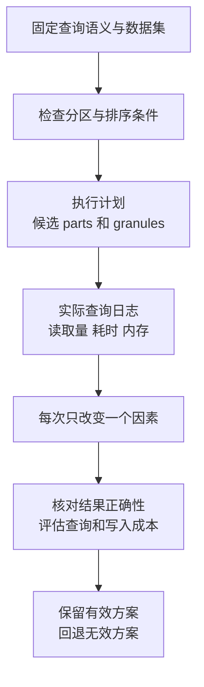

# 07 · 查询调优：先证明读多了，再决定加什么索引

> 给 TraceId 加了 Bloom 索引，查询却没有明显变化。
> 一个可能的原因是：索引确实工作了，只是每个候选块都无法被排除。

**证据边界**：本文为基于官方资料的调优方法，不是压测结论。调研日期为 2026-11-27；全部 SQL 未在 ClickHouse 运行，未创建索引或投影。复用[第 03 篇](/observability/clickhouse/03-schema-and-access-patterns.md)的 `obs_lab.spans`，实际收益和版本兼容性待验证。

## 一、慢查询有不同的“慢法”

不要看到慢查询就直接加索引。先把用户等待时间拆成问题，再选择证据。

| 现象 | 首先检查 | 可能的下一步 |
|------|----------|--------------|
| 读行很多、返回很少 | 时间窗、排序前缀、索引裁剪 | 调整访问路径或排序候选 |
| 读行相近、读字节很大 | 宽属性、读取列、PREWHERE | 减少字段、延迟读取宽列 |
| 读量不大、内存很高 | 高基数聚合、排序、JOIN | 限制维度、调整查询语义 |
| 同一 SQL 尾延迟波动 | 并发、缓存、合并、磁盘与网络 | 关联运行环境，不只看平均值 |
| TraceId 单点回查慢 | 主表是否缺少匹配访问路径 | 辅助时间边界、另一种排序或投影 |

`LIMIT` 控制结果数量，通常不意味着最多扫描相同行数。
`SELECT *`、跨月搜索和任意属性组合查询叠加时，很难靠一个局部索引挽救成本。



## 二、第一层优化：把本来不该读的范围写清楚

本系列排序先按租户、服务，再按小时桶和 TraceId 组织。
因此，服务查询首先保留可信租户、服务和精确时间范围；还可以补充覆盖精确窗口的小时条件。

下面是计划检查示例，**附带设置按官方文档面向 25.9 及以后版本**；旧版本先确认设置是否存在，不直接照抄。

```sql
EXPLAIN indexes = 1
SELECT timestamp, trace_id, span_id, duration_ns
FROM obs_lab.spans
WHERE tenant_id = {tenant:String}
  AND service_name = {service:String}
  AND timestamp >= {from:DateTime64(9, 'UTC')}
  AND timestamp < {to:DateTime64(9, 'UTC')}
  AND toStartOfHour(timestamp) >= toStartOfHour({from:DateTime64(9, 'UTC')})
  AND toStartOfHour(timestamp) <= toStartOfHour({to:DateTime64(9, 'UTC')})
  AND status_code = 'ERROR'
SETTINGS use_query_condition_cache = 0, use_skip_indexes_on_data_read = 0;
```

两个小时条件是保守覆盖，可能包含精确上界所在的小时；最后仍由半开时间谓词过滤。
不要为了“让索引用上”而删除精确时间条件，或把单 Trace 的跨服务检索偷偷改成单服务检索。

### 2.1 怎样读 `EXPLAIN indexes = 1`

官方文档中的 `Parts`、`Granules` 比例表示该阶段**保留数量 / 应用该索引前数量**，不是已排除数量。[S1]
不同阶段会逐步缩小集合；读计划时要看当前分母对应哪个阶段，不能随意拿两行比例相减。

这些信息是计划阶段的索引筛选，不是查询实际执行耗时、物理 I/O 或最终读取字节。
`EXPLAIN` 显示很强的裁剪，只能说明值得继续验证，不能写成“已经获得某倍性能提升”。

当前文档还说明，25.9 起若要获得有意义的索引展示，应关闭查询条件缓存和读取时跳数索引这两个相关设置。[S1]
上例为解释计划使用该配置，不是在建议生产永久关闭优化；不同版本的计划输出与设置必须单独核对。

## 三、PREWHERE：先读筛选列，不是让 I/O 消失

假设错误 Span 很少，而 `attributes` 很宽。先读取状态列过滤，再读取保留下来的数据所需属性，可能比一开始就读取宽列更合理。[S2]

```sql
SELECT timestamp, trace_id, span_id, attributes
FROM obs_lab.spans
PREWHERE status_code = 'ERROR'
WHERE tenant_id = {tenant:String}
  AND service_name = {service:String}
  AND timestamp >= {from:DateTime64(9, 'UTC')}
  AND timestamp < {to:DateTime64(9, 'UTC')}
  AND toStartOfHour(timestamp) >= toStartOfHour({from:DateTime64(9, 'UTC')})
  AND toStartOfHour(timestamp) <= toStartOfHour({to:DateTime64(9, 'UTC')})
LIMIT 100;
```

这是便于解释的显式 PREWHERE 示例，不承诺比优化器自动安排更快；无排序的 `LIMIT 100` 也不是“最新一百条”。
默认开启的 `optimize_move_to_prewhere` 会自动把部分 `WHERE` 条件迁入 PREWHERE，不必机械地手写每个条件。[S2]

注意三个边界：

- 过滤列本身仍然要读；宽属性最终命中多时，后续读取量未必明显下降。
- 过滤后仍有匹配行的 granule，相关列数据仍可能需要加载，不是只产生最终行大小的物理 I/O。
- 扫描行数可能不变而读取字节减少；只看 `read_rows` 会遗漏这类变化。

测试自动优化时，可以对同一个仅写 `WHERE` 的查询比较相关设置，保持其他条件相同。
关闭自动迁移并不会禁用 SQL 中显式写出的 PREWHERE；用显式示例做这个开关对比，会混淆实验变量。

## 四、跳数索引：关键是块内分布，不只是全表基数

跳数索引为若干 granule 保存摘要，判断某一块“不可能有答案”时跳过它。
它不是倒排索引的通用替身，也不是一条值直接映射到唯一行地址的结构。[S3]

| 类型 | 可以评估的分布与条件 | 典型失效方式 |
|------|----------------------|--------------|
| `minmax` | 块内值域较窄，范围条件能排除块 | 各块都覆盖几乎相同的宽值域 |
| `set(N)` | 每块不同值不多，适合成员判断 | 块内不同值超过 N，该块集合失效 |
| `bloom_filter` | 等值或 IN，目标值只可能在少量块中 | 目标值遍布各块，或误报使候选过多 |

例如 `status_code` 全表只出现少数值，不代表 `set(N)` 一定有效。
若每个块都同时有 `OK`、`ERROR`，查询错误时所有块都可能命中，索引只能告诉你“继续读”。
反过来，某属性全表基数很高，但排序让块内只出现少数值，局部集合索引仍可能值得实验。

Bloom Filter 的成员判断允许假阳性：不存在的值可能被判为“可能存在”，造成多读。
正常构建和使用时，它不会把存在的值误判为不存在；这种特性不能随意套用到否定条件。[S3]

### 4.1 为 TraceId 添加索引前，先问四件事

1. 查询是否先约束租户与时间，避免候选分区过多？
2. 一个目标 TraceId 实际分布在多少索引块中？
3. 索引表达式与真实过滤表达式是否匹配，目标版本是否支持？
4. 省下的读取成本是否覆盖索引存储、写入计算和后台维护成本？

索引 `GRANULARITY` 表示一个索引块覆盖多少个存储 granule，不是固定多少行。
存储 granule 又受自适应粒度影响，因此不能把它恒定换算成某个行数。

仅添加索引定义，不等于已有部件全部拥有该索引；历史数据通常需要显式物化。[S3]
本次不提供生产变更命令。实验应在独立候选表进行，分别记录历史构建资源、新写入代价和查询收益。

## 五、Projection：换一种布局，也要付另一份账

投影允许在原表附属结构中保存另一种排序或预聚合结果，查询仍面向原表，由优化器选择适合的路径。[S4]
“自动选择”不等于“一定选择”，表达式匹配、可用字段、部件覆盖及版本行为都影响使用结果。

| 方案 | 适合回答的问题 | 成本与边界 |
|------|----------------|------------|
| 重排并存储所需列 | 能否让 TraceId 检索拥有不同排序前缀？ | 额外数据、写入及合并维护 |
| `_part_offset` 轻量方式 | 能否只存排序键和到原表的偏移？ | 少复制列，但仍需回到原表读取 |
| 聚合投影 | 能否使用预计算分组结果？ | 分组基数、聚合语义、优化器匹配 |
| 独立辅助表与物化视图 | 是否需要显式访问路径和独立生命周期？ | 应用选择、数据同步与保留治理 |

**版本不能一笔带过**：官方文档注明 `_part_offset` 方式自 25.5 引入；同一查询利用多个投影主索引联合剪枝自 25.6 引入。[S4]
后者不等于把多个投影的业务列拼起来读取；页面描述的该联合剪枝机制为 part 级，最终从一个投影或原表读取。
这些是已查文档的版本条件，不是对所有部署分支或未来实现的保证。

添加投影定义与为历史数据物化投影是两件事。
历史构建不是纯元数据操作，必须评估磁盘余量、CPU、I/O 和执行窗口；已有表上的更新、删除等兼容限制也应按目标版本核查。

计划可检查投影是否被分析、用于裁剪或选择读取；`system.query_log` 还提供 `projections` 信息用于执行后核查。[S4][S5]
不要只因名称出现在计划中，就宣布业务查询已经从该投影读取并获得收益。

## 六、用 query_log 做运行证据，先把统计口径固定

下面查询只用于授权运维在隔离环境检查指定实验查询，不是租户业务 API。
系统日志没有本系列的 `tenant_id` 列，不能通过随意拼接租户过滤来假装实现隔离；也不向普通用户暴露原始 SQL。

```sql
SELECT
    event_time, query_id, query_duration_ms,
    read_rows, read_bytes, memory_usage, result_rows
FROM system.query_log
WHERE type = 'QueryFinish'
  AND is_initial_query = 1
  AND query_id = {test_query_id:String}
  AND event_time >= {log_from:DateTime}
  AND event_time < {log_to:DateTime}
ORDER BY event_time DESC
LIMIT 20;
```

`test_query_id` 应由测试调用显式分配并记录，避免靠 SQL 文本模糊匹配误收其他查询。
日志异步写入，查询结束后可能不会立即出现；日志配置关闭、采样或过滤也会影响记录完整性。[S5]

| 字段或口径 | 正确解读 | 不应该推导的结论 |
|------------|----------|------------------|
| `query_duration_ms` | 成功查询在服务端记录的执行时长 | 等于客户端完整端到端延迟 |
| `read_rows`、`read_bytes` | 查询读取量，初始分布式查询含远端累计 | 可再加一遍远端子查询读取量 |
| `memory_usage` | 该日志记录的内存指标 | 全集群同时峰值内存 |
| `QueryFinish` | 成功完成事件 | 覆盖失败查询和超时体验 |
| `is_initial_query = 1` | 顶层查询口径 | 自动代表全部业务请求且没有内部任务 |

`system.query_log` 是节点本地日志。单节点查询不等于全集群观测；跨节点收集时必须带上节点身份和查询链标识。[S5]
初始分布式查询已经汇总远端的读取量，再把同一 `initial_query_id` 下所有子查询读取量相加会重复计算。
需要定位慢分片时可以看子查询，但这是另一种诊断口径，不能混入顶层业务读量统计。

`read_bytes` 也不能单独当作物理磁盘读量；缓存和读取路径需要结合相关 ProfileEvents 与系统指标解释。
同时查看错误事件与客户端超时，否则只统计成功查询会遗漏最差体验。

## 七、实验记录应该长什么样

每个候选方案至少保存以下信息，而不是只保留一张“更快了”的截图：

- **输入**：目标版本、DDL、脱敏数据集、数据分布、部件状态、参数与查询 ID。
- **对照**：基线与候选的唯一差异，冷热缓存条件、并发和后台合并情况。
- **正确性**：结果集合、重复语义、时间精度与租户边界是否一致。
- **读取**：计划候选范围、实际行数与字节、选中的投影或索引路径。
- **成本**：多次查询的耗时分布、内存、磁盘增长、写入与历史物化资源。
- **结论**：适用查询、退化场景、是否保留方案以及回退条件。

先解释差异，再决定推广。只在安静的小数据集上胜出的配置，不自动适合持续写入和高并发环境。
目前没有这些实测记录；本篇提供的是可复核的方法，实验组织见第 10 篇。

## 八、面试追问

### Q1：Bloom Filter 没有漏判，为什么还会慢？

没有漏判只保证不会因为成员测试而错误排除真实结果，不保证能排除很多块。
目标分布、误报、候选块数量和索引维护成本都影响收益；它不是按 TraceId 的唯一行定位。

### Q2：PREWHERE 和主键索引是不是在做同一件事？

不是。主键索引先缩小排序范围，PREWHERE 在候选数据上优先读取过滤列，再决定后续列读取。
二者可以协作，但 PREWHERE 不会让过滤列读取、压缩块或保留粒度的成本消失。

### Q3：EXPLAIN 显示裁剪很好，能否证明生产更快？

不能。计划不是运行，生产还有缓存、并发、合并、网络和数据分布变化。
需要查询日志与客户端观测，按初始查询和节点口径正确归因，同时确认结果没有因错误过滤而变少。

## 来源与适用范围

- [S1] [EXPLAIN](https://clickhouse.com/docs/sql-reference/statements/explain)：索引与投影计划、版本相关设置。
- [S2] [PREWHERE optimization](https://clickhouse.com/docs/optimize/prewhere)：分阶段读取及自动条件迁移。
- [S3] [Data skipping indexes](https://clickhouse.com/docs/optimize/skipping-indexes)：局部分布、索引粒度与物化。
- [S4] [Projections](https://clickhouse.com/docs/data-modeling/projections)：替代布局、`_part_offset`、多投影剪枝及成本。
- [S5] [system.query_log](https://clickhouse.com/docs/operations/system-tables/query_log)：字段、日志本地性与分布式累计口径。

所有来源为滚动官方文档；未执行 SQL、性能测试或历史索引/投影构建。参数必须绑定，租户必须从鉴权获得；调优不能以放松隔离或改变查询语义为代价。

**上一篇**：[06 · 指标与物化视图](/observability/clickhouse/06-metrics-and-materialized-views.md) · **下一篇**：[08 · 集群与可靠性](/observability/clickhouse/08-clusters-and-reliability.md)
