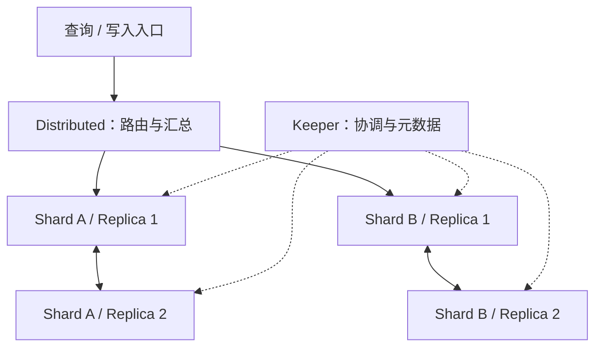
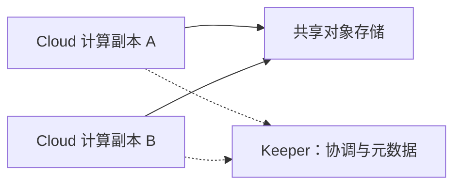

# 08 · 集群与可靠性：分片、副本和确认不是一回事

> 本篇先讨论自建 ClickHouse 的经典架构，再对照 ClickHouse Cloud 的 SharedMergeTree。
> 拓扑是教学设计，未部署集群、执行扩容迁移、测试 quorum 或注入故障。

## 1. 业务困境：节点增加了，为什么可靠性没有同步增加？

设想一个多租户追踪系统：大租户产生多数 Span，小租户希望故障时仍能查询。
团队部署更多节点后，可能仍然遇到三个不同问题：

- 大租户集中在一个分片，其他机器空闲，热点节点持续积压。
- 写入成功后切换查询副本，短时间看不到刚写入的数据。
- 某分片不可用时，查询返回了“正常格式”的不完整统计。

这三件事分别涉及**负载分布、复制可见性、结果完整性**，不能通过同一个“副本数”解决。
讨论架构前，应先写出故障目标：允许丢失多长时间的数据，允许停服多久，允许怎样的降级结果。
RPO 描述可接受的数据恢复点损失，RTO 描述可接受的服务恢复时长；它们需要演练证据而非口头承诺。

## 2. 经典自建架构的四种角色

图中的副本间箭头表示复制关系，不表示任意写入都会等待两个副本完成。
入口节点也未必是独立机器；图示强调逻辑职责，不规定部署数量。

| 名词 | 回答的问题 | 不负责什么 |
| --- | --- | --- |
| Shard，分片 | 数据集合如何分摊到不同组 | 不自动给同一份数据增加冗余 |
| Replica，副本 | 同一分片的数据如何冗余与提供读取能力 | 不等于增加一份新的逻辑数据分片 |
| `Distributed` | 如何路由写入、并行读取及汇总结果 | 不维护最终的业务数据副本 |
| Keeper | 如何协调复制、元数据及相关一致性状态 | 不存储业务数据块，不转发查询结果 |

副本复制以表为单位，而不是复制整个服务器的一切状态。
同机上的复制表、普通表、配置文件与账号管理，不应被假设拥有完全相同的传播机制。
表引擎的复制也不同于 `ON CLUSTER` 等分布式 DDL 机制。

## 3. Distributed：逻辑表后面还有真实的传输路径

### 3.1 查询并不是无成本的透明代理

`Distributed` 将读取发给远端表并汇总结果，远端仍然利用本地表的排序与索引。
默认情况下会访问多个分片，通常每个分片选择一个副本参与读取。
发起节点还要承担结果归并、网络和部分聚合工作。

因此“本地 SQL 很快，分布式 SQL 很慢”需要分别检查：

- 分片上是否扫描了过多数据。
- 少数慢分片是否拖延整体结束时间。
- 中间结果是否过大，导致网络和协调节点成为瓶颈。
- 查询是否本可以通过分片键条件裁剪，却未满足优化条件。

配置 `sharding_key` 不意味着每条查询都自动只访问一个分片。
是否使用 `optimize_skip_unused_shards`、谓词是否可推导、数据是否按当前规则写入，都需要验证。

### 3.2 “不存数据”不等于“不占磁盘”

`Distributed` 不保存最终业务表数据，但后台发送路径可能在入口节点保存待发送文件。
这是一份传输队列，不是已经进入目标分片且可查询的数据。

| 写入路径 | 需要区分的确认点 |
| --- | --- |
| 后台发送 | 入口节点接受并排队，不代表目标分片已经落表 |
| 前台发送 | 等待本次远端写入，不等于所有复制副本追平 |
| 目标表异步写入 | 还要核对 `async_insert` 与 `wait_for_async_insert` |
| 复制确认 | 再核对 `insert_quorum` 等目标表设置 |

`distributed_foreground_insert` 改变前后台发送行为，不提供跨分片事务原子性。
部分目标已写入、其他目标失败时，客户端仍可能收到错误；后续重试必须考虑重复。
入口队列的 `fsync_after_insert`、`fsync_directories` 与远端数据文件的确认不是同一层语义。
不能把“本地队列更耐故障”写成“全部分片和副本持久化完成”。

### 3.3 `internal_replication=true` 不是复制开关

这是集群配置中的分片属性，不是给普通表补上复制能力的魔法参数。

- 为 `true`：Distributed 向该分片的一个健康副本写入，由底层复制表负责扩散。
- 为 `false`：Distributed 分别投递到各副本，但这不等同于复制引擎的一致性管理。
- 若底层只是独立 `MergeTree`，却采用只写一个副本的路径，就不能假设其他副本拥有相同数据。

选型时先确认本地表引擎，再配置路由；不要反过来从集群配置名称猜测表的能力。

## 4. ReplicatedMergeTree：可用性、冗余和新鲜度的取舍

### 4.1 默认复制是异步的

经典复制表允许向可写副本写入，由副本间复制补齐数据。
默认确认不代表所有副本已经收到，因此故障切换可能同时暴露“可读”与“最新”之间的差距。

`insert_quorum` 可以要求更多副本确认，以提高确认时的数据冗余保障。
代价是写入需要满足更多参与者的条件，故障或网络延迟可能降低写入可用性、增加等待。

但 quorum 也不等于：

- 所有副本已经同步。
- 任意副本随后的读都立即包含这次写入。
- 所有存储层已经完成相同级别的持久化。
- 一次多分片写入拥有原子提交语义。

应把写入确认、副本选择与一致性读取要求一起验证，而不是只改一个设置。

### 4.2 Keeper 是协调依赖，不是业务数据仓库

Keeper 保存协调所需的状态和元数据，数据块保存在 ClickHouse 数据存储中。
数据复制由 ClickHouse 节点完成，不需要把所有 Span 先写进 Keeper。

Keeper 不可用时，已有本地数据的普通读取不必因此全部中断，但写入和复制协调会受影响。
因此需要分别观测 Keeper 会话状态、复制表只读状态和已有数据查询能力。
给 Keeper 增加资源，不能替代对数据节点磁盘、merge 或网络瓶颈的处理。

### 4.3 副本布局应跨故障域

这是部署设计建议：如果所有副本依赖同一主机、同一机架或同一故障域，冗余效果会被共同故障削弱。
副本布局还需考虑跨域网络时延与费用，不能单纯追求地理距离。
故障域和确认策略应与 RPO/RTO 对齐，并通过实际恢复演练校准。

## 5. 分片键选型：Trace 聚集还是租户隔离？

假设教学表仍为 `obs_lab.spans`，字段定义沿用[第 03 篇](/observability/clickhouse/03-schema-and-access-patterns.md)。
下表是候选设计的推演，不代表已经测得均衡性或查询性能。

| 候选路由 | 可能收益 | 主要代价 |
| --- | --- | --- |
| `hash(trace_id)` | 同一 Trace 容易聚集；Trace 较多时有利于分散写入 | 单租户服务统计通常跨分片；极大 Trace 仍可能集中 |
| `hash(tenant_id, trace_id)` | 同租户同 Trace 聚集，租户内 Trace 分散 | 租户统计仍跨分片，路由必须统一 |
| `hash(tenant_id)` | 单租户查询有机会只访问一个分片 | 大租户容易形成单分片热点 |
| 租户分组加热点拆分 | 可为大租户提供独立容量与迁移策略 | 路由目录、回放与查询规划更复杂 |

这里的 `hash(...)` 表示设计意图，不是一份可直接复制的 DDL。
实际表达式必须返回引擎接受的类型，且所有写入方对编码、空值和字段规范化保持一致。
租户边界还必须由鉴权控制；分片聚集不是安全隔离机制。

### 5.1 为什么扩容后同一个 Trace 可能不再聚集？

增加分片或改变权重不会自动把历史数据按新规则重分布。
如果路由函数依赖当前分片集合，同一键的新数据与旧数据就可能落在不同位置。

扩容方案至少要明确：

1. 历史数据是否搬迁；不搬迁时查询是否覆盖新旧位置。
2. 回放流量使用哪个路由版本，是否会制造重复。
3. 迁移期间能否使用分片裁剪，如何避免漏查。
4. 新旧数据如何对账，何时结束兼容期。

“增加节点”只是基础设施动作，不是完整的数据迁移方案。

## 6. 查询降级：失败可以看见，不完整也必须看见

`skip_unavailable_shards` 允许某些不可用分片被跳过，可能返回不完整结果。
可跳过的错误范围具有设置和版本差异，不能把它当作“忽略所有错误”的开关。

对探索性排障，业务可能接受“部分数据仍可看”；对计费、SLO 或完整 Trace 判断，静默缺片通常不可接受。
建议在产品层定义两种明确模式：

| 模式 | 行为设计 | 必须展示的信息 |
| --- | --- | --- |
| 完整性优先 | 不能获得完整范围则失败或显式拒绝结果 | 查询失败原因、缺失范围 |
| 可用性优先 | 允许经过授权的部分结果 | 降级标识、可确认的覆盖范围与时间 |

不要在查询层开启跳过分片后，仍对用户展示一个没有任何标识的“全局请求量”。
数据库不会替应用自动补齐完整的覆盖率说明；无法确认时应写“完整性未知”。

## 7. Cloud 对照：不要把经典副本公式照搬过去

ClickHouse Cloud 的 SharedMergeTree 使用共享对象存储，并通过 Keeper 管理协调和元数据。
它不是简单的“每个计算副本各存一份完整本地数据”。

增加计算副本不等于对象存储中的完整业务数据必然同比复制一份。
不过缓存、计算、元数据和对象存储自身冗余仍有成本；“共享”不代表数据只有一个物理副本。
经典 `ReplicatedMergeTree` 也可使用对象存储，因此两种架构的区别不仅是本地盘与远端盘。

Cloud 的建表转换、扩缩容、可用性和备份策略应以对应服务文档为准。
不要把自建的 Keeper 路径、副本名、磁盘卷配置直接搬进 Cloud 教程。
共享存储也不自动消除跨副本元数据可见性的时间差；一致性需求仍须验证。

## 8. 验证：用故障矩阵检查边界

所有演练仅限隔离集群，先保存版本、拓扑、表定义和生效设置，再安排故障与恢复。

| 故障或变更 | 观察对象 | 要回答的问题 |
| --- | --- | --- |
| 一个数据副本不可用 | 写入结果、选副本、复制积压 | 服务是否继续？最近确认数据是否完整？ |
| Keeper 不可达 | 会话、只读状态、写入与读取 | 哪些功能失效？恢复后如何追平？ |
| 一个分片不可用 | 错误和查询覆盖范围 | 完整模式与降级模式能否被用户区分？ |
| 写入响应丢失 | 客户端重试与目标行数 | 是否重复？去重是否处于有效窗口？ |
| 扩容改变路由 | 新旧位置、Trace 完整性 | 历史数据是否仍能完整查询？ |
| 从备份恢复 | 数据、Schema、权限与业务查询 | 恢复点与恢复耗时是否满足目标？ |

不以“进程起来了”作为恢复完成标准，应验证数据范围、业务查询和积压追赶。

## 9. 常见问答：副本为什么不是备份？

**问：已经有两个副本，还需要备份吗？**
答：需要。误删和错误变更可能传播到所有副本；备份用于找回事故前的状态。

**问：备份显示成功就可以了吗？**
答：不够。要在独立目标恢复，验证数据、权限、依赖和耗时；备份位置与删除权限也应隔离。

**问：能给一组通用 quorum 和超时吗？**
答：本文没有部署和延迟证据，不能给出通用值；应根据故障目标、网络和负载测试决定。

## 10. 官方来源与继续阅读

- [Distributed table engine](https://clickhouse.com/docs/engines/table-engines/special/distributed)：路由、后台队列与分片属性。
- [Replicated table engines](https://clickhouse.com/docs/engines/table-engines/mergetree-family/replication)：复制、Keeper、去重与确认。
- [SharedMergeTree](https://clickhouse.com/docs/cloud/reference/shared-merge-tree)：Cloud 共享存储与元数据架构。
- [Backup and restore](https://clickhouse.com/docs/operations/backup)：备份用途与恢复演练。

官方文档为滚动版本，本篇不承诺所有部署方式具有相同默认设置和能力。
上一篇：[07 · 索引与查询调优](/observability/clickhouse/07-indexes-and-query-tuning.md) · 下一篇：[09 · 保留、成本与运维](/observability/clickhouse/09-retention-cost-and-operations.md)
