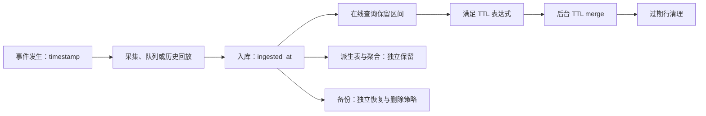
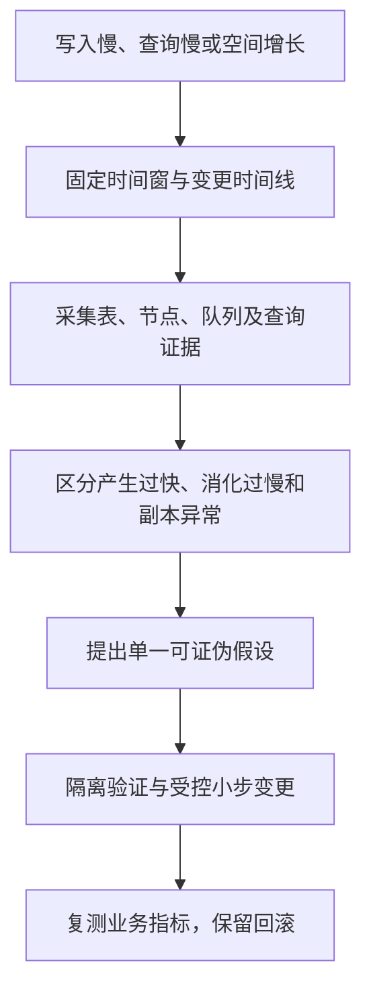

# 09 · 保留、成本与运维：让数据生命周期可以解释

> TTL、容量和故障处理必须共享同一套数据边界。本篇没有生产测量值，也没有执行清理、改配置或恢复命令。
> 下面的 SQL 仅供有权限的运维人员在隔离环境验证；系统表可能暴露全表统计，不是租户查询接口。

## 1. 业务困境：明明只留七天，磁盘为什么还在涨？

“七天保留”可能指事件发生后七天，也可能指接入后七天。
它还没有回答：迟到数据怎么算，TTL 多久清理，副本算几份，物化视图和备份是否另行保留。

一次容量超预期，可能来自不同机制：

- 流量或单条事件属性变大，原来的容量假设失效。
- 历史回放覆盖更多分区，产生更多小 part。
- merge、mutation 或复制积压，旧 part 和临时工作空间占用持续存在。
- 明细表已清理，但派生表、日志或备份继续增长。

因此不能看到磁盘增长就立即缩短 TTL，也不能看到 part 多就立即强制合并。
先定义数据生命周期，再建立测量口径，最后才决定治理动作。

## 2. 从事件到删除：不是一只统一的时钟



本系列使用 `timestamp` 表示事件时间，`ingested_at` 表示教学表接入时间。
定义以[第 03 篇](/observability/clickhouse/03-schema-and-access-patterns.md)为准；不要另造一个未定义的 `event_time` 列写进 `obs_lab` 业务表查询。这里只约束本系列教学表；`system.query_log` 的 `event_time` 是系统表自带列，在查询日志时按系统表定义使用。

### 2.1 事件时间与入库时间的取舍

| 保留依据 | 适合的业务表述 | 迟到或回放的后果 |
| --- | --- | --- |
| `timestamp` | 只保存最近一段事件历史 | 迟到数据剩余保留期更短，过期回放可能很快被清理 |
| `ingested_at` | 接入后保留一个完整调查窗口 | 很老的历史事件仍会占用新的完整窗口 |
| 分层策略 | 明细短留、聚合长留 | 每张表都要定义独立口径与删除策略 |

例如保留期为七天，一条六天前的事件今天接入：按事件时间只剩约一天，按入库时间仍有七天。
这只是时间定义推演，不是 TTL 调度完成时限。
如果 Writer 保留原始接入时间或回放时重新赋值，还会改变 `ingested_at` 的含义，必须事先约定。

### 2.2 TTL 到期不是立即删除

ClickHouse 的 TTL 删除在后台 merge 中执行，不是到期时逐行触发一个实时删除定时器。
`merge_with_ttl_timeout` 约束重复 TTL merge 的最小间隔，不是完成删除的严格上界。
磁盘空间、后台任务和资源争用会影响处理进展，因此应观测实际过期数据与任务状态。

表级删除 TTL、列级 TTL 与移动 TTL 也不是同一动作：

- 表级删除 TTL 清理过期行。
- 列级 TTL 用列类型的默认值替换过期值，不等于删除整行。
- 移动 TTL 改变存储位置，不会因为变冷就自动删除数据。

不要把 `OPTIMIZE TABLE ... FINAL` 设成日常兜底定时任务。
官方说明它可以强制合并，但频繁执行可能造成额外资源压力；先查清后台为何未达到目标。

### 2.3 冷热分层要先确认部署方式

自建环境可通过已配置的磁盘、卷和存储策略设计 `TO DISK`、`TO VOLUME` 迁移。
必须先验证目标资源、访问权限、成本和读取延迟，不能只写一条 TTL 就假设冷存储已存在。

官方 TTL 文档中的手动磁盘与卷迁移步骤不适用于 ClickHouse Cloud。
Cloud 的共享对象存储、缓存和服务能力，应按对应产品文档设计，不照搬自建存储 XML。
即使使用对象存储，也要分别核算容量、请求、网络和计算成本，而非只比较每 GB 单价。

## 3. 容量估算：先讲单位，再讲倍数

对于经典独立数据副本的自建部署，可以从下列估算开始：

\[
S_{base} \approx R \times B_u \times 86400 \times D \div C \times N
\]

| 符号 | 定义 | 获取方式 |
| --- | --- | --- |
| \(R\) | 实际保留的事件数/秒 | 区分接收、采样后和成功落表流量 |
| \(B_u\) | 每条事件在表中未压缩的数据字节 | 代表性数据的表统计，不直接用 OTLP 包大小 |
| \(D\) | 保留天数 | 与实际 TTL 时间字段和流量分布一致 |
| \(C\) | 未压缩字节 / 压缩字节 | 对代表性 part 的字节先求和再相除 |
| \(N\) | 独立完整数据副本数量 | 仅适用于对应自建部署模型 |

上式只估算压缩数据主体；marks、索引、投影、派生表、日志、备份、非活跃 part 和合并工作空间需单列。增长、突发与回放余量须测量，本文不提供统一百分比。

流量和事件大小有波动时应分段求和。压缩比受 Schema、排序、属性分布和 part 状态影响，不能借用宣传案例的固定倍数。

Cloud SharedMergeTree 共享持久化数据，计算副本数不能直接代入 \(N\)；应按实际计费项拆解，不能认定扩计算副本就同比增加完整业务存储。

## 4. 测量实例：从 system.parts 得到可解释的口径

以下只读示例限定 `obs_lab.spans`，区分活动与非活动 part；它是当前节点视图，跨节点统计必须明确架构，避免重复汇总同一逻辑数据。

```sql
SELECT
    partition,
    active,
    count() AS part_count,
    sum(rows) AS part_rows,
    sum(bytes_on_disk) AS part_file_bytes,
    sum(data_compressed_bytes) AS compressed_bytes,
    sum(data_uncompressed_bytes) AS uncompressed_bytes,
    round(
        sum(data_uncompressed_bytes)
        / nullIf(sum(data_compressed_bytes), 0),
        2
    ) AS compression_factor
FROM system.parts
WHERE database = 'obs_lab'
  AND table = 'spans'
GROUP BY partition, active
ORDER BY partition DESC, active DESC
LIMIT 100;
```

解释结果前先确认四个限制：

1. `active=1` 表示当前使用的 part；`active=0` 可能仍在等待删除并占用空间。
2. `bytes_on_disk` 含 part 的辅助文件，压缩与未压缩数据字段不含这些辅助开销。
3. `rows` 是 part 统计，在存在删除掩码等机制时不应直接当作逻辑可见行数。
4. `LIMIT` 限制输出条目，不证明底层只扫描了对应数量的元数据。

纯数据压缩倍数采用“先汇总再相除”，不能把每个大小悬殊的 part 的压缩倍数直接平均。
零分母和小样本也要处理；压缩倍数并不必然大于一。
该查询不是磁盘文件系统使用量的完整替代，更不是恢复后数据完整性的校验。

## 5. 排障路径：先保存证据，再改变设置



### 5.1 系统表分别回答什么问题？

| 证据 | 观察重点 | 常见误读 |
| --- | --- | --- |
| `system.parts` | 分区、活动状态、数量与大小分布 | 把 part 数当作事件数，或忽略非活动空间 |
| `system.merges` | 当前任务、耗时、进度、是否 mutation | 没有正在合并就认为不存在积压或调度问题 |
| `system.mutations` | `is_done`、`parts_to_do`、最近失败信息 | `parts_to_do=0` 就断言全部完成 |
| `system.replicas` | 只读、会话、队列、复制延迟 | 队列非零就认定故障；把复制延迟当可见延迟 |
| `system.replication_queue` | 任务类型、重试、异常及推迟原因 | 把最近错误当作当前永久失败 |
| `system.query_log` | 耗时、扫描、内存口径、终态与异常 | 将日志行数当查询数，或把读取字节当物理磁盘 I/O |

`system.replicas` 与 `system.replication_queue` 主要用于经典复制表，不是所有引擎的通用健康视图。
其他系统表的集群覆盖方式也有差异，应按目标引擎和版本逐项确认，不能机械地全部套用跨节点函数。

`system.merges` 是正在执行的任务视图，不是完整历史或待调度队列。
复制表的 mutation 即使 `parts_to_do=0`，也可能等待尚未结束的 INSERT 产生需要处理的 part。
最近失败字段应结合当前状态与时间线解释，避免重复处理已经恢复的问题。

### 5.2 query_log：既是证据，也是敏感资产

统计成功查询应关注 `QueryFinish`；分析失败还要包含相应异常终态，避免把开始事件重复计数。
分布式查询可通过 `query_id`、`initial_query_id` 关联，但不能把已汇总的初始查询统计再与子查询简单相加。

日志有刷新延迟，也可能受关闭或采样设置影响；“刚查不到日志”不能直接证明没有执行。
`read_rows` 和 `read_bytes` 是逻辑读取统计，不等于物理磁盘读；内存字段的聚合与计量口径应按版本核对。
SQL 文本、异常、用户和客户端信息可能含敏感内容，因此查询日志需要单独的权限、脱敏与保留政策。

### 5.3 从症状到假设，而不是从症状到参数

| 症状 | 优先核实的假设 | 变更前的对照证据 |
| --- | --- | --- |
| 小 part 持续增加 | 小批量、高并发、分区扇出过大 | 每批字节与分区数、part 生成与合并趋势 |
| merge 消化不及产生 | CPU、I/O、空间或任务争用 | 资源趋势、任务持续时间和失败原因 |
| mutation 长期未完成 | 任务失败或相关写入尚未完成 | 状态、失败时间、活跃写入与资源 |
| 复制积压 | 网络、Keeper、来源副本或本地资源异常 | 队列任务类型、异常和副本状态 |
| 查询读量异常 | 过滤不匹配排序或索引，或分片覆盖变化 | 查询形状、执行计划和同口径历史记录 |

不要先提高 part 限制、后台并发和内存上限来消除表面报错。
设置变更可能转移瓶颈甚至放大资源争用，必须有假设、验收标准和回滚条件。

## 6. 监控：告警要表达业务后果

建议同时保留“业务结果”和“内部压力”两类监控，而不是只看服务器存活。

- 业务结果：最终可见延迟、失败率、丢弃量、重复比例、查询完整性和恢复对账差异。
- 交付压力：队列容量与最老年龄、重试、限流、回放进度。
- 存储压力：part 数量与大小分布、merge/mutation 进展、磁盘余量与增长速度。
- 复制状态：只读、Keeper 会话、复制积压与延迟，结合拓扑判断。
- 查询成本：同类查询耗时、读取量、并发与受控内存统计。

阈值应由 SLO、正常波动、容量预算和恢复能力共同决定。
本文没有实测基线，因此不规定“超过多少 part”或“延迟多少秒”就是通用故障。

## 7. 安全与删除：TTL 不是权限系统，也不是法规保证

通过 RBAC 分离写入、查询、Schema 管理和运维权限，避免业务账号拥有不必要的全局授权。
租户值必须来自可信鉴权上下文，并使用驱动支持的参数绑定；客户端传入任意 `tenant_id` 不构成授权。

行策略可作为只读查询的纵深控制，但需在实际读取的底层表与节点验证生效。
不能假设只给 `Distributed` 逻辑表配置策略就覆盖全部远端路径。
行策略也不隐藏所有行数和资源统计；系统表访问、表函数、写入与分区操作权限需要另外限制。

凭据仅通过环境变量或受控秘密系统注入，不写入仓库、示例 URL 和查询日志。
敏感 attributes 在采集阶段就应最小化并按需脱敏，而不是寄希望于未来某次 TTL merge。

如果有严格删除期限，必须建立覆盖明细、派生表、缓存、日志和备份的删除流程与验证证据。
源表 TTL 不会自动为所有派生对象定义相同策略，后台 merge 也不构成准时删除承诺。
保留与恢复需求存在冲突时，应由明确的数据政策决定备份到期和恢复后的再删除流程。

## 8. 隔离环境验收与问答

| 验证项 | 待执行方法 | 需要保存的证据 |
| --- | --- | --- |
| 时间口径 | 使用及时、迟到、过期回放三类有限样本 | 两类时间字段与实际可见、清理时点 |
| 容量估算 | 用代表性 Schema、属性和批次写入 | part 字节口径、压缩倍数与额外开销 |
| 后台任务 | 观察自然 merge 与受控变更进展 | 状态时间线，不仅保存最终截图 |
| 权限隔离 | 用独立测试身份尝试跨租户与系统表访问 | 拒绝结果、授权清单和远端路径覆盖 |
| 恢复与删除 | 恢复到独立目标后检查范围与策略 | 数据对账、恢复耗时和删除验证 |

**问：磁盘没立即下降，是不是 TTL 无效？**
答：不能直接推断。先核对时间字段、过期范围、后台任务和非活动 part，再判断配置是否生效。

**问：最有效的降本手段是不是换冷盘？**
答：不知道。需要先测量保留量、字段大小、重复、压缩、查询负载和计费项，再比较方案。

## 9. 官方来源与继续阅读

- [TTL 管理](https://clickhouse.com/docs/guides/developer/ttl)：后台清理与冷热迁移的部署边界。
- [system.parts](https://clickhouse.com/docs/operations/system-tables/parts)、[system.merges](https://clickhouse.com/docs/operations/system-tables/merges)：容量及正在执行的任务。
- [system.mutations](https://clickhouse.com/docs/operations/system-tables/mutations)：变更进度与失败信息。
- [system.replicas](https://clickhouse.com/docs/operations/system-tables/replicas)、[system.replication_queue](https://clickhouse.com/docs/operations/system-tables/replication_queue)：经典复制状态。
- [system.query_log](https://clickhouse.com/docs/operations/system-tables/query_log)：查询证据、刷新与日志口径。
- [访问控制](https://clickhouse.com/docs/operations/access-rights)、[备份恢复](https://clickhouse.com/docs/operations/backup)：权限与恢复边界。
- [SharedMergeTree](https://clickhouse.com/docs/cloud/reference/shared-merge-tree)：共享存储架构。

系统字段和能力以目标版本为准；本篇 SQL 仅经过静态审校，未取得执行或容量测试结果。
上一篇：[08 · 集群与可靠性](/observability/clickhouse/08-clusters-and-reliability.md) · 下一篇：[10 · 实验与面试](/observability/clickhouse/10-labs-and-interview.md)
