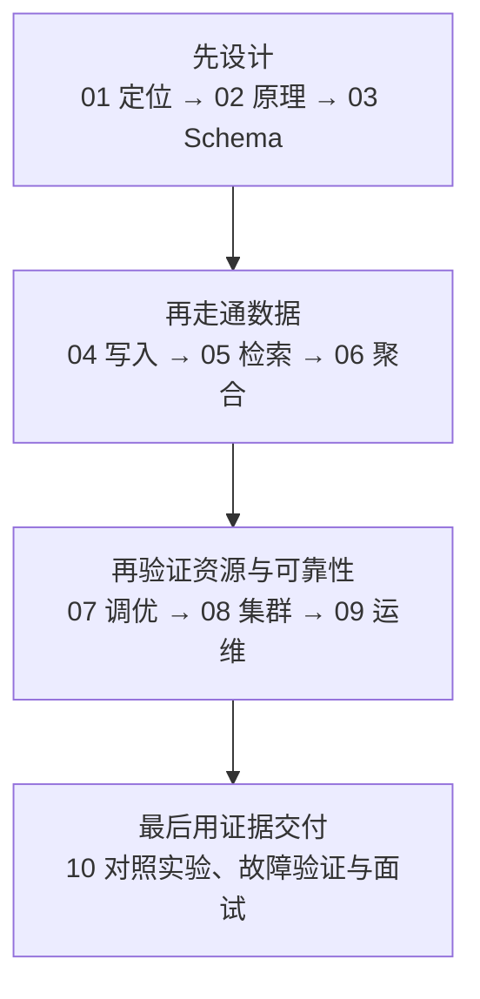

# ClickHouse 可观测性存储：从一条 Span 到海量数据分析

> 一条 Trace 能查出来，不代表请求量算对了；INSERT 返回成功，也不代表在所有故障下都不会丢数据。
> 本系列把 ClickHouse（CK）的底层机制，放回 Logs、Traces、Metrics 的工程问题里：**查得出、算得对、写得稳、成本可解释。**

## 一、适合谁，读完能做什么

面向后台、APM、可观测平台与数据基础设施工程师。不要求已用过 ClickHouse，但需要理解 SQL、日志/Span/指标的基本含义。

| 你要解决的问题 | 优先阅读 | 预期产出 |
|----------------|----------|----------|
| 判断是否该用 CK | 01、03、08 | 有访问模式、可靠性和成本边界的选型方案 |
| 设计 Trace/Log 存储 | 02、03、04、05 | 能解释分区/排序取舍，识别写入确认和检索边界 |
| 从 Span 生成指标 | 06、10 | 能说明计数口径、采样偏差、聚合状态和重复风险 |
| 查询慢、写入积压 | 07、09、10 | 按扫描、索引、part、merge、队列逐层排查 |
| 准备面试或技术评审 | 每篇问答、10 | 能说清原理、适用条件、失败方式和验证证据 |

它不是 SQL 函数目录，也不把“背过 MergeTree 名字”当成工程经验。经验的价值在于：知道何时不能套用一个结论，以及该怎样验证。

## 二、先说明证据，不包装成生产战绩

**调研与归档日期：2026-11-27。**

| 类别 | 本系列怎么使用 |
|------|----------------|
| 官方机制 | 引用 ClickHouse 官方文档与 OTel README，文末给出可访问链接 |
| 教学设计 | 明确标识为候选架构、示例 DDL、取舍建议，不声称来自现网 |
| 实验计划 | 给出步骤、控制变量、预期关系和记录方式，结果写“待执行” |
| 实测结果 | 本次没有 CK 实测结果；页面/图示验收不等于数据库正确性与性能验收 |

本地未发现 `clickhouse` 可执行文件；没有安装、连接或操作生产数据库。**本系列 SQL 未经 ClickHouse 运行验证，没有吞吐、压缩率、成本下降比例等实测结论。**

### 版本怎么读

- ClickHouse 官网是滚动文档；本系列未选定生产 CK 版本。基础 MergeTree 机制与版本敏感优化分开说明。
- OTel ClickHouse Exporter 的 README 固定到提交 [`083eddd8df2eb2c48a9cf43995470b25df4bf8b8`](https://github.com/open-telemetry/opentelemetry-collector-contrib/blob/083eddd8df2eb2c48a9cf43995470b25df4bf8b8/exporter/clickhouseexporter/README.md)，该文档提交日期为 2026-11-03。**这是文档快照，不是一个 Collector release 号。**
- 异步去重、投影、JSON、文本索引，以及 Collector 队列/批处理配置的变化，必须在目标版本确认。不给“所有版本通用”的一键配置。
- 正式复现时记录 CK 版本、部署方式、Collector 镜像版本/摘要、客户端版本、DDL 和配置快照。不能只写“最新版”。

## 三、沿着数据走，而不是沿着术语背

| 篇目 | 核心问题 |
|------|----------|
| [01 · CK 在可观测平台里，应该负责什么](/observability/clickhouse/01-role-and-architecture.md) | Logs、Traces、Metrics 的访问模式哪里不同？直写和消息队列怎么取舍？ |
| [02 · 一条 Span 的落盘之旅](/observability/clickhouse/02-mergetree-internals.md) | part、granule、mark、稀疏主索引和后台 merge 如何配合？ |
| [03 · 先写查询，再设计表](/observability/clickhouse/03-schema-and-access-patterns.md) | 租户、时间、TraceId、属性怎样进入字段、排序键与分区？ |
| [04 · 写入成功，数据就安全了吗](/observability/clickhouse/04-ingestion-and-delivery.md) | async insert、队列、重试和 ACK 分别承诺什么？ |
| [05 · 从慢请求找到整条链路和关联日志](/observability/clickhouse/05-trace-and-log-queries.md) | 服务趋势与单 Trace 检索为什么可能需要两种布局？ |
| [06 · 从 Span 到指标：快不难，算对才难](/observability/clickhouse/06-metrics-and-materialized-views.md) | 采样、重复、分位数与增量视图会怎样影响统计？ |
| [07 · SQL 很快，不一定是索引的功劳](/observability/clickhouse/07-indexes-and-query-tuning.md) | 怎样用执行计划与查询记录证明扫描真的减少？ |
| [08 · 分片解决容量，副本解决什么](/observability/clickhouse/08-clusters-and-reliability.md) | Distributed、复制表、Keeper 与查询完整性如何分工？ |
| [09 · 性能问题背后的维护成本](/observability/clickhouse/09-retention-cost-and-operations.md) | TTL、冷热数据、合并、容量和恢复怎样形成闭环？ |
| [10 · 用实验验证设计，用证据回答面试](/observability/clickhouse/10-labs-and-interview.md) | 如何设计可复现对照与故障演练，而不是只展示正常路径？ |

每篇采用“业务问题 → 底层机制 → 设计选择 → 验证 → 失败边界 → 面试问答 → 来源”的结构；图用于建立因果关系，而不替代证据。

## 四、贯穿案例：三个问题，一套教学模型

### 找到一条 Trace

一个租户提供 TraceId，但不知道经过哪些服务，且可能有迟到 Span。不能先用当前服务过滤掉其他服务，也不能把查询结果缺失自动判断为链路没有发生。

### 看清服务趋势

同一租户希望看服务请求量、错误和延迟。必须先确定 SpanKind、重复、采样与统计窗口。**一分钟 P99 的平均数不是一小时 P99。**

### 处理写入积压

输入量看起来没变，part 数、合并压力和排队延迟却增长。需要联看批次、分区扇出、重试和后台工作；不能第一步就上调 parts 阈值或强制合并。

### 示例约定

- 第 03 篇是 `obs_lab.spans` 的 DDL 唯一来源；其余篇复用字段，不各自发明另一套明细表。
- 时间使用 UTC，`duration_ns` 明确为纳秒；SpanKind、Status 为教学 Writer 规范化字符串。
- 第 06 篇建立独立预聚合表；第 10 篇给出用于验算的小数据，而非虚构生产数据。
- **教学表不兼容 exporter 默认 schema。** 若使用标准 ClickHouse Exporter，必须按其固定版本建表与写入合同配置，或开发并验证映射 Writer。
- SQL 的 `{tenant:String}` 等是类型化参数；绑定值之外还要做授权，不能拼接 SQL 或由调用者任意选租户。
- 所有建表、插入、回填、物化、重试和故障操作只面向授权的隔离实验环境；不要在生产复制执行。

## 五、十条值得带进评审会的判断

1. 主键不是唯一约束；MergeTree 合并不是业务去重。
2. 排序键服务访问局部性，分区键服务数据管理，分片键服务分布式路由。
3. `async_insert` 不能消除高分区扇出的成本，等待模式也不能替代端到端持久化设计。
4. 超时不等于没写入；安全重试需要定义批次与幂等边界。
5. ReplacingMergeTree 的后台替换不能视为实时唯一键服务。
6. 增量 MV 消费插入块，不应期待源表后续合并自动修正聚合。
7. Span 数不自动等于请求数；Tail Sampling 后的分布不能直接代表总体。
8. 跳数索引的价值是实际排除的数据，而不是索引数量。
9. 副本不是备份；跳过不可用分片可能让查询“成功但不完整”。
10. TTL 不保证到点立即删除；保留、删除与恢复目标必须有可验证合同。

具体限制与来源在对应章节展开。这些是评审起点，不是不用测就成立的性能结论。

## 六、怎样把文章变成自己的经验

依次完成六组实验：批量与小 part、两种排序键、Map 与独立列、跳数索引局部分布、重复与 MV、故障与重放。

每组都记录：输入数据/种子、版本、配置、基线、改动、观察值、反例和恢复方式。把“我猜这样快”改成“在这些条件下，读取字节和延迟出现了怎样的变化”。实验矩阵与面试题见[第 10 篇](/observability/clickhouse/10-labs-and-interview.md)。

**简历/面试中的边界**：阅读文档、完成实验和负责生产系统是三种不同经历。可以说明学到了什么、验证了什么；没有运行的实验不要写成优化成果，更不要引用文中教学数值当业务规模。

## 七、与现有博客的连接

- [延迟采样方案](/observability/design/otel-tail-based-sampling.md)：理解保留策略和链路完整性的业务背景，不作为本系列 CK 性能证据。
- [一个指标的冒险之旅](/observability/victoriametrics/metric-journey.md)：另一种存储系统的阅读路线，不能把 VM 实现直接套到 CK。
- [Spring Boot 中使用 Meter.batchCallback](/observability/implementation/otel-meter-batchcallback-springboot.md)：指标在采集端如何产生；产生成功不代表后端已落库。

## 核心来源入口

- [MergeTree](https://clickhouse.com/docs/engines/table-engines/mergetree-family/mergetree)
- [可观测 Schema 设计](https://clickhouse.com/docs/use-cases/observability/schema-design)
- [异步写入](https://clickhouse.com/docs/optimize/asynchronous-inserts)
- [增量物化视图](https://clickhouse.com/docs/materialized-view/incremental-materialized-view)
- [Distributed 引擎](https://clickhouse.com/docs/engines/table-engines/special/distributed)
- [EXPLAIN](https://clickhouse.com/docs/sql-reference/statements/explain) 与 [query_log](https://clickhouse.com/docs/operations/system-tables/query_log)
- [OTel Metrics 数据模型](https://opentelemetry.io/docs/specs/otel/metrics/data-model/)

---

开始阅读：[01 · CK 的角色与架构](/observability/clickhouse/01-role-and-architecture.md)
