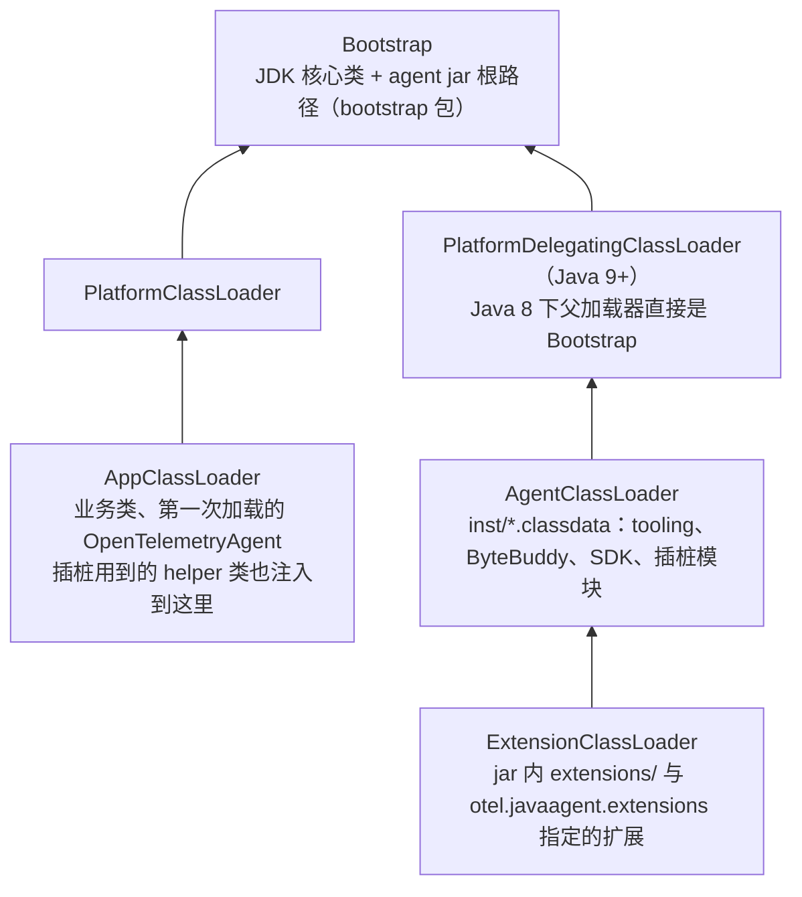
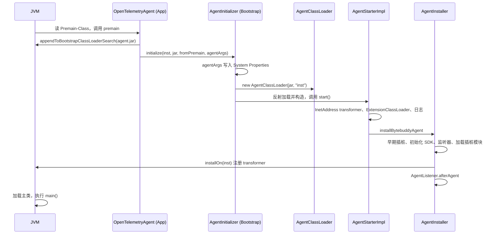
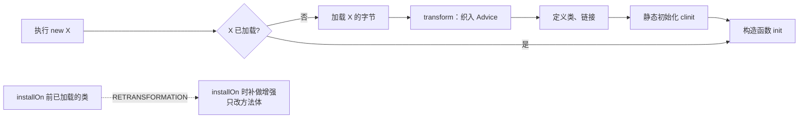

# OTel Java Agent 加载顺序：从 `-javaagent` 到 `new` 的那一刻

> 加上 `-javaagent:opentelemetry-javaagent.jar` 之后，JVM 里到底发生了什么？agent 的类由谁加载？业务代码的字节码是在 `new` 之前还是之后被改写的？
> 本文基于 **opentelemetry-java-instrumentation 2.23.0 源码**、**实际 jar 包结构**和 **JDK 21 上的实验**回答这三个问题。每个结论都标注了出处。

---

## 结论先行

1. **agent 在 `main()` 之前启动**。JVM 先调用 `premain`，agent 把自己追加到 Bootstrap 类路径，经过三层类加载器启动 ByteBuddy，调用 `installOn(inst)` 注册 `ClassFileTransformer`。这一切完成后，JVM 才加载业务主类。
2. **字节码增强发生在“类加载时”，不是 `new` 执行完以后**。如果 `new X()` 是第一次触发 `X` 加载的动作，那么顺序是：解析 `X` → 加载 → **transform 织入** → 静态初始化 `<clinit>` → 构造函数 `<init>` → 返回对象。增强只做一次，以后再 `new` 不会重复增强。
3. **触发类加载的不只有 `new`**。`Class.forName`、调用静态方法、访问静态字段等都会触发。如果某个类在 transformer 注册之前就已经加载（例如 JDK 核心类），agent 会在 `installOn` 时通过 **RETRANSFORMATION** 补做增强，但只能改方法体。

---

## 一、入口：JVM 怎么找到 agent

`-javaagent` 指向的 jar 必须在 `MANIFEST.MF` 里声明入口类。OTel 的构建脚本是这样写的：

```kotlin
// javaagent/build.gradle.kts:239-247
manifest {
  attributes(
    "Main-Class" to "io.opentelemetry.javaagent.OpenTelemetryAgent",
    "Agent-Class" to "io.opentelemetry.javaagent.OpenTelemetryAgent",
    "Premain-Class" to "io.opentelemetry.javaagent.OpenTelemetryAgent",
    "Can-Redefine-Classes" to true,
    "Can-Retransform-Classes" to true,
  )
}
```

| 属性 | 作用 |
|------|------|
| `Premain-Class` | 启动时通过 `-javaagent` 加载，调用 `premain` |
| `Agent-Class` | 运行时通过 Attach API 动态加载，调用 `agentmain` |
| `Main-Class` | `java -jar opentelemetry-javaagent.jar` 时打印版本号 |
| `Can-Retransform-Classes` | 允许对**已加载的类**重新执行 transform，后面会用到 |

我解压了实际构建出的 jar，MANIFEST 与上面一致。

---

## 二、jar 的两层结构：谁能看见谁

agent jar 不是一个普通的 fat jar，它分成两层（对构建产物解压统计所得）：

| 位置 | 数量 | 内容 | 由谁加载 |
|------|------|------|----------|
| 根路径 `io/...` | 1064 项 | `OpenTelemetryAgent`、`bootstrap` 包（如 `AgentInitializer`、`AgentClassLoader`） | **Bootstrap**（整个 jar 被追加到 Bootstrap 类路径） |
| `inst/**/*.classdata` | 13620 个 | tooling（`AgentInstaller` 等）、ByteBuddy、OTel SDK、所有插桩模块 | **AgentClassLoader** |

关键在于 `.classdata` 这个后缀。普通类加载器找类时找的是 `X.class`，所以 `inst/` 下的类对 Bootstrap 和应用类加载器**都不可见**，只有 `AgentClassLoader` 会去读它们：

```java
// javaagent-bootstrap/.../AgentClassLoader.java:260-266
// shading renames .class to .classdata
boolean isClass = name.endsWith(".class");
if (isClass) {
  ...
}
String jarEntryName = jarEntryPrefix + name;   // jarEntryPrefix = "inst/"
```

这样设计的目的有两个：

- **bootstrap 包放在根路径**：插桩后的业务代码要调用 agent 的“桥接类”，而且这个调用可能发生在任何类加载器中，包括 JDK 自己的类（Bootstrap 加载的类看不到下层加载器里的类）。所以桥接类必须放在 Bootstrap 层。
- **实现放在 `inst/` 并隔离**：agent 自带的 ByteBuddy、OTel SDK 版本，不能和业务代码里的同名库冲突。

<details>
<summary>💭 想一想：如果把整个 agent 都放进 Bootstrap，会有什么问题？</summary>

**答案**：会产生两类问题。一是**版本冲突**：业务自己也可能依赖 ByteBuddy、OTel API，同名类出现在 Bootstrap 后，因为双亲委派会优先从 Bootstrap 加载，业务拿到的就是 agent 的版本。二是 **`getClassLoader()` 返回 `null`**：Bootstrap 加载的类调用 `getClassLoader()` 得到 `null`，很多库没有处理这种情况。源码里专门有一段防护，就是为了防止“整个 uber jar 被追加到 Bootstrap”导致应用崩溃（见下一节 `verifyJarManifestMainClassIsThis`）。

</details>

---

## 三、三层类加载器



几个细节（均有源码出处）：

- **`AgentClassLoader` 的父加载器**：Java 9+ 是 `PlatformDelegatingClassLoader`，Java 8 是 `null`（即 Bootstrap）。见 `AgentClassLoader.java:150-154`。
- **`PlatformDelegatingClassLoader` 只把 `java.*` 和 `com.sun.net.httpserver.*` 交给 platform 加载**，其余一律走 Bootstrap。原因写在注释里：模块化应用的 platform 加载器里可能有业务类，agent 不想受它们干扰。见 `AgentClassLoader.java:514-541`。
- **`ExtensionClassLoader`** 用 ByteBuddy 的 `MultipleParentClassLoader` 把多个扩展 jar 组合起来，父加载器是 `AgentClassLoader`。见 `ExtensionClassLoader.java:56-77`。
- **插桩 helper 类注入到业务的类加载器**。`HelperInjector` 的类注释写的是 “Injects instrumentation helper classes into the user's class loader”，目标是 Bootstrap 时走单独的 `injectBootstrapClassLoader` 分支。见 `muzzle/.../HelperInjector.java:49-50, 359`。

> 相关阅读：[Bootstrap ClassLoader 注入修复](/observability/implementation/otel-bootstrap-classloader-injection.md) 记录了一次真实踩坑：内联的 Advice 代码在业务类加载器里找不到 agent 的类，导致 `NoClassDefFoundError`。它和本文讲的是同一套类加载器分层。

---

## 四、启动全链路



### 4.1 `OpenTelemetryAgent.premain`：只做跳板

```java
// javaagent-bootstrap/.../OpenTelemetryAgent.java:53-65
private static void startAgent(Instrumentation inst, String agentArgs, boolean fromPremain) {
  try {
    File javaagentFile = installBootstrapJar(inst);
    InstrumentationHolder.setInstrumentation(inst);
    JavaagentFileHolder.setJavaagentFile(javaagentFile);
    AgentInitializer.initialize(inst, javaagentFile, fromPremain, agentArgs);
  } catch (Throwable ex) {
    // Don't rethrow.  We don't have a log manager here, so just print.
    System.err.println("ERROR " + OpenTelemetryAgent.class.getName());
    ex.printStackTrace();
  }
}
```

`installBootstrapJar` 的核心是三行：

```java
// OpenTelemetryAgent.java:96-98
JarFile agentJar = new JarFile(javaagentFile, false);
verifyJarManifestMainClassIsThis(javaagentFile, agentJar);
inst.appendToBootstrapClassLoaderSearch(agentJar);
```

`verifyJarManifestMainClassIsThis` 检查 jar 里有没有 `Premain-Class`。如果有人把 agent 的内容误打包进业务的 uber jar，这一步会拒绝启动，避免把整个业务 jar 追加到 Bootstrap。

注意两点：

- `premain` 里的异常**不会抛出**，只打印。agent 启动失败不会导致应用起不来。
- 这个类的注释要求它“尽量少做事、不存静态数据、跳转后不再引用”。原因在第六节的实验里会看到。

### 4.2 `AgentInitializer`：确认自己在 Bootstrap，再创建隔离加载器

```java
// javaagent-bootstrap/.../AgentInitializer.java:51-71
if (AgentInitializer.class.getClassLoader() != null) {
  throw new IllegalStateException("agent initializer should be loaded in boot loader");
}
...
agentClassLoader = createAgentClassLoader("inst", javaagentFile);
agentStarter = createAgentStarter(agentClassLoader, inst, javaagentFile);
if (!fromPremain || !delayAgentStart()) {
  agentStarter.start();
  agentStarted = true;
}
```

- `OpenTelemetryAgent` 引用 `AgentInitializer` 时，jar 已经在 Bootstrap 类路径上了，按双亲委派，`AgentInitializer` 由 Bootstrap 加载。这里有一个硬校验，不满足就直接失败。
- `createAgentStarter` 通过 `agentClassLoader.loadClass("io.opentelemetry.javaagent.tooling.AgentStarterImpl")` **反射**加载实现类（`AgentInitializer.java:207-208`）。Bootstrap 层的代码看不到 `inst/` 里的类，只能通过反射跨过去，拿到的是 Bootstrap 层定义的 `AgentStarter` 接口。
- `delayAgentStart()` 只在 **Oracle/OpenJDK 1.8.0_40 之前**的版本返回 true。这时 agent 往 `sun.launcher.LauncherHelper.checkAndLoadMain` 插一个钩子，推迟到加载主类前再启动（`AgentInitializer.java:146-170`、`AgentStarterImpl.java:48-68`）。其它版本都是在 `premain` 里同步启动。
- `agentArgs` 按 `;` 分隔、`key=value` 形式写入 System Properties（`AgentInitializer.java:218-239`）。

### 4.3 `AgentStarterImpl.start`：准备扩展与日志

```java
// javaagent-tooling/.../AgentStarterImpl.java:71-104（节选）
installTransformers();   // InetAddress 相关的 transformer
EarlyInitAgentConfig earlyConfig = EarlyInitAgentConfig.create();
extensionClassLoader = createExtensionClassLoader(getClass().getClassLoader(), earlyConfig);
...
loggingCustomizer.init(earlyConfig);
AgentInstaller.installBytebuddyAgent(instrumentation, extensionClassLoader, earlyConfig);
```

`installTransformers()` 注册的 `InetAddressClassFileTransformer` 会把 `InetAddress.resolver()` 里的 `VM.isBooted()` 改写成 `AgentInitializer.isAgentStarted(VM.isBooted())`。目的是防止 agent 启动完成前就加载 `InetAddressResolverProvider` SPI（源码注释引用了 issue #7130、#10921）。这说明 agent 不只增强业务类，必要时也会改写 JDK 类。

### 4.4 `AgentInstaller.installBytebuddyAgent`：八个步骤

按代码顺序（`AgentInstaller.java:119-229`）：

| 步骤 | 代码 | 说明 |
|------|------|------|
| ① 构建 AgentBuilder | `.with(RedefinitionStrategy.RETRANSFORMATION)` `.disableClassFormatChanges()` | 允许补增强已加载的类，但不允许改类结构 |
| ② 早期插桩 | `installEarlyInstrumentation(agentBuilder, inst)` | 只安装 VirtualField（给类加字段），策略是 `DISABLED`，只对 Bootstrap 中尚未加载的类生效 |
| ③ 初始化 SDK | `installOpenTelemetrySdk(extensionClassLoader, earlyConfig)` | 读取配置，初始化 exporter、sampler 等 |
| ④ BeforeAgentListener | `agentListener.beforeAgent(autoConfiguredSdk)` | 扩展点 |
| ⑤ 忽略规则 | `configureIgnoredTypes(...)` | 哪些类、类加载器不做增强 |
| ⑥ 加载插桩模块 | `agentExtension.extend(agentBuilder, sdkConfig)` | 其中 `InstrumentationLoader` 通过 SPI 加载全部 `InstrumentationModule` |
| ⑦ 注册 transformer | `agentBuilder.installOn(inst)` | **从这一刻起，新加载的类会经过 transform** |
| ⑧ AgentListener | `runAfterAgentListeners(...)` | 扩展点；Java 8 且使用自定义 JUL LogManager 时会延后执行 |

第 ② 步为什么要单独做、还要用 `DISABLED`？源码注释给了答案：

```java
// AgentInstaller.java:256-258
// We are only going to install the virtual fields here. Installing virtual field changes class
// structure and can not be applied to already loaded classes.
agentBuilder = agentBuilder.with(AgentBuilder.RedefinitionStrategy.DISABLED);
```

加字段会改变类结构，JVM 不允许对已加载的类这样做，所以只能赶在类加载之前、尽早安装。

### 4.5 `InstrumentationLoader`：插桩模块从哪来

```java
// javaagent-tooling/.../instrumentation/InstrumentationLoader.java:31-44
for (InstrumentationModule instrumentationModule :
    loadOrdered(InstrumentationModule.class, Utils.getExtensionsClassLoader())) {
  agentBuilder = instrumentationModuleInstaller.install(instrumentationModule, agentBuilder, config);
}
```

所有插桩模块（Spring、JDBC、Kafka……）都通过 `ServiceLoader` 从 `ExtensionClassLoader` 加载，按 `order()` 排序后（`SafeServiceLoader.java:49-53`：`result.sort(Comparator.comparing(Ordered::order))`），逐个注册到 `AgentBuilder` 上。自定义扩展 jar 里的 `InstrumentationModule` 也是这样被发现的。

---

## 五、增强发生在 `new` 之前还是之后

### 5.1 `ClassFileTransformer` 的调用时机

ByteBuddy 的 `installOn(inst)` 会通过 `Instrumentation.addTransformer(...)` 注册 transformer。JVM 在**加载并定义一个类时**，把这个类的原始字节交给所有已注册的 transformer，用返回的新字节来定义类。所以增强的时机取决于“类什么时候被加载”。



### 5.2 三种情况

| 情况 | 增强时机 | 说明 |
|------|----------|------|
| 类首次由 `new` 触发加载 | `new` 的过程中，`<clinit>` 和 `<init>` 之前 | 最常见的情况 |
| 类由其他方式首次加载（`Class.forName`、静态调用、反射等） | 那次加载时 | 之后的 `new` 拿到的已经是增强后的类 |
| 类在 `installOn` 之前已经加载 | `installOn` 时通过 retransform 补做 | 受 `disableClassFormatChanges()` 限制，不能加字段和方法 |

一个类只会被增强一次（retransform 场景除外）。之后无论 `new` 多少次，执行的都是同一份增强后的字节码。

---

## 六、实验验证

### 6.1 实验代码

```java
// demo/OrderService.java
package demo;
public class OrderService {
  static { System.err.println("[app] OrderService.<clinit> 静态初始化"); }
  public OrderService() { System.err.println("[app] OrderService.<init> 构造函数"); }
  public String create() { return "order-1"; }
}

// demo/Main.java
package demo;
public class Main {
  public static void main(String[] args) {
    System.err.println("[app] main() 开始");
    System.err.println("[app] ---- 执行 new OrderService() 之前 ----");
    OrderService s = new OrderService();
    System.err.println("[app] ---- new 返回之后 ----");
    System.err.println("[app] create() = " + s.create());
  }
}
```

### 6.2 启动命令

```bash
javac -d out demo/*.java

java -javaagent:opentelemetry-javaagent.jar \
  -Dotel.traces.exporter=none -Dotel.metrics.exporter=none -Dotel.logs.exporter=none \
  "-Dotel.instrumentation.methods.include=demo.OrderService[create]" \
  -Xlog:class+load=info:stderr \
  -cp out demo.Main > run.log 2>&1
```

- `otel.instrumentation.methods.include` 让 agent 去增强一个业务类的方法，这样才能观察到“业务类被 transform”。
- `-Xlog:class+load` 是 JDK 9+ 的写法。Java 8 用 `-verbose:class`。

### 6.3 类加载日志（行号来自 run.log）

| 行号 | 事件 | 结论 |
|------|------|------|
| 787 | `OpenTelemetryAgent`，source 是 `file:...jar` | 由 AppClassLoader 加载，`premain` 开始 |
| 836 | `AgentInitializer`，source 是不带 `file:` 的路径 | 来自 Bootstrap（这个类有硬校验，必须由 Bootstrap 加载） |
| 849 | `AgentClassLoader`，同上 | 来自 Bootstrap |
| 966 | `AgentStarterImpl` | 来自 `inst/`，由 AgentClassLoader 加载 |
| 1272 | `AgentInstaller` | 同上 |
| 6496 | `demo.Main` | **agent 初始化全部完成后**才加载主类 |
| 6499 | `[app] 执行 new OrderService() 之前` | |
| 6500~6538 | 一批 `net.bytebuddy.asm.Advice$*` 类被加载 | transformer 正在为 `OrderService` 生成增强代码 |
| 6539 | `demo.OrderService` 加载完成 | |
| 6540 | `[app] <clinit>` | 增强完成后才执行静态初始化 |
| 6541 | `[app] <init>` | 最后才构造对象 |

行号的绝对值会随环境变化，有意义的是**先后顺序**。

### 6.4 字节码对比：确认织入真的发生了

日志里的 ByteBuddy 类加载只是间接证据。用 `-Dnet.bytebuddy.dump=<目录>` 让 ByteBuddy 把增强前后的类都写到磁盘，再用 `javap -c -p` 对比：

```text
原始 create()：
  0: ldc  #21   // String order-1
  2: areturn

增强后 create() 新增的调用：
  MethodInstrumentation$MethodAdvice$AdviceScope.start(SpanKind, Class, String)
  MethodInstrumentation$MethodAdvice$AdviceScope.end(Class, Object, Throwable)
  ExceptionLogger.logSuppressedError(String, Throwable)   × 3
```

| 方法 | 原始指令数 | 增强后指令数 |
|------|-----------|-------------|
| `create()` | 2 | 明显增加（插入了 start/end 和异常处理） |
| `<init>` | 5 | 5 |
| `<clinit>` | 3 | 3 |

只有被配置的方法被改写，构造函数和静态初始化没有变化。

### 6.5 一个意外发现：`OpenTelemetryAgent` 被加载了两次

日志第 787 行和第 1335 行都出现了 `io.opentelemetry.javaagent.OpenTelemetryAgent`：

- 第 787 行：AppClassLoader 加载（JVM 按 `Premain-Class` 加载它）；
- 第 1335 行：Bootstrap 又加载了一次。紧挨着它的上一条是 `tooling.AgentVersion`，而 `AgentVersion.java:12` 里有 `OpenTelemetryAgent.class.getPackage().getImplementationVersion()`。此时 jar 已经在 Bootstrap 类路径上，从 Bootstrap 层引用这个类，就会在 Bootstrap 里再定义一份。

这两个是**不同的 `Class` 对象**，静态字段不共享。这正是源码注释提醒的风险：

```java
// OpenTelemetryAgent.java:26-37
// JVM loads this class onto app's class loader, afterwards agent needs to inject its classes
// onto bootstrap classpath. This leads to this class being visible on bootstrap. This in turn means
// that this class may be loaded again on bootstrap by accident if we ever reference it after
// bootstrap has been setup.
//   - Do as little as possible here
//   - Never reference this class after we have setup bootstrap and jumped over to 'real' agent code
//   - Do not store any static data in this class
```

`AgentVersion` 只是取包上的版本号，不涉及静态状态，所以没有问题。但如果在 `OpenTelemetryAgent` 里存了静态数据，跳转后再去读，读到的会是另一份未初始化的副本。

<details>
<summary>💭 想一想：为什么 OTel 选择把 Instrumentation 存在 InstrumentationHolder，而不是 OpenTelemetryAgent 的静态字段？</summary>

**答案**：`InstrumentationHolder` 位于 bootstrap 包，在 `premain` 调用它的时候 jar 已经追加到 Bootstrap，所以它只会由 Bootstrap 加载，全局只有一份。而 `OpenTelemetryAgent` 本身由 AppClassLoader 加载，后续 Bootstrap 层的代码再引用它时会得到另一份 `Class`。状态放在它身上会“看起来存了、读起来是空的”。

</details>

---

## 七、常见误区

| 误区 | 实际情况 |
|------|----------|
| agent 在 `new` 时拦截构造函数 | 增强时机是**类加载**；默认插桩改写的是目标方法，构造函数不一定被改动（实验中 `<init>` 指令数不变） |
| 每次 `new` 都会触发增强 | 只在类第一次加载时增强一次 |
| agent 的所有类都在 Bootstrap 里 | 只有 jar 根路径的 bootstrap 包在 Bootstrap；tooling、ByteBuddy、SDK、插桩模块都在 `inst/` 里，由 AgentClassLoader 加载 |
| `premain` 里完成了所有初始化 | `premain` 只是跳板，真正的工作在 `AgentInitializer` → `AgentStarterImpl` → `AgentInstaller` |
| 已加载的类就没法增强了 | 可以通过 retransform 补做，但不能改类结构 |
| agent 启动失败会导致应用起不来 | `premain` 捕获所有 `Throwable`，只打印不抛出 |

---

## 八、面试问答

<details>
<summary>Q1：OTel Java Agent 在 main 方法之前还是之后启动？</summary>

**之前**。`-javaagent` 会让 JVM 在加载主类前调用 `Premain-Class` 的 `premain`。OTel 在 `premain` 里同步完成类加载器搭建、SDK 初始化、插桩模块注册和 `installOn`，然后 JVM 才加载主类。实验中 agent 的类在 run.log 第 787 行开始加载，`demo.Main` 到第 6496 行才加载。唯一的例外是 Java 8 早于 1.8.0_40 的版本，agent 会推迟到 `LauncherHelper.checkAndLoadMain` 时启动，但依然在 `main()` 之前。

</details>

<details>
<summary>Q2：字节码增强是在 new 之前还是之后？</summary>

**在类加载时**。首次 `new` 触发类加载，JVM 加载字节后、定义类之前调用 transformer，然后才执行 `<clinit>` 和 `<init>`。所以增强在对象创建之前完成，而且只做一次。如果类在 agent 安装前已经加载，则在 `installOn` 时通过 retransform 补做。

</details>

<details>
<summary>Q3：为什么要调用 appendToBootstrapClassLoaderSearch？</summary>

插桩后的代码会被内联到业务类、甚至 JDK 类的方法里，这些代码要调用 agent 的桥接类。Bootstrap 加载的类看不到下层加载器里的类，因此桥接类必须放在 Bootstrap 层，才能保证任何类加载器下的代码都能访问到。

</details>

<details>
<summary>Q4：既然 jar 已经进了 Bootstrap，为什么还需要 AgentClassLoader？</summary>

为了**隔离**。只有 bootstrap 包需要全局可见；ByteBuddy、OTel SDK 等实现如果也进 Bootstrap，就会和业务依赖的同名库冲突（双亲委派会优先返回 Bootstrap 的版本）。所以它们以 `.classdata` 后缀放在 `inst/` 下，只有 AgentClassLoader 能加载。

</details>

<details>
<summary>Q5：已经加载的类怎么增强？有什么限制？</summary>

`AgentBuilder` 配置了 `RedefinitionStrategy.RETRANSFORMATION`，`installOn` 时会找出已加载且匹配的类，调用 `retransformClasses` 补做增强。同时配置了 `disableClassFormatChanges()`，因为 JVM 的 retransform 不允许增删字段和方法，只能改方法体。这也是 VirtualField（需要加字段）必须走“早期插桩”、并且用 `DISABLED` 策略的原因。

</details>

<details>
<summary>Q6：插桩模块是怎么被发现和加载的？</summary>

`InstrumentationLoader` 本身是一个 `AgentExtension`（`@AutoService` 注册），它通过 `ServiceLoader` 从 `ExtensionClassLoader` 加载所有 `InstrumentationModule`，按 `order()` 排序后逐个注册到 `AgentBuilder`。自定义扩展 jar 里的模块也走这条路。

</details>

<details>
<summary>Q7：如果业务把 agent 打进了自己的 fat jar 会怎样？</summary>

agent 通过 `OpenTelemetryAgent` 类所在的 jar 来定位自身，然后把这个 jar 追加到 Bootstrap。如果它在业务 fat jar 里，整个业务 jar 都会进 Bootstrap，很多库会因为 `getClassLoader()` 返回 `null` 而出错。所以 `verifyJarManifestMainClassIsThis` 会检查 jar 有没有 `Premain-Class`，没有就拒绝安装。

</details>

---

## 九、边界说明

- 本文基于 **2.23.0** 版本（作者 fork，commit `57828f5dc7`）。其他版本的类名、步骤可能不同。
- Java 8 早期版本（< 1.8.0_40）的延迟启动路径**只读了源码，没有做实验**。
- 实验中 JVM 没有自动退出，猜测与 fork 中的扩展线程有关，**未验证**，不影响本文结论。复现时如遇到同样情况，手动结束进程即可。
- 源码中 `TransformLoggingListener` 会在 FINE 级别输出 `Transformed {类名} -- {类加载器}`（`AgentInstaller.java:467-475`），但本次构建的 agent 日志没有输出到 stderr，所以改用字节码 dump 证明织入发生。

---

<details>
<summary>📌 本文事实来源</summary>

- MANIFEST 属性：`【实测】` `javaagent/build.gradle.kts:239-247`，并解压构建产物核对
- 启动链路：`【实测】` `OpenTelemetryAgent.java`、`AgentInitializer.java`、`AgentStarterImpl.java`、`AgentInstaller.java:119-229`、`InstrumentationLoader.java`
- 类加载器：`【实测】` `AgentClassLoader.java:107, 150-154, 260-267, 514-541`、`ExtensionClassLoader.java:56-77`、`HelperInjector.java:49-50, 359`
- jar 结构（根路径 1064 项 / `inst/*.classdata` 13620 个）：`【实测】` 解压 `opentelemetry-javaagent-2.23.0.jar` 统计
- 加载顺序与织入：`【实测】` JDK 21.0.7 + `-Xlog:class+load` + `-Dnet.bytebuddy.dump` + `javap`
- `ClassFileTransformer` 在类定义时被调用：`【业界通用】` `java.lang.instrument` 规范

</details>
