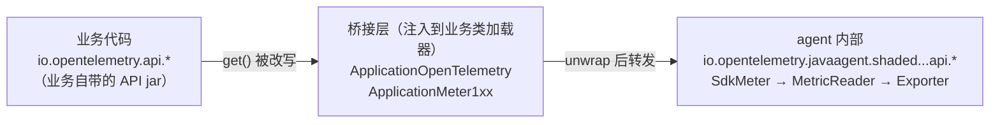
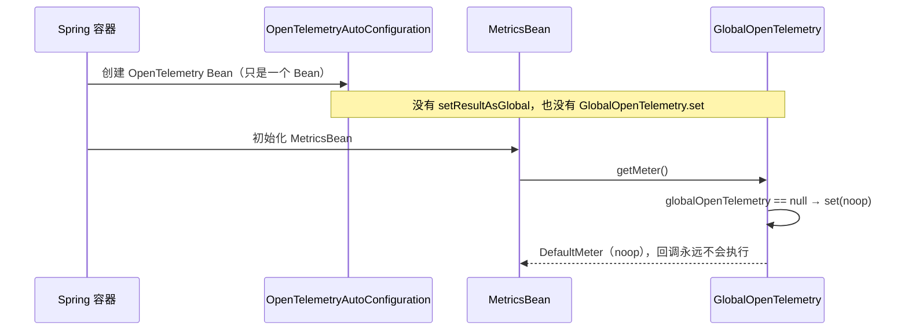
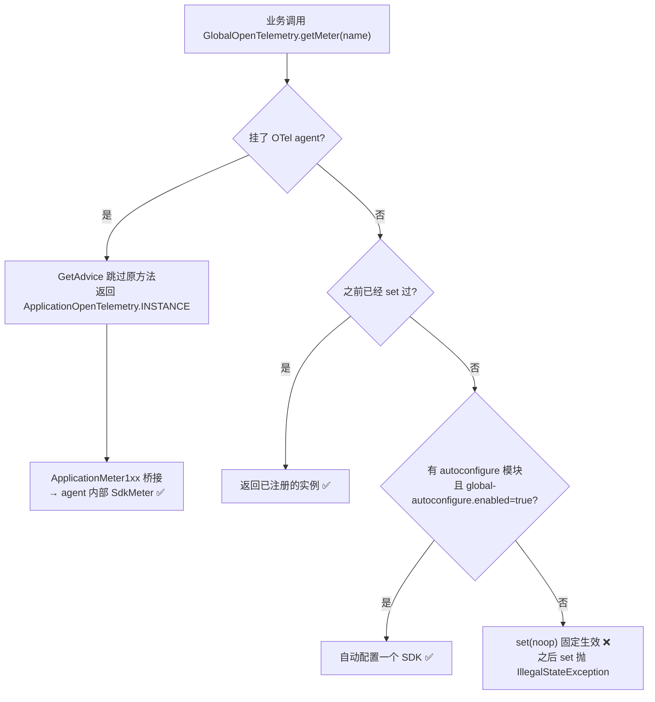
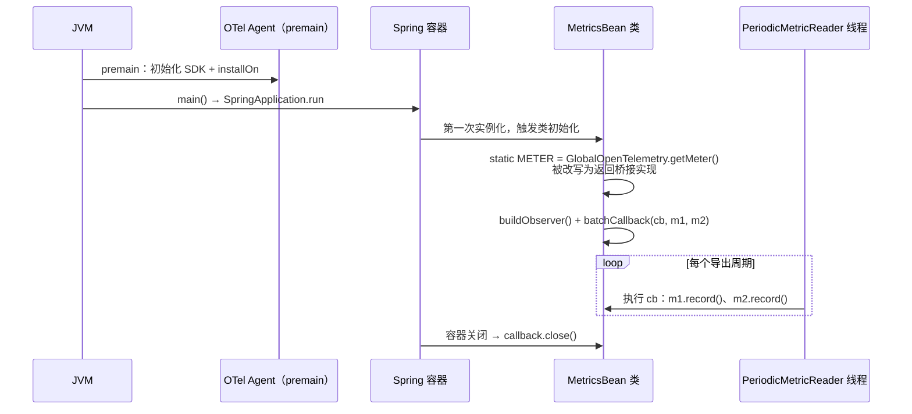
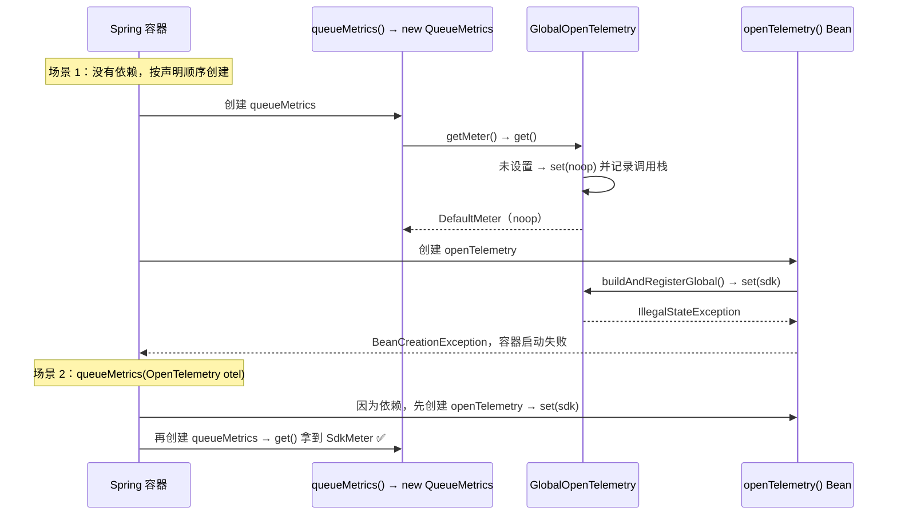

# Spring Boot 中使用 Meter.batchCallback：为什么 GlobalOpenTelemetry 有时拿到的是 noop

> 在 Spring Boot 里写 `Meter meter = GlobalOpenTelemetry.getMeter(INSTRUMENTATION_NAME)`，再用 `batchCallback` 上报几个 gauge。挂了 Java Agent 一切正常；换成 Spring Boot Starter 后指标全没了，也不报错。
> 本文基于 **opentelemetry-java（1.58.0-SNAPSHOT）** 和 **opentelemetry-java-instrumentation（2.23.0）** 源码，加上三组对照实验，讲清楚原因和正确写法。

---

## 结论先行

1. **挂了 OTel Java Agent**：`GlobalOpenTelemetry.getMeter(...)` 什么时候调用都能拿到可用的 Meter，写在 static 字段里也行。agent 在 `premain` 阶段已经初始化好 SDK，并且改写了业务代码里的 `GlobalOpenTelemetry.get()`，直接返回 agent 的桥接实现。
2. **只用 Spring Boot Starter，不挂 agent**：`GlobalOpenTelemetry` **永远是 noop**。Starter 只创建了一个 `OpenTelemetry` Bean，不会注册到 Global。而且第一次 `get()` 会把 noop 固定写进去，之后再 `set()` 直接抛异常。
3. **推荐写法**：在 Bean 里注入 `OpenTelemetry`，没有这个 Bean 时再退回到 Global；`batchCallback` 返回的句柄在 Bean 销毁时 `close()`。

---

## 一、`GlobalOpenTelemetry.get()` 的默认行为

### 1.1 未设置时，第一次 `get()` 会把 noop 固定下来

```java
// opentelemetry-java: api/all/.../GlobalOpenTelemetry.java:140-158
public static OpenTelemetry get() {
  OpenTelemetry openTelemetry = globalOpenTelemetry;
  if (openTelemetry == null) {
    synchronized (mutex) {
      openTelemetry = globalOpenTelemetry;
      if (openTelemetry == null) {
        OpenTelemetry autoConfigured = maybeAutoConfigureAndSetGlobal();
        if (autoConfigured != null) {
          return autoConfigured;
        }
        set(OpenTelemetry.noop());   // ← 固定写入 noop
        openTelemetry = Objects.requireNonNull(globalOpenTelemetry);
      }
    }
  }
  return openTelemetry;
}
```

`set()` 只允许调用一次，第二次直接抛异常：

```java
// GlobalOpenTelemetry.java:171-180
public static void set(OpenTelemetry openTelemetry) {
  synchronized (mutex) {
    if (globalOpenTelemetry != null) {
      throw new IllegalStateException(
          "GlobalOpenTelemetry.set has already been called. GlobalOpenTelemetry.set must be "
              + "called only once before any calls to GlobalOpenTelemetry.get. ...",
          setGlobalCaller);
    }
    ...
```

所以“先 `get` 后 `set`”的结果是：`get` 拿到 noop，`set` 抛异常。

### 1.2 自动配置默认是关闭的

`maybeAutoConfigureAndSetGlobal()` 只有两个条件同时满足才会生效（`GlobalOpenTelemetry.java:303-323`）：

- classpath 上有 `opentelemetry-sdk-extension-autoconfigure`；
- 设置了 `-Dotel.java.global-autoconfigure.enabled=true`。

默认不满足，所以默认走到 `set(noop)`。

### 1.3 API 自己的建议

这个类的 Javadoc 写得很直白（`GlobalOpenTelemetry.java:31-35`）：为了避开初始化顺序问题，最好把 `OpenTelemetry` 实例传来传去，而不是用 `GlobalOpenTelemetry`。之所以还有这个类，是因为 javaagent 通过它把自己的实例暴露给业务代码。

<details>
<summary>💭 想一想：为什么 API 要把 noop“固定”下来，而不是每次都返回一个临时的 noop？</summary>

**答案**：为了让“先 get 后 set”这种顺序错误**尽早暴露**。如果每次返回临时 noop，之后 `set` 成功了，前面拿到 noop 的代码不会自动更新，就会出现“一部分代码有数据、一部分没有”的情况，很难排查。固定之后，迟到的 `set` 会抛异常，并且异常的 cause 里带着第一次 `set` 的调用栈（`setGlobalCaller`），能直接定位是谁先调用的。

</details>

---

## 二、挂 agent 时：`get()` 被整体替换

### 2.1 GetAdvice：跳过原方法，直接返回桥接实例

```java
// opentelemetry-api-1.0/javaagent/.../OpenTelemetryInstrumentation.java:54-67
public static class GetAdvice {
  @Advice.OnMethodEnter(skipOn = Advice.OnDefaultValue.class)
  public static Object onEnter() {
    return null;
  }

  @AssignReturned.ToReturned
  @Advice.OnMethodExit(onThrowable = Throwable.class, suppress = Throwable.class)
  public static application.io.opentelemetry.api.OpenTelemetry methodExit() {
    return ApplicationOpenTelemetry.INSTANCE;
  }
}
```

`skipOn = OnDefaultValue` 配合 `onEnter` 返回 `null`，意思是“进入方法时返回默认值就跳过原方法体”。所以 1.1 节那段“固定 noop”的逻辑**根本不会执行**，返回值被换成 agent 的 `ApplicationOpenTelemetry.INSTANCE`。

同一个类里还改写了：

- `set(...)`：被忽略，只打一条 WARNING，提示“agent 提供了全局对象”（第 70-82 行）；
- `resetForTest()`：同样被忽略（第 84-97 行）。

`isSet()` 和 `getOrNoop()` 由 `opentelemetry-api-1.57` 模块改写，实测在 agent 下 `isSet()` 返回 `true`。

### 2.2 `application.io.opentelemetry` 是什么

源码里写的类型是 `application.io.opentelemetry.api.OpenTelemetry`，看起来像一个不存在的包。它是打包时的占位：

```kotlin
// conventions/.../javaagent-shadowing.gradle.kts
relocate("io.opentelemetry.api", "io.opentelemetry.javaagent.shaded.io.opentelemetry.api")   // 第 37 行
relocate("application.io.opentelemetry", "io.opentelemetry")                                 // 第 50 行
```

- agent 自己用的 API 被重定位到 `io.opentelemetry.javaagent.shaded...`；
- 源码里的 `application.io.opentelemetry` 被重定位回业务使用的 `io.opentelemetry`。

这样，agent 能同时操作两套 API 类型：业务那一套（业务 jar 里的）和 agent 自己那一套（shaded），二者互不冲突。

### 2.3 `batchCallback` 怎么穿过桥接层

```java
// opentelemetry-api-1.15/javaagent/.../ApplicationMeter115.java:22-43
@Override
public BatchCallback batchCallback(
    Runnable callback,
    ObservableMeasurement observableMeasurement,
    ObservableMeasurement... additionalMeasurements) {
  return new ApplicationBatchCallback(
      agentMeter.batchCallback(
          callback, unwrap(observableMeasurement), unwrap(additionalMeasurements)));
}

private static io.opentelemetry.api.metrics.ObservableMeasurement unwrap(
    ObservableMeasurement observableMeasurement) {
  ...
  if (!(observableMeasurement instanceof ObservableMeasurementWrapper)) {
    // unwrap instruments that weren't created by us into a dummy instrument
    // sdk ignores instruments that it didn't create
    return new io.opentelemetry.api.metrics.ObservableMeasurement() {};
  }
  return ((ObservableMeasurementWrapper<?>) observableMeasurement).unwrap();
}
```

业务传进来的 instrument 是桥接层包装过的对象，这里解包成 agent 内部的 SDK instrument，再交给 agent 的 `SdkMeter`。如果传入的不是桥接层创建的（比如业务自己 new 了一个 SDK 的 instrument），就替换成一个空对象，SDK 会忽略它。



---

## 三、只用 Spring Boot Starter 时：不会注册 Global

```java
// spring-boot-autoconfigure/.../OpenTelemetryAutoConfiguration.java:109-131（节选）
@Bean
public AutoConfiguredOpenTelemetrySdk autoConfiguredOpenTelemetrySdk(...) {
  return AutoConfigureUtil.setConfigPropertiesCustomizer(
          AutoConfiguredOpenTelemetrySdk.builder()
              .setComponentLoader(new OpenTelemetrySdkComponentLoader(applicationContext)),
          c -> SpringConfigProperties.create(...))
      .build();
}

@Bean
public OpenTelemetry openTelemetry(AutoConfiguredOpenTelemetrySdk autoConfiguredOpenTelemetrySdk) {
  logStart();
  return autoConfiguredOpenTelemetrySdk.getOpenTelemetrySdk();
}
```

- 构建时没有调用 `setResultAsGlobal()`，而 builder 里这个开关默认是 `false`（`AutoConfiguredOpenTelemetrySdkBuilder.java:124`）。`build()` 的第一句就是 `if (!setResultAsGlobal) return buildImpl();`，只有开关为 `true` 才会执行 `GlobalOpenTelemetry.set(...)`（同文件第 428-438 行）。
- 在 `instrumentation/spring` 下的 main 源码里搜索 `GlobalOpenTelemetry`，命中的全是 javaagent 插桩模块，`spring-boot-autoconfigure` 里一处都没有。

所以只用 Starter 时，SDK 只存在于 Spring 容器里。任何地方调用 `GlobalOpenTelemetry.get()` 都会走到 1.1 节的逻辑，拿到并固定 noop。



---

## 四、SDK 对 batchCallback 的约束

```java
// opentelemetry-java: sdk/metrics/.../SdkMeter.java:222-234
for (ObservableMeasurement measurement : measurements) {
  if (!(measurement instanceof SdkObservableMeasurement)) {
    logger.log(Level.WARNING,
        "batchCallback called with instruments that were not created by the SDK.");
    continue;
  }
  SdkObservableMeasurement sdkMeasurement = (SdkObservableMeasurement) measurement;
  if (!instrumentationScopeInfo.equals(sdkMeasurement.getInstrumentationScopeInfo())) {
    logger.log(Level.WARNING,
        "batchCallback called with instruments that belong to a different Meter.");
    continue;
  }
  ...
```

两条约束，不满足时**只打 WARNING 并跳过，不会抛异常**：

1. instrument 必须由 SDK 创建；
2. instrument 必须由**调用 `batchCallback` 的同一个 Meter**（相同的 instrumentation scope）通过 `buildObserver()` 创建。

另外，`Meter.batchCallback` 的 Javadoc 对回调本身有要求（`Meter.java:129-134`）：在有限时间内执行完、可以被多个线程反复调用、只记录已注册的 instrument。

---

## 五、实验验证

### 5.1 实验代码

```java
public class MetricsReporter {
  static final Meter METER = GlobalOpenTelemetry.getMeter("demo-reporter");
  static { System.err.println("[clinit] MetricsReporter, meter=" + METER.getClass().getName()); }

  static void register() {
    ObservableLongMeasurement queue = METER.gaugeBuilder("demo.queue.size").ofLongs().buildObserver();
    ObservableLongMeasurement active = METER.gaugeBuilder("demo.active.threads").ofLongs().buildObserver();
    METER.batchCallback(() -> {
      System.err.println("[callback] batchCallback 被调用");
      queue.record(42);
      active.record(7);
    }, queue, active);
  }
}
```

三个场景：

- **A**：挂 agent，classpath 只有 API jar，直接调用 `MetricsReporter.register()`；
- **B**：不挂 agent，先触发 `MetricsReporter` 初始化，再 `GlobalOpenTelemetry.set(sdk)`；
- **C**：不挂 agent，先 `GlobalOpenTelemetry.set(sdk)`，再触发 `MetricsReporter` 初始化。

B 和 C 的 SDK 配置了一个 500ms 周期的 `PeriodicMetricReader`，exporter 把数据打印出来。

### 5.2 结果

| 场景 | 拿到的 Meter 类型 | 回调是否执行 | 其他现象 |
|------|----------------|------------|---------|
| A：挂 agent | `...opentelemetryapi.v1_38.metrics.ApplicationMeter138` | ✅ | 业务不需要带 SDK |
| B：先 get 后 set | `io.opentelemetry.api.metrics.DefaultMeter`（noop） | ❌ | 后面的 `set` 抛出 `GlobalOpenTelemetry.set has already been called` |
| C：先 set 后 get | `io.opentelemetry.sdk.metrics.SdkMeter` | ✅ | 导出 `demo.queue.size = 42`、`demo.active.threads = 7` |
| `isSet()` 首次调用 | 挂 agent 返回 `true`，不挂返回 `false` | — | — |

场景 A 出现的是 **v1_38** 版本的桥接类：agent 会按业务使用的 API 版本，选择对应版本的桥接实现。

---

## 六、加载顺序全景

### 6.1 `getMeter()` 会拿到什么



### 6.2 挂 agent 时，为什么写在 static 字段里也没问题



agent 在 `main()` 之前就完成了初始化（见 [Java Agent 加载顺序与增强时机](/observability/implementation/otel-javaagent-loading-order.md)），而业务类最早也要到 `main()` 之后才被初始化，所以时间上总是来得及。

static 字段的风险在于：**它只在类初始化时赋值一次**。不挂 agent 时，如果那一刻 Global 还是 noop，这个字段就永远是 noop。类初始化的具体时机见 [Java 类加载、初始化与执行顺序](/java/java-class-init-order.md)。

---

## 七、Spring Boot 中的推荐写法

```java
@Component
public class QueueMetrics implements DisposableBean {
  private static final String INSTRUMENTATION_NAME = "com.example.queue";
  private final BatchCallback callback;

  public QueueMetrics(ObjectProvider<OpenTelemetry> otelProvider, QueueService queue) {
    // 有 Starter：注入它创建的 Bean；只挂 agent：没有这个 Bean，退回到 Global（agent 会接管）
    OpenTelemetry otel = otelProvider.getIfAvailable(GlobalOpenTelemetry::get);
    Meter meter = otel.getMeter(INSTRUMENTATION_NAME);

    // instrument 必须由同一个 meter 创建，否则 SDK 打 WARNING 并忽略
    ObservableLongMeasurement size =
        meter.gaugeBuilder("queue.size").ofLongs().buildObserver();
    ObservableLongMeasurement consumers =
        meter.gaugeBuilder("queue.consumers").ofLongs().buildObserver();

    // 一次回调采集多个值：执行要快、线程安全、只记录上面注册过的 instrument
    this.callback = meter.batchCallback(() -> {
      QueueStats s = queue.snapshot();
      size.record(s.size());
      consumers.record(s.consumers());
    }, size, consumers);
  }

  @Override
  public void destroy() {
    callback.close(); // 注销回调，避免容器刷新后残留
  }
}
```

| 设计点 | 原因 |
|--------|------|
| 构造函数注入，不写 static 字段 | 获取时机由 Spring 控制；只用 Starter 时，static 字段里的 Global 一定是 noop |
| `getIfAvailable(GlobalOpenTelemetry::get)` 兜底 | 同一份代码兼容“只用 Starter”和“只挂 agent” |
| 不要自己写 `@Bean @ConditionalOnMissingBean OpenTelemetry` 兜底 | 业务配置类先于自动配置处理，你的 Bean 会先注册，导致 Starter 认为已有 Bean 而跳过 SDK 创建（Spring 官方建议条件注解只用于自动配置类） |
| 用 `batchCallback` 而不是多个单独回调 | 一次快照得到多个值，指标之间口径一致，被观测对象只查一次 |
| `destroy()` 里 `close()` | `BatchCallback` 是 `AutoCloseable`，不关闭的话回调一直留在 SDK 里 |

**一定要用 Global、又不挂 agent 时**：保证 `set` 在任何 `get` 之前。可以在 `main` 类的 static 块里，或者 `SpringApplication.run` 之前，执行 `OpenTelemetrySdk.builder()...buildAndRegisterGlobal()`（`GlobalOpenTelemetry.java:162-164` 的 Javadoc 也是这么建议的），并且不要同时使用 Starter。实验场景 C 验证了这个顺序可行。

---

## 八、面试问答

<details>
<summary>Q1：GlobalOpenTelemetry.getMeter() 为什么有时拿到的是 noop？</summary>

`get()` 发现全局实例还没设置时，会尝试自动配置；自动配置默认关闭，于是执行 `set(OpenTelemetry.noop())` 并把 noop 固定下来。之后谁再 `set` 都会抛 `IllegalStateException`。只用 Spring Boot Starter 时，Starter 不会注册 Global，所以必然走到这条路径。

</details>

<details>
<summary>Q2：挂了 agent 为什么写在 static 字段里也没问题？</summary>

两个原因。一是时间：agent 在 `premain` 里就初始化好了 SDK，比任何业务类的初始化都早。二是改写：agent 用 `GetAdvice` 跳过了 `GlobalOpenTelemetry.get()` 的原方法体，直接返回桥接实例，根本不会走“固定 noop”的逻辑。

</details>

<details>
<summary>Q3：agent 怎么让业务的 API 和自己的 SDK 不冲突？</summary>

shadow 重定位。agent 自己的 API 被重定位到 `io.opentelemetry.javaagent.shaded...`；桥接代码里用 `application.io.opentelemetry` 占位，打包时重定位回业务的 `io.opentelemetry`。桥接层同时持有两套类型，业务调用进来后，解包、转发给 agent 内部的 SDK。

</details>

<details>
<summary>Q4：batchCallback 注册成功了但没有数据，可能是什么原因？</summary>

按顺序排查：① Meter 是不是 noop（打印 `meter.getClass()`）；② instrument 是不是由同一个 Meter 创建（不是的话 SDK 打 WARNING `belong to a different Meter` 并跳过）；③ 有没有配置 metric reader/exporter；④ 回调里有没有 `record`。前两种情况都不会抛异常，只能看日志或类型。

</details>

<details>
<summary>Q5：业务里调用 GlobalOpenTelemetry.set() 在挂 agent 时会怎样？</summary>

被 `SetAdvice` 拦截，调用被忽略，只打一条 WARNING：“all GlobalOpenTelemetry.set calls are ignored - the agent provides the global OpenTelemetry object”。业务自己构建的 SDK 不会生效。

</details>

---

## 九、边界说明

- 第七节的 `ObjectProvider` 兜底和 `@ConditionalOnMissingBean` 建议，依据的是 Spring 通用规则，**未起 Spring Boot 应用实测**。
- agent 和 Starter **同时使用**的行为不在本文范围内。
- 实验用的是作者 fork 构建的版本（API/SDK 1.58.0-SNAPSHOT、agent 2.23.0）。其他版本的类名（如 `ApplicationMeter138`）可能不同。
- 第十节案例的未验证项，见该节末尾。

---

## 十、案例：@Bean 方法里 new 对象

### 10.1 场景

```java
@Configuration
public class MetricsConfig {
  @Bean
  QueueMetrics queueMetrics() {
    return new QueueMetrics();
  }
}

public class QueueMetrics {
  public QueueMetrics() {
    Meter meter = GlobalOpenTelemetry.getMeter(INSTRUMENTATION_NAME);   // 构造函数里取 Meter
    ObservableLongMeasurement size = meter.gaugeBuilder("queue.size").ofLongs().buildObserver();
    meter.batchCallback(() -> size.record(...), size);
  }
}
```

这样写正常吗？

### 10.2 结论

**写在 `@Bean` 方法里本身没有问题，关键是构造函数执行那一刻 `GlobalOpenTelemetry` 是否已经有真正的 SDK。**

| 接入方式 | 结果 |
|----------|------|
| 挂 OTel Java Agent | ✅ 正常，容器启动前 agent 已经就绪 |
| 只用 Spring Boot Starter | ❌ 拿到 noop，没有数据，也不报错 |
| 自己在某个 `@Bean` 里 `buildAndRegisterGlobal()` | ⚠️ 取决于 Bean 创建顺序；顺序反了，**整个容器启动失败** |

还有一个与 OTel 无关的坑：`@Configuration(proxyBeanMethods = false)` 下，如果别的 `@Bean` 方法直接调用了这个方法，构造函数会执行两次，回调也会注册两次。

### 10.3 实验

环境：Spring 6.2.8 `AnnotationConfigApplicationContext`，OTel API/SDK 1.58.0-SNAPSHOT，JDK 21。构造函数就是 10.1 节的写法。

| 编号 | 配置 | 构造函数拿到的 Meter | 结果 |
|------|------|------------------|------|
| 1 | `queueMetrics()` 写在前面；`openTelemetry()` 里 `buildAndRegisterGlobal()`；两者没有依赖 | `DefaultMeter`（noop） | **容器启动失败**：`BeanCreationException` → `IllegalStateException: GlobalOpenTelemetry.set has already been called` |
| 2 | 同上，但写成 `queueMetrics(OpenTelemetry otel)`（参数不使用） | `SdkMeter` | ✅ 先创建 OpenTelemetry Bean，回调正常执行 |
| 3 | 模拟 Starter：`openTelemetry()` 只 `build()`、不注册 Global；`queueMetrics` 依赖它 | `DefaultMeter` | 容器正常启动，**回调一次都没执行** |
| 4a | 默认 `@Configuration`，另一个 `@Bean` 里直接调用 `queueMetrics()` | `SdkMeter` | 构造 1 次，回调 1 份 |
| 4b | 同上，但 `proxyBeanMethods = false` | `SdkMeter` | **构造 2 次，回调 2 份**，SDK 没有打任何告警 |
| 5 | 挂 agent，classpath 只有 API | `ApplicationMeter138` | ✅ 回调正常执行 |

- **场景 1**：构造函数先 `get()`，把 noop 固定下来；`openTelemetry()` 再 `set` 时抛异常。异常发生在 Bean 创建过程中，所以整个容器起不来。
- **场景 2**：只是多声明了一个不使用的参数，Spring 就会先创建 OpenTelemetry Bean，顺序随之改变。
- **场景 3**：依赖了也没用。OpenTelemetry Bean 虽然先创建，但没有注册到 Global，构造函数里拿到的仍是 noop。只用 Starter 时就是这种情况（见第三节）。
- **场景 4a 和 4b 的差别**：默认 `@Configuration` 会用 CGLIB 代理配置类，`@Bean` 方法之间的直接调用会被拦截、返回容器里已有的单例；`proxyBeanMethods = false` 时没有代理，直接调用就是普通的 Java 方法调用，于是又 `new` 了一次。



### 10.4 排查技巧：找到“抢先调用 get() 的人”

场景 1 的异常链最后一层是一个 `java.lang.Throwable`，它就是 `set()` 里记录的 `setGlobalCaller`（`GlobalOpenTelemetry.java:182`）。因为 noop 也是通过 `set` 写入的，这个调用栈指向的正是第一次调用 `get()` 的位置：

```text
java.lang.Throwable
  at io.opentelemetry.api.GlobalOpenTelemetry.get(GlobalOpenTelemetry.java:152)
  at demo.QueueMetrics.<init>(QueueMetrics.java:13)
  at demo.Configs$GlobalLater.queueMetrics(Configs.java:14)
```

线上遇到 `GlobalOpenTelemetry.set has already been called`，去看异常最后一个 cause 的调用栈即可。

### 10.5 改法

**首选：把 `OpenTelemetry` 传进构造函数，不在构造函数里调 Global。**

```java
@Bean
QueueMetrics queueMetrics(ObjectProvider<OpenTelemetry> otel, QueueService queue) {
  // 有 Starter 用它创建的 Bean；只挂 agent 时没有这个 Bean，退回到 Global（agent 会接管）
  return new QueueMetrics(otel.getIfAvailable(GlobalOpenTelemetry::get), queue);
}

public class QueueMetrics implements AutoCloseable {
  private final BatchCallback callback;

  public QueueMetrics(OpenTelemetry otel, QueueService queue) {
    Meter meter = otel.getMeter(INSTRUMENTATION_NAME);
    ObservableLongMeasurement size = meter.gaugeBuilder("queue.size").ofLongs().buildObserver();
    this.callback = meter.batchCallback(() -> size.record(queue.size()), size);
  }

  @Override
  public void close() {
    callback.close();
  }
}
```

- `QueueMetrics` 实现 `AutoCloseable`，Spring 销毁 `@Bean` 时会自动调用 `close()`，把回调注销掉。
- **一定要保留构造函数里调 Global 的写法**：只有挂 agent 时才安全。如果是自己注册 Global，让这个 `@Bean` 方法声明 `OpenTelemetry` 参数（场景 2），确保注册先发生；不要依赖方法的书写顺序。
- **避免构造两次**：保持默认的 `proxyBeanMethods = true`；或者 `@Bean` 方法之间通过参数传依赖，不要直接调用另一个 `@Bean` 方法。

### 10.6 本节未验证的部分

- 场景 3 是用“不注册 Global 的 OpenTelemetry Bean”**模拟** Starter，没有真正引入 Starter 跑 Spring Boot。
- 场景 4b 的两份回调对同一个指标、同一组属性各记录一次，**最终导出的值是否冲突没有检查**。
- `@Bean` 实现 `AutoCloseable` 后会被自动关闭，这是 Spring 文档的规则，实验没有覆盖。

---

<details>
<summary>📌 本文事实来源</summary>

- `GlobalOpenTelemetry` 行为：`【实测】` `opentelemetry-java/api/all/.../GlobalOpenTelemetry.java:31-35, 140-184, 303-323`
- `batchCallback` 约束：`【实测】` `opentelemetry-java/sdk/metrics/.../SdkMeter.java:213-234`、`api/.../Meter.java:129-144`
- agent 改写 `get/set/resetForTest`：`【实测】` `opentelemetry-api-1.0/javaagent/.../OpenTelemetryInstrumentation.java`
- `isSet/getOrNoop` 改写：`【实测】` `opentelemetry-api-1.57/javaagent/.../OpenTelemetryInstrumentation.java`
- 桥接与解包：`【实测】` `opentelemetry-api-1.15/javaagent/.../ApplicationMeter115.java:22-56`
- shadow 重定位：`【实测】` `conventions/.../javaagent-shadowing.gradle.kts:37, 50`
- Starter 不注册 Global：`【实测】` `spring-boot-autoconfigure/.../OpenTelemetryAutoConfiguration.java:109-131`、`AutoConfiguredOpenTelemetrySdkBuilder.java:124, 404-405, 428-438`
- 三场景结果：`【实测】` JDK 21 实验
- 第十节案例：`【实测】` Spring 6.2.8 `AnnotationConfigApplicationContext` + JDK 21 实验（6 个场景）
- Spring 条件注解建议、`proxyBeanMethods`、`AutoCloseable` 自动关闭：`【业界通用】` Spring 官方文档

</details>
